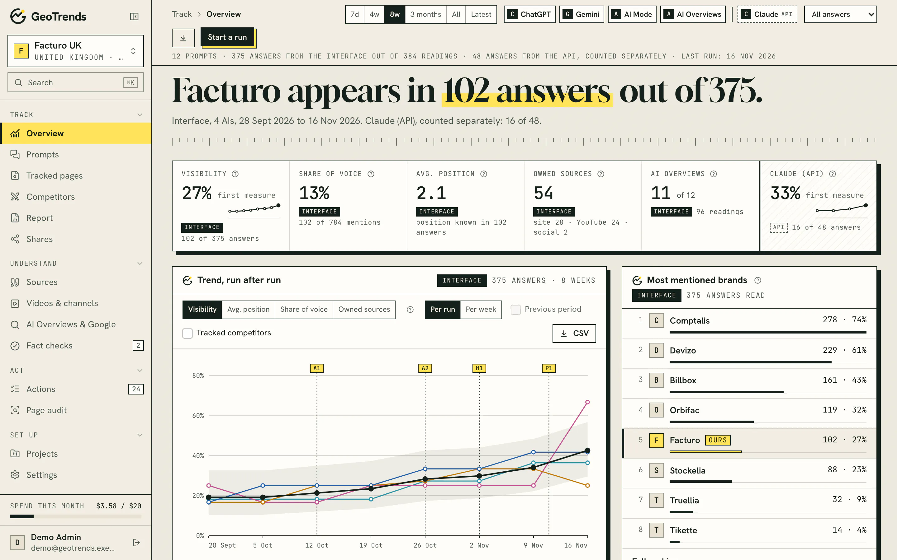

<!-- Page generated from the site documentation (src/site/docs) by scripts/exporter-docs.ts: do not edit it here. -->

# What is GeoTrends?

> GeoTrends records what ChatGPT, Gemini, Claude and Google answer your customers, tells you whether your brand is there, who is cited instead and what to fix.

[Lire cette page en français](../fr/README.md)

When a customer asks an AI “which invoicing software should a freelancer choose?”, the answer names a few brands and cites a few pages. GeoTrends asks those prompts for you, keeps every answer with its sources, and tells you whether your brand is in it. It is a **GEO** tool (Generative Engine Optimization): search optimisation for AI answers.

It does three things: **measure** where the brand stands, AI by AI and prompt by prompt; **understand** who is cited instead and thanks to which pages; **act** from a work list drawn from the runs, then measure again.

*The overview of the Facturo UK sample project: visibility, share of voice, average position and their trend, each number with its method and its number of answers.*

## What the tool does

- **It asks your prompts to the AIs**, the ones your customers ask them, from the project’s country and in its language. ChatGPT, Gemini, Google AI Mode and AI Overviews are recorded from their interface; Claude is queried through its API.
- **It keeps every answer**: its text, the cited sources, the pages read, the brands mentioned in order. For each one it says whether the brand is **cited** (one of its pages or videos as a source), **mentioned** (its name in the text) or **absent**.
- **It shows who takes the spot**: the brands mentioned most often, the sites and pages used as sources, the YouTube videos, the Google results under each AI Overview.
- **It turns that into a work list**: pages to appear on, your pages to fix, topics to cover, wrong facts to get corrected. Once an action is done, the tool compares presence before and after.

## Four principles, visible on screen

| Principle | What it means in the tool |
| --- | --- |
| Real data | An interface reading shows what a person sees. Claude, queried through its API, always has its own column: the two methods are never added together. |
| Reliable numbers | Every number says how many answers it rests on. Below 5 answers, no percentage is shown. A change is only coloured when it exceeds the margin of error. |
| Action | Every line of the work list links to the answers that justify it. No made-up gain score. |
| Costs in plain sight | The price of a run is shown before it is sent, and every paid call is logged in the cost journal, under a monthly cap. |

> [!NOTE]
> **Free, open-source software**
>
> GeoTrends is released under the AGPL-3.0 licence: you install it yourself, with your own API keys, and you only pay for your readings, straight to the providers. See [Install GeoTrends](./get-started/install.md). The screenshots in these docs show a sample brand, Facturo, and its fictional competitors.

## What it does not do

- **It promises no citation.** Nobody knows how to get cited for certain. The tool measures, you fix, it measures again.
- **It gives no score out of 100.** Visibility is read with its method and its number of answers, not as a grade.
- **It does not track Perplexity or Copilot**, and does not connect visits coming from AI engines (Google Analytics, Search Console). Neither is built.
- **Sending the Monday report by e-mail is not battle-tested yet.** The report is written and can be read on screen; sending needs a Resend key and has not been used in real conditions yet.

**Where to start**

- [Install GeoTrends](./get-started/install.md): Install the tool yourself and plug in your keys, in fifteen minutes.
- [Quick start](./get-started/quick-start.md): From the first project to the first run, in six steps.
- [Key concepts](./get-started/key-concepts.md): Prompt, run, method, visibility, share of voice: the words of the tool.
- [Reading your first results](./get-started/first-results.md): What to look at, and in which order, when the answers come back.
- [Measurement method](./reference/method.md): How the tool counts, and what it does not know.

## Contents

### Get started

What the tool measures, how to install it, the words to know, the first run and what it costs.

- [Install GeoTrends](./get-started/install.md): Install GeoTrends on your own machine with Docker: download the code, plug in your API keys (DataForSEO, DeepSeek or Anthropic), create the admin account.
- [Quick start](./get-started/quick-start.md): From the first project to the first results in six steps: create the brand, declare what it owns, write its prompts, start a run, then read the answers.
- [Key concepts](./get-started/key-concepts.md): Prompt, run, reading, method, presence, visibility, share of voice, verdict, margin of error: the words of the tool and exactly what they count, before reading a screen.
- [Reading your first results](./get-started/first-results.md): When the first run’s answers come back: have them read, then look at the overview, the verdicts, the brands and the sources, in that order, without over-reading.
- [What a run costs](./get-started/costs.md): The price of each paid call, what is free, the monthly cap and the confirmation threshold, with budget examples for 10 and 50 prompts tracked each month.
- [Frequently asked questions](./get-started/faq.md): GEO, interface or API, repeated readings, no score out of 100, YouTube videos, missing AI Overviews, costs, Claude counted apart: short answers to common questions.

### Set up a project

A brand, what it owns, its competitors, its prompts, and the runs.

- [Create a project](./project/create-a-project.md): A project tracks one brand: its name, what it owns, its competitors, its prompts, the country and the language. Creating it is free; spending starts with a run.
- [Sites, YouTube channels and social profiles](./project/sites-channels-profiles.md): Declare what belongs to the brand: its sites, YouTube channels, social profiles and other spellings of its name. A citation of any of them counts for the brand.
- [Choose your competitors](./project/competitors.md): Track three to six brands against yours: that is what makes share of voice computable, and what attributes cited pages to them. Tracking a brand is free.
- [Write the prompts to track](./project/prompts.md): Prompts are what your customers ask the AIs: everything the tool measures depends on them. How to write them, add them, archive them, and where to find ideas.
- [Start a run](./project/start-a-run.md): A run asks the project’s prompts to the AIs you tick. Each AI’s price is shown before sending and the monthly cap is checked: nothing leaves without your click.
- [Automatic runs](./project/scheduled-runs.md): Every week for ChatGPT, Gemini and Google, every two weeks for Claude: once ticked, runs start on their own and pause when the monthly cap is reached.

### Measure

The brand’s visibility, AI by AI and prompt by prompt, with every answer.

- [Overview](./measure/overview.md): The tool’s home screen: visibility, share of voice, average position, alerts and presence AI by AI, then the week’s three actions. Every number states its method.
- [The Prompts screen](./measure/prompts.md): One row per prompt: the latest status for each AI, a verdict over the period rather than a percentage, and who is named first. The starting point for action.
- [A prompt’s page](./measure/prompt-page.md): Everything about one prompt: the verdict and its margin of error, the status for each AI, every full answer with its sources, who wins and thanks to which pages.
- [Tracked pages](./measure/tracked-pages.md): Start from a page of the brand: the tool reads it, suggests the prompts it answers, then tells you whether AIs cite it and what they cite instead.
- [All answers](./measure/answers.md): The evidence behind every number: the list of recorded answers, filtered by AI, by brand presence, by brand mentioned or by site cited, each readable in full.
- [Deep measurement](./measure/deep-measurement.md): Ask one prompt 5, 10 or 25 times in a row to settle its verdict and narrow the margin of error, without skewing the overall numbers of the project.

### Understand

Who is cited instead of you, and thanks to which pages, videos and Google results.

- [Competitors and share of voice](./understand/competitors.md): Which brands the AIs mention on your prompts, at what position and in what share of the answers: ranking, share of voice, head-to-head, prompt by prompt.
- [Cited sources](./understand/sources.md): The sites and pages the AIs cite to answer your prompts: their type, who owns them, your own pages, and which of them moved up or down at the latest run.
- [Videos and channels](./understand/videos.md): Whether the AIs cite your YouTube channels, on which prompts a video from another channel takes the spot, and which other channels come back most often.
- [AI Overviews and Google results](./understand/google.md): Google AI Overviews against the top ten results of the same search: one instruction per prompt, the share of ranked sources, and ideas for new prompts.
- [Fact checks](./understand/fact-checks.md): You write what is true about the brand: price, offer, country, dates. The tool flags the AI answers that say otherwise, with the sentence and the source at fault.
- [Topics and the topic map](./understand/topic-map.md): A topic and an intent for each prompt, set by a small model or by hand, then the topic map: the topics the brand holds, and those another brand takes from it.

### Act

The work list drawn from the runs, the outreach log, then the result.

- [The work list](./act/work-list.md): What to do to get into the answers, drawn from the runs: your pages to fix, pages to appear on, topics to cover and wrong facts, each with its evidence.
- [Following up an action and its outreach](./act/outreach.md): An action’s sheet keeps its status, a free note, the date it was done and the outreach log: whom you wrote to, when, what you asked and what came back.
- [Measuring after an action](./act/measure-after-action.md): An action marked done is followed up: the brand’s presence on its prompts, four weeks before and after, and a sentence on whether the change exceeds the noise.
- [Page audit](./act/page-audit.md): Can an AI read your page, and does it find an answer there? Allowed crawlers, server response, text without JavaScript, headings, structured data, date, author.

### Steer

The report, costs, exports, settings and accounts.

- [Report and alerts](./steer/report-and-alerts.md): The report compares the last two run days: presence gained or lost, new brands, sources, spend. Alerts keep only the changes that exceed the margin of error.
- [Share with a client](./steer/share-with-a-client.md): A private link, with no account, that a client or partner opens to see where their brand stands on a set of prompts. Updated with every run, turned off in one click.
- [The cost dashboard](./steer/costs.md): Every paid call is logged in the cost journal. The Costs screen draws from it the month’s spend, its projection, the cap and the split by provider and project.
- [CSV exports](./steer/exports.md): Four free CSV exports: the recorded answers, the cited sources, the work list and the cost journal, plus the data behind each chart, in the interface language.
- [Settings](./steer/settings.md): Tool-wide settings: interface language, confirmation threshold, each project’s run schedule, the state of provider connections, your password and the team’s accounts.
- [Accounts and sign-in](./steer/accounts.md): The first account is created on first launch; after that each person is invited and chooses a password through a link. Two roles, the menu, quick search.

### Reference

The AI engines tracked, the method, countries and languages, the glossary, what’s new.

- [AI engines tracked](./reference/ai-engines.md): ChatGPT, Gemini, Google AI Mode and AI Overviews are read from their interface, Claude through its API. What each reading holds, and the engines not tracked.
- [Measurement method](./reference/method.md): How the tool counts: brand presence, thresholds, verdict, margin of error, real changes, periods, methods kept apart, and what the measurement cannot tell.
- [Countries and languages](./reference/countries-and-languages.md): Each project asks its prompts from one country and in one language, fixed at the first run. The countries and languages offered, and the interface language.
- [Glossary](./reference/glossary.md): The words of GeoTrends in one line each: prompt, run, reading, method, visibility, share of voice, verdict, margin of error, source, work list and the rest.
- [What’s new](./reference/changelog.md): What has changed in GeoTrends, day by day, newest first: open-source software you install yourself, tracked pages, client sharing, invitations, documentation.

## Use cases

Each use case starts from a question you are asking, says which data to look at and on which screen, then what the measurement lets you decide.

### Start tracking

- [Am I tracking the right prompts?](./use-cases/tracking-the-right-prompts.md): Check that your prompts are the ones your customers ask: verdicts, brand named first, ideas from Google and the AIs, prompts to add or to archive.
- [Branded or unbranded: how should I split my prompts?](./use-cases/branded-or-unbranded-prompts.md): A prompt that contains the brand name does not measure the same thing as one that does not. How to spot them, read them apart and balance them in a project.
- [Which AI engines should I look at first, and why is Claude kept apart?](./use-cases/which-ai-engines-first.md): Four AI engines read through the interface, one through its API: how to compare them, where to start, and why Claude’s number is never added to the others.

### Understand your visibility

- [Does ChatGPT cite my brand, and on which prompts?](./use-cases/does-chatgpt-cite-my-brand.md): ChatGPT’s number, then the list of prompts where it cites, mentions or ignores the brand, down to the text of each answer with its sources and searches.
- [Is my brand cited, mentioned or absent?](./use-cases/cited-mentioned-or-absent.md): Site cited, video cited, name only, page read but not cited: four ways of being in an AI answer, which are not read the same way and not fixed the same way.
- [A number moved: real change or noise?](./use-cases/real-change-or-noise.md): Margin of error, coloured changes, chart markers and deep measurement: how to tell whether a rise or a drop in visibility is real before you react to it.

### Against competitors

- [Who is cited instead of me?](./use-cases/who-is-cited-instead-of-me.md): The brands AIs name on your prompts, the ones to track as competitors, their position, their share of voice, and the pages that get them cited instead of you.
- [Which competitor is moving in on my topics?](./use-cases/competitor-moving-in.md): Spot the brand that is rising in AI answers, check that the rise is beyond the margin of error, then see on which prompts and thanks to which pages.
- [On which topics am I absent while a competitor holds the ground?](./use-cases/topics-where-i-am-absent.md): Tag prompts by topic, read the topic map (held, contested, to win back, blind spot) and choose where to put the effort, one topic at a time.

### Improve your content and reputation

- [Which page should I get into first?](./use-cases/pages-to-appear-on.md): The pages AIs cite on your prompts without you, sorted by site type, and how to choose the one where you ask for a place, then follow up on the outreach.
- [My page is read but not cited: what should I fix?](./use-cases/page-read-not-cited.md): An AI opens your page then cites someone else’s, or Google ranks it without using it in its AI Overview: how to spot it, compare, and rewrite the page.
- [An AI keeps saying something wrong about my brand: what can I do?](./use-cases/wrong-information.md): Write down what is true about the brand, spot the answers that say otherwise, trace the page used as a source, then fix it or ask its author for a correction.
- [Which YouTube videos should I make?](./use-cases/videos-to-make.md): The prompts where AIs cite a YouTube video that is not yours, the channels that take the spot, and how to turn that into a list of videos to make.

### Measure the impact

- [Did my fix make a difference?](./use-cases/did-my-fix-work.md): Mark an action as done, read the brand’s presence before and after on the prompts concerned, and know what can be said about it, and what cannot.
- [How do I prepare the Monday team meeting?](./use-cases/monday-team-meeting.md): The report compares the last two runs, the work list says what to do, the exports hold the data: an agenda in fifteen minutes, without the noise.

### Technical and budget

- [Can AI crawlers read my page?](./use-cases/can-ai-crawlers-read-my-page.md): A free audit of one page: what robots.txt allows, what the server answers to AI crawlers, the text readable without JavaScript, and what hinders citation.
- [How do I track a brand without going over budget?](./use-cases/tracking-on-a-budget.md): Price shown before each send, pace of automatic runs, confirmation threshold and monthly cap: set a project’s spending before it happens, not after.

---

Updated: 2026-11-25 · [Read this page on the website](https://geotrends.io/en/docs)
