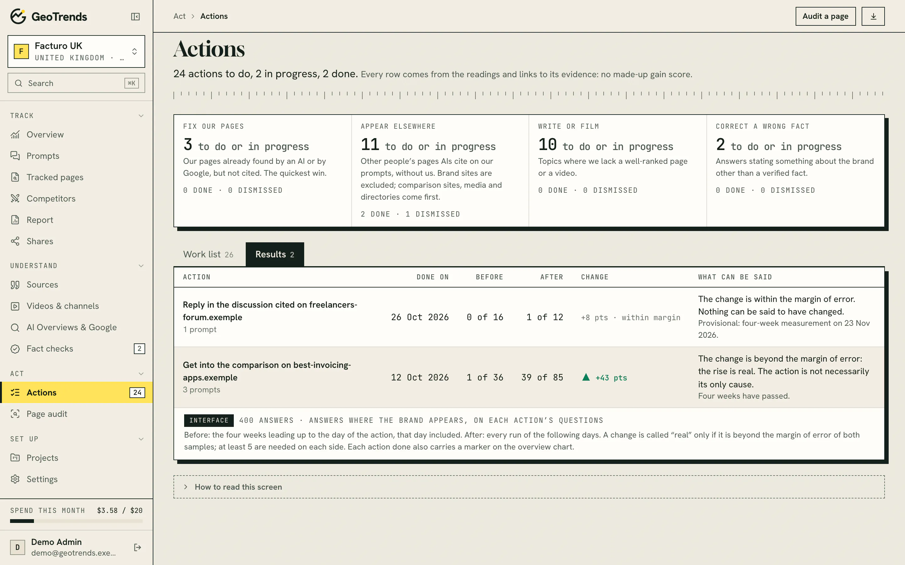

<!-- Page generated from the site documentation (src/site/docs) by scripts/exporter-docs.ts: do not edit it here. -->

# Measuring after an action

> An action marked done is followed up: the brand’s presence on its prompts, four weeks before and after, and a sentence on whether the change exceeds the noise.

[← Documentation contents](../README.md) · [Lire cette page en français](../../fr/agir/mesure-apres-action.md)

Fixing a page or getting into a comparison takes time. You still need to know whether it changed anything. As soon as a work-list line is marked “done”, the tool compares the brand’s presence on that action’s prompts, before and after, and says plainly whether the change exceeds the margin of error.

The result can be read in two places: the **Results** tab of the Actions screen, which gathers every action done, and the **Before and after** block of each action’s sheet. On the overview’s main chart, an “Action done” marker also flags the date, and its line, under the chart, opens this result.

*The Results tab of the Actions screen, Facturo UK project: each action done, its date, presence before and after, the change and what can be said.*

## How the result is calculated

- **The prompts**: those of the action, kept when it was marked done, even if it leaves the list afterwards.
- **Before**: the interface answers to these prompts over the four weeks leading up to the day of the action, that day included. A reading on the same day came before the action’s effect.
- **After**: every interface answer of the following days.
- **Presence**: the answers where the brand is mentioned or cited, out of the answers received. A prompt with no AI Overview does not count as an absence.
- **The change** is called “real” only if it exceeds the margin of error of both samples, and at least 5 answers are needed on each side.

Deep measurement readings count here: asking the prompt several times after the action is the quickest way to get enough answers.

## The Results tab

| Column | What it shows |
| --- | --- |
| **Action** | The title, the number of prompts, and “out of the list” if the runs no longer suggest it. |
| **Done on** | The date used for the comparison, which can be corrected in the sheet. |
| **Before** | Answers with the brand, out of the answers received in the four weeks before (“2 out of 12”, for example). |
| **After** | The same since the day after the action. |
| **Change** | The change in points, coloured only when it exceeds the margin of error. |
| **What can be said** | The conclusion in one sentence, then “Provisional: four-week measurement on …” or “Four weeks have passed.” |

| Situation | What the tool says |
| --- | --- |
| No run since the action | Nothing to compare yet. |
| No run in the four weeks before | No point of comparison. |
| Fewer than 5 answers on one side | Too few readings to conclude: at least 5 are needed on each side. |
| Change within the margin of error | Nothing can be said to have changed. |
| Rise beyond the margin | The rise is real. The action is not necessarily its only cause. |
| Drop beyond the margin | The drop is real. The action is not necessarily its cause. |

The result can be read at any time, but it is marked provisional during the four weeks after the action. In the sheet, the **Before and after** block gives the same numbers, with **The four weeks before**, **Since …**, the change and the conclusion.

## Following the effect of a fix

1. **Mark the line “Done” on the right day.** The day the fixed page goes live, or the comparison adds you. If you do it later, correct **Done on** in the sheet.

2. **Let the runs go on.** The weekly automatic runs fill the **After** column. To go faster on one prompt, start a deep measurement from its page: the price is written on the button.

3. **Read the result after four weeks.** Open the **Results** tab. A rise beyond the margin is real; a change within the margin does not allow a conclusion.

4. **Cross-check with the markers.** On the overview chart, a model-change marker on the same date can explain the change as much as your action.

## Limits

> [!WARNING]
> The tool says whether the change is real, not whether it comes from the action: a new model, a competitor or another action on the same prompts can play a part too. With a few prompts run once a week, four weeks often give fewer than 5 answers on each side: deep measurement helps then. An action with no measurable effect is not necessarily useless; the tool only says that it cannot be proven.

**See also**

- [The work list](./work-list.md)
- [Deep measurement](../measure/deep-measurement.md)
- [Measurement method](../reference/method.md)
- [Did my fix make a difference?](../use-cases/did-my-fix-work.md)

---

Updated: 2026-11-18 · [Read this page on the website](https://geotrends.io/en/docs/act/measure-after-action)
