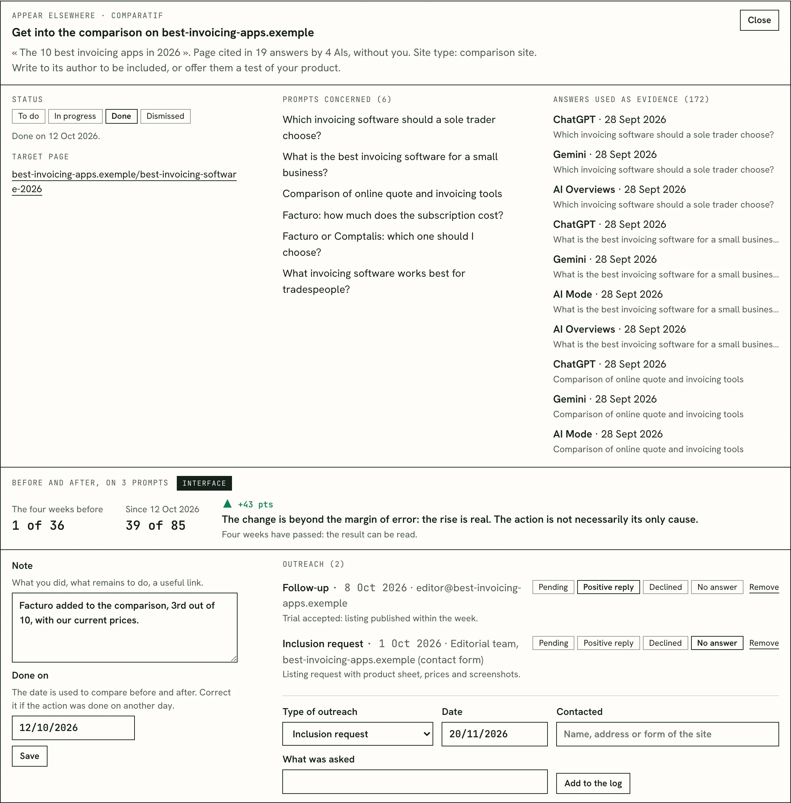

<!-- Page generated from the site documentation (src/site/docs) by scripts/exporter-docs.ts: do not edit it here. -->

# Following up an action and its outreach

> An action’s sheet keeps its status, a free note, the date it was done and the outreach log: whom you wrote to, when, what you asked and what came back.

[← Documentation contents](../README.md) · [Lire cette page en français](../../fr/agir/prises-de-contact.md)

Getting into a comparison or getting an article corrected often takes several messages, over several weeks. An action’s sheet keeps a record of that work: you will not chase the same site twice, and you will see what worked. It is all free: nothing goes to a paid provider.

The sheet opens with a click on a line’s title in the work list, or on its **Follow-up** column (“add a note”, “1 note”, or the number of outreach entries and the last reply). The **See the action** links on the Videos & channels and Fact checks screens open the right sheet directly.

## The line’s status

| Status | When to choose it |
| --- | --- |
| **To do** | The starting status of every line. |
| **In progress** | You have started: a page being rewritten, a message sent. A first outreach moves a new line to “In progress”. |
| **Done** | The action is finished. The tool keeps the date and a copy of the line: that is what makes the before-and-after comparison possible. |
| **Dismissed** | The line is not worth it. It leaves the open lines without being deleted. |

Under the buttons, the sheet shows “Done on …” or “Last change on …”. The date a line was done no longer moves if the line was already done.

## The note

The **Note** field takes what you did, what remains to do, a useful link: 2,000 characters at most. For a line marked done, a **Done on** field lets you correct the date if the action was done on another day (never a future date): it is the date used to compare before and after. **Save** keeps both. The note appears in the list’s **Follow-up** column and in the CSV export.

## The outreach log

The **Outreach** block lists each step, most recent first: its type, its date, the person or form contacted, and what was asked. To add one, fill in **Type of outreach**, **Date** (today by default), **Owner** (the name, address or contact form of the site) and **What was asked**, then **Add to the log**.

| Type of outreach | What for |
| --- | --- |
| **Inclusion request** | Ask for a spot in a comparison, a directory, an article. Selected by default. |
| **Test offer** | Offer an author a test of your product. |
| **Reply in a thread** | Reply in a forum or social network discussion. |
| **Correction request** | Get wrong information corrected. Selected by default for a wrong fact. |
| **Follow-up** | Chase a step that got no reply. |
| **Other outreach** | Everything else. |

A new entry is “Pending”. When the reply arrives, one click records it: **Positive reply**, **Declined**, **No answer**, or **Pending** again. **Remove** deletes an entry from the log.

*An action’s sheet: its status, the target page, the prompts concerned, the note and the outreach log.*

## Keeping the log of an outreach

1. **Open the sheet.** From the work list, click the line’s title, for example “Get into the comparison on comparatif-logiciels.exemple”.

2. **Log the message sent.** Choose **Inclusion request**, say whom you contacted (“editorial team, contact form”) and what you asked, then **Add to the log**. The line moves to “In progress”.

3. **Log the reply.** The day the author answers, click **Positive reply** or **Declined**. With no news, record **No answer**, then add a **Follow-up**.

4. **Mark the line “Done”.** Once the page cites you, mark the line **Done**. Correct the date in **Done on** if the page changed on another day.

## Limits

> [!WARNING]
> The log is a notebook: the tool sends no message and chases no one. A line the runs no longer suggest disappears from the list, unless it is done (it then stays in the Results tab); its note and log are kept and come back if the page is cited again. A positive reply does not guarantee a citation: only the next measurement will tell.

**See also**

- [The work list](./work-list.md)
- [Measuring after an action](./measure-after-action.md)
- [Which page should I get into first?](../use-cases/pages-to-appear-on.md)
- [An AI keeps saying something wrong about my brand: what can I do?](../use-cases/wrong-information.md)

---

Updated: 2026-11-18 · [Read this page on the website](https://geotrends.io/en/docs/act/outreach)
