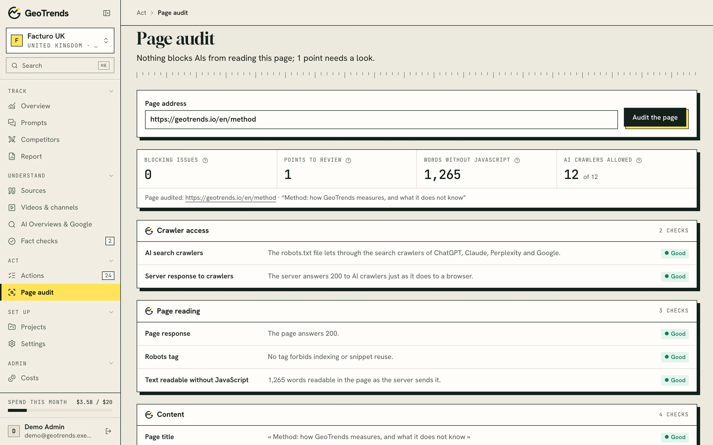

<!-- Page generated from the site documentation (src/site/docs) by scripts/exporter-docs.ts: do not edit it here. -->

# Page audit

> Can an AI read your page, and does it find an answer there? Allowed crawlers, server response, text without JavaScript, headings, structured data, date, author.

[← Documentation contents](../README.md) · [Lire cette page en français](../../fr/agir/audit.md)

Before rewriting a page, you need to know whether the block is technical: a forbidden crawler, a server that turns crawlers away, text that only appears with JavaScript. The audit reads the page the way AI crawlers do and says, point by point, what stops an AI from reading or reusing it. The page is read directly and for free: no paid call.

Enter the full address of a public page in **Page address**, then **Audit the page**. You also get here through the **Audit** button in the Our pages tab of the Sources screen, through **Audit this page** on a “Fix our pages” line of the work list, and through **Audit a page** in the top bar of the Actions screen. A local address or an IP address is refused: “This address cannot be read.”

*The audit of a facturo.exemple page: the summary in four numbers, then the checks grouped into four families, each with its status.*

## The summary

| Tile | What it counts |
| --- | --- |
| **Blocking issues** | What stops an AI from reading or reusing the page: fix these first. |
| **Points to review** | What does not prevent reading but makes the page harder to cite. |
| **Words without JavaScript** | Number of words in the page as the server sends it. AI crawlers do not run JavaScript. |
| **AI crawlers allowed** | AI crawlers the site’s robots.txt file lets through, out of the twelve listed. |

## The checks

Each check carries a status: **Good**, **To review**, **Blocking** or **For information**, with a sentence explaining what was found.

| Check | Rule |
| --- | --- |
| **Crawler access**: AI search crawlers | Blocking if robots.txt forbids the page to a search crawler (ChatGPT, Claude, Perplexity, Google or Bing). With no robots.txt file, nothing is forbidden. |
| **Crawler access**: Server response to crawlers | Blocking if the server answers 200 to a browser but something else to a crawler: a firewall or the host blocks it, even if robots.txt allows it. |
| **Crawler access**: Training crawlers | For information if GPTBot, ClaudeBot, Google-Extended or Applebot-Extended are forbidden. It is a choice: it does not prevent being cited. |
| **Page reading**: Page response | Blocking if the page does not answer 200, or does not answer within 15 seconds. |
| **Page reading**: Robots tag | Blocking if the page carries “noindex” or “nosnippet”. |
| **Page reading**: Text readable without JavaScript | Blocking under 150 words, to review under 400 words, good beyond. The header, menu and footer do not count. |
| **Page reading**: Canonical address | To review if the page points to another address as canonical: that is the one search engines keep. |
| **Content**: Page title | Good if the page has a title tag, to review otherwise. |
| **Content**: Main heading | Good with a single main heading (h1); to review with no h1, or with several. |
| **Content**: Sectioning | To review under three subheadings (h2); good beyond, with the number of subheadings phrased as questions. |
| **Content**: Lists and tables | Good from two lists or tables; for information below that. |
| **Signals for AIs**: Structured data | Good if the page declares structured data (JSON-LD), with its types; to review otherwise. |
| **Signals for AIs**: Page date | To review with no readable publication or update date, or if it is more than 18 months old; good otherwise. |
| **Signals for AIs**: Author | Good if an author is declared; for information otherwise. |
| **Signals for AIs**: llms.txt file | Always for information: nothing proves AIs use it. |

## Crawler by crawler

The last block gives, for each of the twelve crawlers, the **Site rule** (Allowed or Blocked, read from robots.txt) and the **Server response**, tested for five of them by announcing their name; the others are marked “not tested”.

| Crawler | What it is for | Response tested |
| --- | --- | --- |
| OAI-SearchBot | ChatGPT: search and citations | yes |
| ChatGPT-User | ChatGPT: page opened at a user’s request | yes |
| GPTBot | OpenAI: model training | no |
| Claude-SearchBot | Claude: search and citations | yes |
| Claude-User | Claude: page opened at a user’s request | no |
| ClaudeBot | Anthropic: model training | no |
| PerplexityBot | Perplexity: search and citations | yes |
| Googlebot | Google: results, AI Overviews and AI Mode | yes |
| Google-Extended | Google: Gemini training | no |
| Bingbot | Bing: results and Copilot | no |
| Applebot-Extended | Apple: model training | no |
| CCBot | Common Crawl: dataset reused by many models | no |

## Auditing a page in five steps

1. **Choose the page.** Preferably one of your pages already found by an AI or by Google: a “Fix our pages” line of the work list, or a page “Read, not cited” on the Sources screen.

2. **Read the blocking issues first.** A forbidden crawler, a page that does not answer 200 or text invisible without JavaScript come before everything else.

3. **Check crawler by crawler.** If access is blocked, the last block says which crawler, and whether robots.txt or the server refuses it.

4. **Review the content.** One main heading, clear subheadings (phrased as questions when possible), a comparison in a table, a visible date and author.

5. **Run the audit again.** After the fix, audit the same address again: it is free. Then mark the work-list line “Done”.

## Limits

> [!WARNING]
> The audit does not say whether the page will be cited: it says whether something prevents it. It reads the page as the server sends it, from the tool’s server: a firewall that recognises real crawlers by their address may treat them differently. The server response is only tested for five crawlers. It audits one page at a time, and does not read the meaning of the text: a technically clean page can still lack the answer to the prompt.

**See also**

- [Cited sources](../understand/sources.md)
- [The work list](./work-list.md)
- [Can AI crawlers read my page?](../use-cases/can-ai-crawlers-read-my-page.md)
- [My page is read but not cited: what should I fix?](../use-cases/page-read-not-cited.md)

---

Updated: 2026-11-18 · [Read this page on the website](https://geotrends.io/en/docs/act/page-audit)
