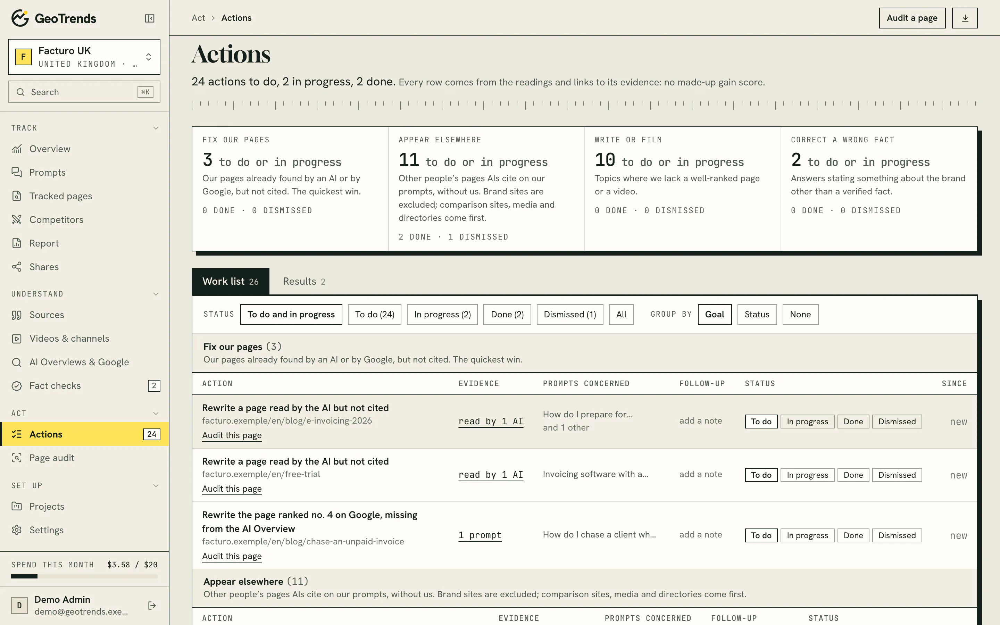

<!-- Page generated from the site documentation (src/site/docs) by scripts/exporter-docs.ts: do not edit it here. -->

# The work list

> What to do to get into the answers, drawn from the runs: your pages to fix, pages to appear on, topics to cover and wrong facts, each with its evidence.

[← Documentation contents](../README.md) · [Lire cette page en français](../../fr/agir/liste-de-travail.md)

The Actions screen answers the Monday-morning question: what to do first? Every line comes from the runs and links to the answers that justify it. No gain score is invented. The list is free: it triggers no paid call.

In the menu, the number next to **Actions** counts the lines to do. You also get here through **To do this week** on the overview, through **See the action** on the Videos & channels and Fact checks screens, and through **The three most useful actions** in the report. In the top bar, **Audit a page** opens the audit, and **Export** gives the list as CSV.

*The work list of the Facturo UK project: the four goals at the top, then the lines grouped by goal, each with its evidence, its follow-up and its status.*

## Where the lines come from

The list reads the latest reading of each interface AI for each tracked prompt. It draws five kinds of lines from it, filed under four goals:

| Goal | Line | When it appears |
| --- | --- | --- |
| **Fix our pages** | “Rewrite the page ranked no. 4 on Google, missing from the AI Overview” | Your page is in Google’s top ten results for the prompt, but the AI Overview does not cite it. The page is found: it lacks a clear answer at the top of the page. |
| **Fix our pages** | “Rewrite a page read by the AI but not cited” | An AI opened a page of the brand without keeping it. Look at the pages cited instead and give the same answer, more clearly. |
| **Appear elsewhere** | “Get into the comparison on comparatif-logiciels.exemple”, “Get a mention in…” | A page from another site is cited on your prompts, without you. The title and the advice depend on the site’s type. |
| **Write or film** | “Shoot a video on “…”” | The AIs cite videos on the prompt, none from your channels. |
| **Write or film** | “Work on SEO for “…”” | Google shows an AI Overview without you, and your site is not in the top ten results. Only if a site is declared for the brand. |
| **Correct a wrong fact** | “Correct a wrong fact: “…”” | An answer states something about the brand other than a verified fact. One line per answer; a mistake made by Claude, queried through its API, is flagged too, and the line says so. |

For a page to appear on, the site’s type gives the title and the advice: a comparison site (“Get into the comparison on…”: write to its author, or offer them a test of your product), a directory (“Get listed in the … directory”), a media site (“Get a mention in…”), a blog (“Suggest an addition to the article on…”), a forum or a social network (“Reply in the discussion cited on…”), and for the rest “Get a place on…”.

## Which pages make it into the list

- **Brand sites** are left out: you do not ask a rival for a spot. A site is recognised as such if it is declared for a competitor, classified as “brand site”, or bears the name of a brand mentioned in the answers.
- YouTube videos go through the “Shoot a video” lines, not through the pages to appear on.
- If at least five pages are cited in two answers or more, only those are kept; otherwise, the first fifteen. Never more than forty.
- Comparison sites, media and directories come first: that is where you can ask for a spot. Official sites, shops and the rest come last.
- A page added from the Sources screen (**Add to the work list**), or that already carries a status, a note or an outreach, stays in the list as long as it is cited, even once.

Lines are sorted by a weight from 1 to 5, computed from what can be counted: 5 for a page of yours already found, 4 for a wrong fact, 2 for SEO; for a page to appear on, the number of answers and AIs that cite it, plus one point for a comparison site, a media site or a directory. At equal weight, the line with more answers comes first. The weight is not shown on screen; it is in the CSV export, column “Weight (1 to 5)”.

## What the screen shows

At the top, **Actions by goal**: one tile per goal, with the number of lines to do or in progress, a sentence of explanation, and the count of lines done and dismissed. Clicking a tile filters the list on that goal. Two tabs follow: **Work list** and **Results** (see [Measuring after an action](./measure-after-action.md)).

Above the table, the **Status** choice shows the lines to do and in progress by default; **All** also shows the lines done and dismissed. **Group by** splits the table by **Goal** (the default), by **Status**, or **None**.

| Column | What it shows |
| --- | --- |
| **Action** | The line’s title, the target page’s address, the site type for a page to appear on, and **Audit this page** for a page to fix. |
| **Evidence** | The number of answers and AIs concerned (or “read by 2 AIs”). A click opens the prompt, or the sheet if there are several. |
| **Prompts concerned** | The first prompt, and the number of others. |
| **Follow-up** | The number of outreach entries and the last reply received, “1 note”, or **add a note**. |
| **Status** | Four buttons: To do, In progress, Done, Dismissed. One click is enough. |
| **Since** | The date it was done, or of the last status change, or “new”. |

## An action’s sheet

Clicking a line’s title opens its sheet: the goal, the site type, the “added by hand” mention where relevant, the title and the full advice. Then the **Status**, the **Target page** with **Audit this page**, the **Prompts concerned**, and the **Answers used as evidence**: up to ten answers, with their AI and date, each opening the text. At the bottom, the free note and the outreach log (see [Following up an action](./outreach.md)). **Close** goes back to the list.

> [!NOTE]
> **A line marked done keeps its trace**
>
> When a line is marked **Done**, the tool keeps the date and a copy of the line (title, page, prompts). If the runs no longer suggest it afterwards, because the page is no longer cited without you, it leaves the list but stays in the Results tab, with its note, its log and its before-and-after.

## Working through the list

1. **Start with “Fix our pages”.** These are your pages already found by an AI or by Google: the quickest win. **Audit this page** first tells you whether something blocks them from being read.

2. **Open the sheet and check the evidence.** Read the answers used as evidence before acting: the cited page, the prompt, the AI.

3. **Mark the line “In progress”.** Log what you do and every outreach in the sheet. A first outreach moves a new line to “In progress”.

4. **Mark the line “Done”.** On the day the page is fixed, published or cited elsewhere. The date is used to compare before and after.

5. **Dismiss what is not worth it.** **Dismissed** takes a line out of the open lines without deleting it: **All** still shows it.

## Limits

> [!WARNING]
> The list follows the latest runs: a page that is no longer cited leaves it, and a new one comes in. Only interface readings count, except for wrong facts. The weight is a sort order drawn from counts, not a promised gain: doing an action guarantees no citation. The advice depends on the site’s type; as long as a site is not classified, the line says so.

**See also**

- [Following up an action and its outreach](./outreach.md)
- [Measuring after an action](./measure-after-action.md)
- [Page audit](./page-audit.md)
- [Which page should I get into first?](../use-cases/pages-to-appear-on.md)

---

Updated: 2026-11-18 · [Read this page on the website](https://geotrends.io/en/docs/act/work-list)
