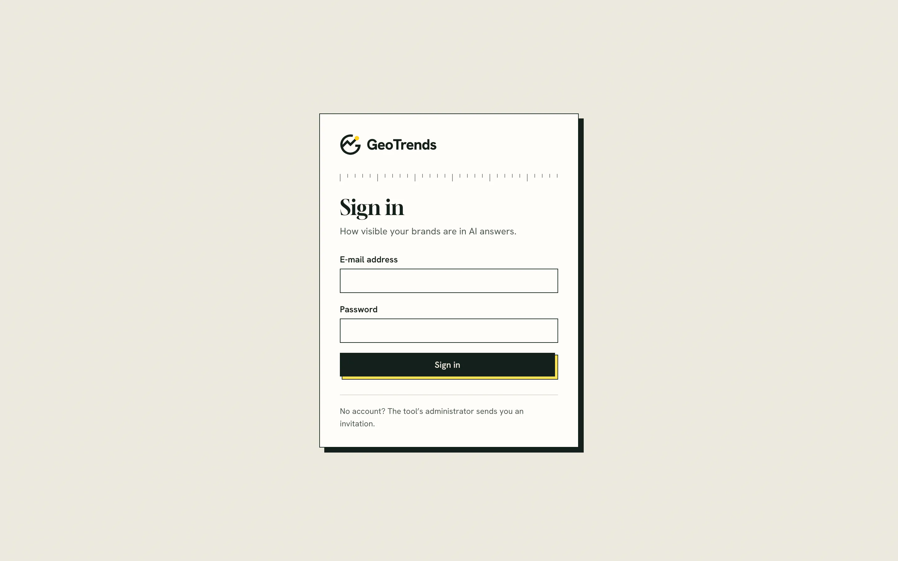
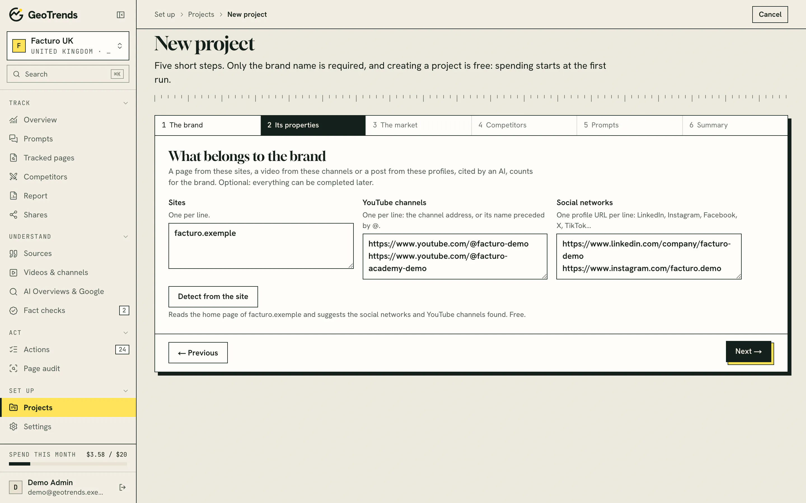
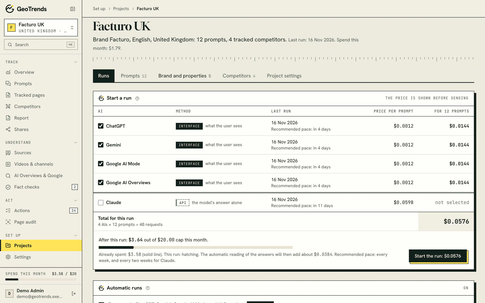

<!-- Page generated from the site documentation (src/site/docs) by scripts/exporter-docs.ts: do not edit it here. -->

# Quick start

> From the first project to the first results in six steps: create the brand, declare what it owns, write its prompts, start a run, then read the answers.

[← Documentation contents](../README.md) · [Lire cette page en français](../../fr/demarrer/prise-en-main.md)

This page follows the shortest path, from signing in to the first results. Allow half an hour, including a few minutes of waiting while the answers come back. Nothing is paid before step 5, and the price is always shown before anything is sent.

## Before you start

- The tool installed, and an account. The first account is created on first launch; the next ones by invitation from the administrator. See [Install GeoTrends](./install.md) and [Accounts and sign-in](../steer/accounts.md).
- The brand’s name as AI engines write it, its site, its YouTube channel and its social profiles, if any.
- About ten prompts a customer would ask an AI, in their own words. Keep a good share of them without the brand’s name: those are the ones that bring new customers.

## The six steps

1. **Sign in.** Open the sign-in page (**Sign in** button at the top of the site), then enter your e-mail address and password. The tool opens on the overview of the last project shown.

   

2. **Create the project.** Menu **Set up › Projects**, then **New project**. Creation takes five short steps and a summary: the brand, its properties, the market (country and language), competitors, prompts. Only the brand’s name is required, and creating a project costs nothing. Details: [Create a project](../project/create-a-project.md).

   

3. **Declare what belongs to the brand.** Sites, YouTube channels, social profiles, other spellings of the name. A page of these sites or a video of these channels, cited by an AI, then counts for the brand. The **Detect from the site** button reads the home page and suggests the profiles it finds, for free; review them before adding. Details: [Sites, YouTube channels and social profiles](../project/sites-channels-profiles.md).

4. **Write the prompts.** One prompt per line, the way a customer would ask it. Ten are enough to start. A prompt that has been recorded can no longer be edited: you archive it, and its history stays. Writing tips: [Write the prompts to track](../project/prompts.md).

5. **Start the first run.** On the project page, **Runs** tab, the table gives each AI’s price per prompt and the total. ChatGPT, Gemini, Google AI Mode and AI Overviews are ticked; Claude, more expensive, is not. Click **Start the run**: its price is written on the button. Answers come back within minutes, 45 at most, and the page updates by itself. Details: [Start a run](../project/start-a-run.md).

   

6. **Read the first results.** Open **Track › Overview**. If a banner says some answers have not been read yet, **Read the answers** extracts the brands mentioned, their position and the tone (a paid call, its price is shown). Then follow the reading order in [Reading your first results](./first-results.md).

   

> [!NOTE]
> **What this first run costs**
>
> An answer recorded from the interface costs $0.0012. Ten prompts asked to four AIs make 40 readings, about $0.05, plus about $0.0008 per answer for automatic reading. Every call is logged in the cost journal. See [What a run costs](./costs.md).

## Next

- **Track competitors.** After the first run, the Competitors screen suggests the brands the AIs mention most on your prompts. **Track** makes one a competitor: free, and it starts no run. See [Choose your competitors](../project/competitors.md).
- **Turn on automatic runs.** In the project’s Runs tab: every week for the AIs recorded from the interface, every two weeks for Claude. They stop by themselves when the monthly cap is reached. See [Automatic runs](../project/scheduled-runs.md).
- **Classify the sites and tag the prompts.** Two clicks, a few cents at most for a project, with the price written on each button: the type of every cited site (on Sources) and the topic of every prompt (on Prompts). The rest happens on its own.
- **Open the work list.** The Actions screen gathers what to do, drawn from the runs. See [The work list](../act/work-list.md).

> [!WARNING]
> A first run is a sample: one answer per prompt and per AI. It tells you where the brand appears today, not a trend. Lines and changes start to mean something from the second or third run.

**See also**

- [Key concepts](./key-concepts.md)
- [Reading your first results](./first-results.md)
- [Create a project](../project/create-a-project.md)
- [Am I tracking the right prompts?](../use-cases/tracking-the-right-prompts.md)

---

Updated: 2026-11-25 · [Read this page on the website](https://geotrends.io/en/docs/get-started/quick-start)
