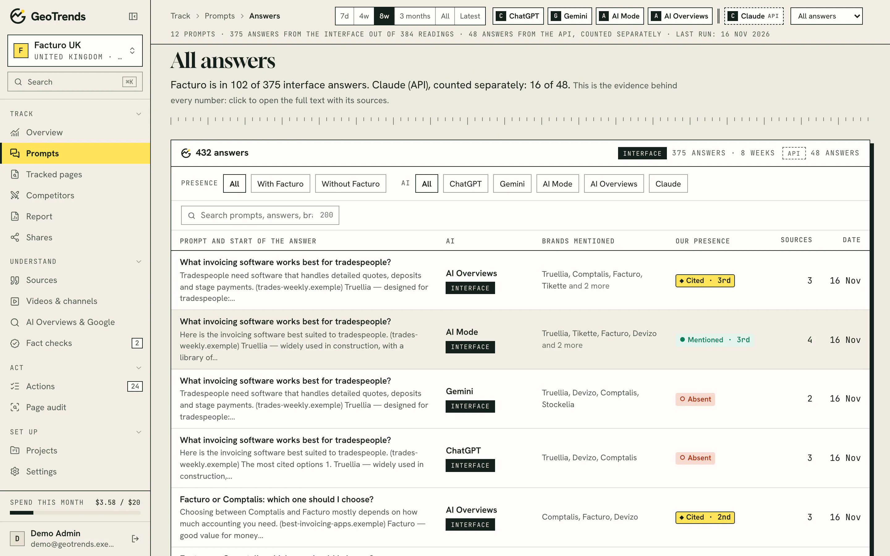

<!-- Page generated from the site documentation (src/site/docs) by scripts/exporter-docs.ts: do not edit it here. -->

# All answers

> The evidence behind every number: the list of recorded answers, filtered by AI, by brand presence, by brand mentioned or by site cited, each readable in full.

[← Documentation contents](../README.md) · [Lire cette page en français](../../fr/mesurer/reponses.md)

A number is only useful if you can see what it counts. The Answers screen lists the recorded answers behind a number: ChatGPT’s, those that mention Comptalis, those that cite a site, those where Facturo is absent. A click opens the full answer, without leaving the list.

The screen has no menu entry of its own: you reach it from a number. The underlined number of the overview’s headline opens the answers with the brand; **All answers**, under the latest answers, opens the full list. Clicking a brand in a ranking, an AI in a table or a site on the Sources screen opens the list already filtered. Quick search (⌘K or Ctrl K) leads there too, through a brand name.

*The Answers screen of the Facturo UK project: one row per answer, with the AI, the brands mentioned and the brand’s presence; on the right, an answer opened in full.*

## What the list shows

The title states the selection: “All answers”, or for example “Answers ChatGPT, with Facturo”. The sentence below counts the received answers where the brand appears. Above the list, two choices combine with the filter that came from the original screen:

- **Presence**: All, **With Facturo**, **Without Facturo**. “Without” keeps only the received answers: a prompt without an AI Overview is not an absence.
- **AI**: All, or one AI. Claude, measured through its API, is one AI among the others in this choice, with its API stamp in the list.

Other filters only come through a link from another screen, and are added to the title: answers **mentioning** a brand, **citing** a site or a page, **measured through the interface** or **through the API**, or the answers **to the prompt** chosen. **Show all** clears them all. The period and AIs of the top bar apply too.

| Column | What it shows |
| --- | --- |
| **Prompt and start of the answer** | The prompt’s text, then the first words of the answer, as the AI wrote them. For an empty, pending or failed answer, the reason. |
| **AI** | The AI’s name and its method, interface or API. |
| **Brands mentioned** | The first four brands mentioned, in order, then “and n more”. “not read yet” until reading is done. |
| **Our presence** | The brand’s status in this answer: Cited, Mentioned (with its position), Read, Absent, No overview, Pending, Failed. |
| **Sources** | The number of cited sources. |
| **Date** | The day of the reading. |

Columns sort with a click. Beyond eight answers, a field searches prompts, answer text and brands. The 200 most recent answers are shown; beyond that, a line says so, and a filter narrows the list.

## Reading an answer

Clicking a row opens a panel on the right: the prompt, the AI and the day, the method, the status, the time of the reading and the model. Then the full text, with the brand highlighted, tracked competitors underlined and sources numbered, and below the **Brands mentioned, in order** and **Cited sources**. **Open the prompt** leads to the prompt’s page, on this AI and this day, for everything else: pages read, the AI’s searches, the history.

> [!NOTE]
> **Deep measurements**
>
> Like the overall numbers, the list leaves out the readings of a deep measurement: a prompt asked twenty-five times would drown it. They show up when the list is filtered on their prompt.

## Checking what a number says

1. **Start from the number.** On the overview, the Gemini row of the **Presence, AI by AI** table shows a low visibility: click Gemini.

2. **Keep the absences.** Choose **Presence › Without Facturo**: only Gemini’s answers where the brand is missing remain.

3. **Read the brands mentioned.** The **Brands mentioned** column shows who keeps taking its place. Sort by prompt to see the topics.

4. **Open an answer.** A click shows the full text and its sources. **Open the prompt** to go further.

## Limits

> [!WARNING]
> Without a method filter, the headline sentence counts interface answers and Claude’s API answers together; for a single-method count, pick an AI or start from an overview number, which filters on the method. Answers are shown as recorded, never translated. The brands mentioned come from a small model’s reading, except for ChatGPT.

**See also**

- [A prompt’s page](./prompt-page.md)
- [Overview](./overview.md)
- [Who is cited instead of me?](../use-cases/who-is-cited-instead-of-me.md)
- [Does ChatGPT cite my brand, and on which prompts?](../use-cases/does-chatgpt-cite-my-brand.md)

---

Updated: 2026-11-18 · [Read this page on the website](https://geotrends.io/en/docs/measure/answers)
