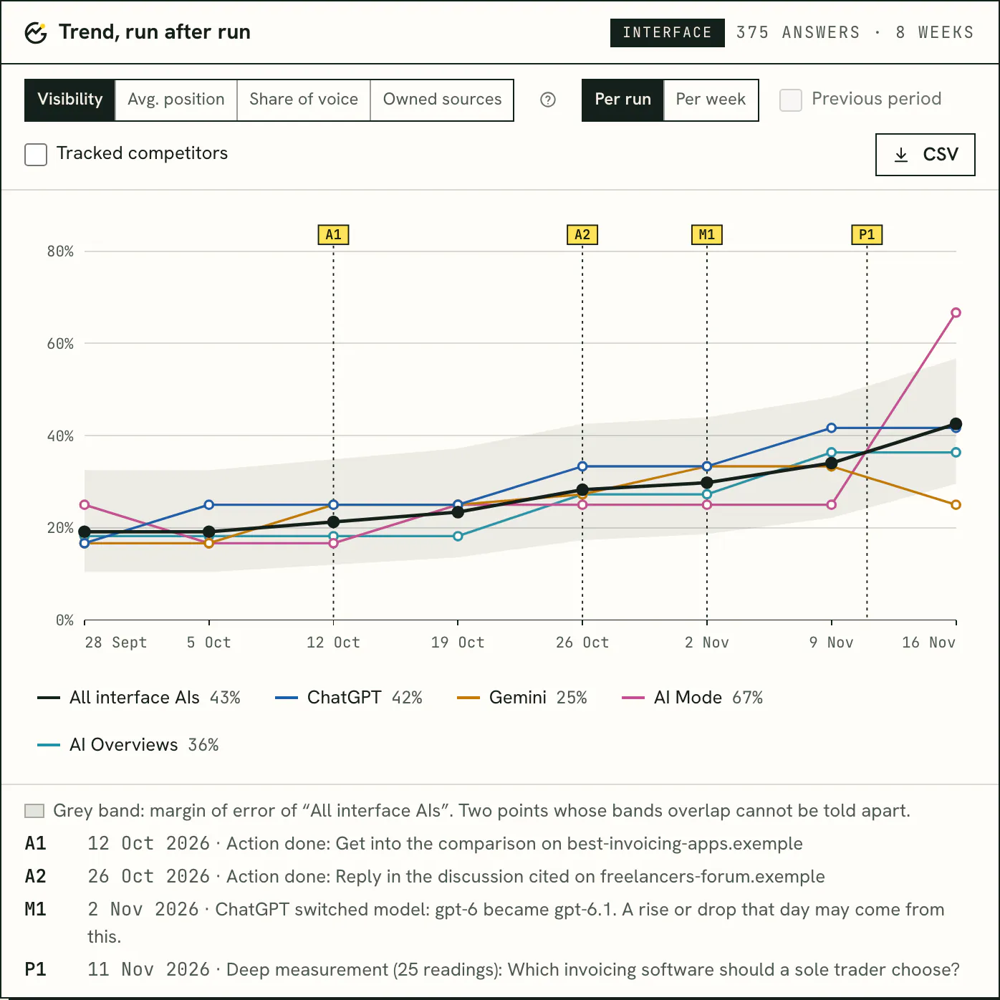
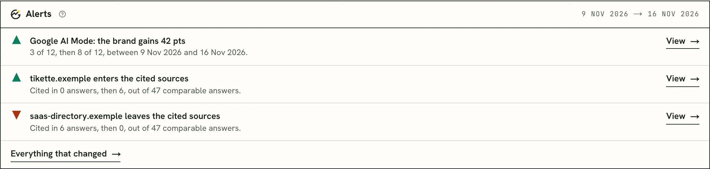

<!-- Page generated from the site documentation (src/site/docs) by scripts/exporter-docs.ts: do not edit it here. -->

# Overview

> The tool’s home screen: visibility, share of voice, average position, alerts and presence AI by AI, then the week’s three actions. Every number states its method.

[← Documentation contents](../README.md) · [Lire cette page en français](../../fr/mesurer/vue-d-ensemble.md)

The overview opens after you sign in. It answers two questions: where does the brand stand in AI answers, and what has changed since last time? Everything comes from the runs already stored: opening this screen costs nothing.

To get there: menu **Track › Overview**, or click the logo at the top of the menu. The screen shows the project selected at the top of the menu, over the period and the AIs set in the top bar.

*The overview of the Facturo UK project: the headline sentence, the key figures, then the main chart and the most mentioned brands.*

## The top bar

It is the same on every measurement screen and stays visible as you scroll. On the left, the breadcrumb and the project. In the middle, the filters. On the right, the screen’s buttons: **Export** (the screen’s CSV), **Start a run** and quick search.

| Filter | What it changes |
| --- | --- |
| **Period** | 7 days, 4 weeks, 8 weeks (the default), 3 months, **All time** or **Latest run only** (the most recent answer of each AI for each prompt). Changes compare with the period of the same length just before. |
| **AI** | One pill per AI already recorded in the project. A click hides or shows it. Claude’s pill carries the API label: it is never added to interface readings. |
| **Versus** | Keeps only the answers that name a tracked competitor, to see where you stand against it. Answers whose brands have not been read yet are left out, and a banner says so. |
| **Reset** | Back to 8 weeks, all AIs, all answers. |

These settings apply to every measurement screen and are kept from one page to the next. Under the bar, a line reminds you what you are looking at: the number of prompts, interface answers, API answers (counted separately), pending answers, and the date of the last run.

> [!NOTE]
> **A run is not sent from here**
>
> The **Start a run** button opens the Runs tab of the project page. That is where the price of each AI is shown, before anything is sent. See [Start a run](../project/start-a-run.md).

## The headline sentence

At the top, a sentence gives the raw count: the brand appears in so many answers out of so many, recorded from the interface. Clicking the number opens those answers. Below: the number of AIs, the dates covered, then Claude’s count, separately. If there is only one run day, the screen says so: it is a sample, not a trend yet.

A project with no prompt shows **Write my prompts**; a project with no run shows **Prepare the first run**, with the price of an interface run for all its prompts. If the answers have not come back yet, the sentence says so: they arrive within minutes.

## Key figures

Each tile shows its method and its base (“12 out of 40 answers”, for example). The help bubble explains how the number is calculated, and clicking the tile opens the screen with the details.

| Tile | What it counts | Method |
| --- | --- | --- |
| **Visibility** | Share of interface answers where the brand is mentioned or cited. Shown from 5 answers; below that, the tile says “From 5 readings”. The bubble gives the margin of error. | interface |
| **Share of voice** | Mentions of the brand relative to those of the brand and its tracked competitors. “n/a” as long as no competitor is tracked. | interface |
| **Avg. position** | Average position of the brand among the brands mentioned, in the answers where it has a position. The smaller, the better. | interface |
| **Owned sources** | Number of times a page of the site or a video of the brand is cited as a source, split between site and YouTube. | interface |
| **AI Overviews** | Number of prompts for which Google shows an AI Overview, out of the prompts recorded. A prompt without an overview is not an absence of the brand. | interface |
| **Claude (API)** | Visibility in Claude’s answers, queried through its API. The tile only appears once Claude has been recorded. | API |

> [!NOTE]
> **A coloured change is a real change**
>
> Under the value, the change from the previous period is shown in points. It is only coloured (▲ green, ▼ red) when it exceeds the margin of error of both periods. Otherwise it stays grey, marked “within margin”, or “too few readings” when one side has fewer than 5 answers. The calculation is detailed in [Measurement method](../reference/method.md).

## The main chart

The **Trend, run after run** block draws one line per interface AI, and one for all of them together, with its grey band: the margin of error. One point is one run day. Segments are straight, never smoothed, and a day without a run leaves a gap, not a zero. The left and right arrow keys read the points one by one.

- **Metric shown**: Visibility, Avg. position, Share of voice or Owned sources. Share of voice is only drawn with at least one tracked competitor.
- **Per run** or **Per week**: one point per run day, or one point per week.
- **Previous period**: the same metric over the previous period, dotted.
- **Tracked competitors**: each competitor’s line next to yours, for visibility and share of voice.
- **CSV**: the chart’s data, as displayed.

Markers flag three events on the line: the day an AI switches model (a rise or drop that day may come from it), the day an action is marked done, and the deep measurements of a prompt, which do not count in the line.

On the right, **Most mentioned brands** ranks the brands mentioned in the answers read, yours highlighted, with their change. **Full ranking** opens the Competitors screen. If Claude has been recorded, its line has a block of its own, **Claude, measured through its API**, dotted: it is never drawn with the interface lines.

*The main chart: one line per interface AI, the grey band of the margin of error, the options above and the markers below.*

## Alerts

The **Alerts** block shows what changed between the last two run days, only when the change exceeds the margin of error: visibility going up or down, an AI gaining or losing the brand, a brand settling in, a source coming in or out, an AI Overview appearing. Four at most here; **Everything that changed** opens the report. Alerts do not depend on the top-bar filters. When nothing exceeds the margin, the screen says “No alert.”

*The Alerts block: only the changes that exceed the margin of error between the last two run days, each with its link.*

## Presence, AI by AI

One row per AI, never a total across them. Claude, measured through its API, is set apart by a double rule. Columns sort with a click on their header.

| Column | Definition |
| --- | --- |
| **AI** | The AI’s name and, below, the models recorded. The “strongest” and “weakest” labels rank the interface AIs that have at least 5 answers. |
| **Method** | Interface or API. |
| **Runs** | Answers received, out of the readings sent. “no overview”: prompts where Google showed no AI Overview, which do not count as an absence. |
| **Visibility** | Share of answers where the brand is mentioned or cited, from 5 answers. Below that, the count only (“2 out of 4”). |
| **Change** | Change from the previous period, coloured only beyond the margin of error. |
| **Avg. position** | Average position of the brand among the brands mentioned. |
| **Site cited** | Answers where a page of the site (or of a declared social profile) is among the sources. |
| **Video cited** | Answers where a video from one of the brand’s channels is cited, without a page of the site. |
| **Name only** | The brand is mentioned in the text, without any of its pages being cited. |
| **Read, not cited** | A page of the brand was read by the AI, without being cited as a source. |
| **Trend** | The small line of this AI’s visibility. |

## Where visibility comes from, and who gets the citations

**Where visibility comes from** splits the answers where the brand appears into three parts: **Through the site**, **Through the YouTube channel**, **By name only**. Each calls for different work: writing, filming, or getting the brand talked about elsewhere.

**Who gets the citations** splits all the cited sources: the brand, the tracked competitors, other brands, then third-party sites by type (comparison sites, media, blogs…). Clicking a part opens the Sources screen, filtered. As long as some sites are not classified, a line says so.

Once the tone of the answers has been read, **Tone used for Facturo** counts positive mentions (the brand is recommended), neutral ones (simply mentioned) and negative ones (advised against).

## Coverage: prompt by AI

One row per prompt, one column per AI: the square shows each AI’s latest reading. Clicking a square opens the answer. When a prompt has several readings for an AI, the “present out of recorded” count is shown next to it. The last column, **Coverage**, counts the interface AIs where the brand appears, out of those that answered.

| Square | What it means |
| --- | --- |
| **Cited** | A page or a video of the brand is among the sources. |
| **Mentioned** | The brand’s name is in the answer. |
| **Absent** | The AI answered without the brand (including when it read one of its pages without citing it). |
| **No overview** | The AI displayed nothing: it is not an absence. |

## Brands and sites cited instead of you

**Mentioned instead of us** lists the other brands mentioned, with their number of answers, how many times they are named first and their average position. The **Track** button makes one a competitor of the project: it is free and starts no run. **Sites the AIs cite** ranks the most cited sites, with their type.

## To do this week, and latest answers

**To do this week** shows the first three lines of the work list (to do or in progress), each with its evidence: the number of answers and AIs, and the prompt behind it. **Latest answers** shows the six most recent answers; **All answers** opens the full list.

## Reading the overview in five minutes

1. **Check what you are looking at.** Read the line under the top bar: how many prompts, how many interface answers, how many pending, the date of the last run. If answers are pending, wait until they are back.

2. **Read visibility and its change.** A coloured change is real; a grey one is within the margin of error, and you should not draw conclusions from it.

3. **Find the weakest AI.** In **Presence, AI by AI**, look at the row marked “weakest” and its **Site cited**, **Name only** and **Read, not cited** columns: they tell whether the problem is the site, awareness, or a page found but not kept.

4. **Open the alerts.** They only show what exceeds the margin of error. Each alert has a **View** link to the prompt, the AI or the source concerned.

5. **Move to action.** Open the first line of **To do this week**, or the whole work list on the Actions screen.

## Limits

> [!WARNING]
> The brands mentioned, their position and the tone are read from the text by a small model, except for ChatGPT, which returns them itself. Until reading is done, a banner offers **Read the answers**, with its price (about $0.0008 per answer). With one answer per prompt and per AI on each date, few changes exceed the margin of error: that is on purpose, and it is why the screen shows few alerts.

**See also**

- [The Prompts screen](./prompts.md)
- [Competitors and share of voice](../understand/competitors.md)
- [Report and alerts](../steer/report-and-alerts.md)
- [Measurement method](../reference/method.md)

---

Updated: 2026-11-18 · [Read this page on the website](https://geotrends.io/en/docs/measure/overview)
