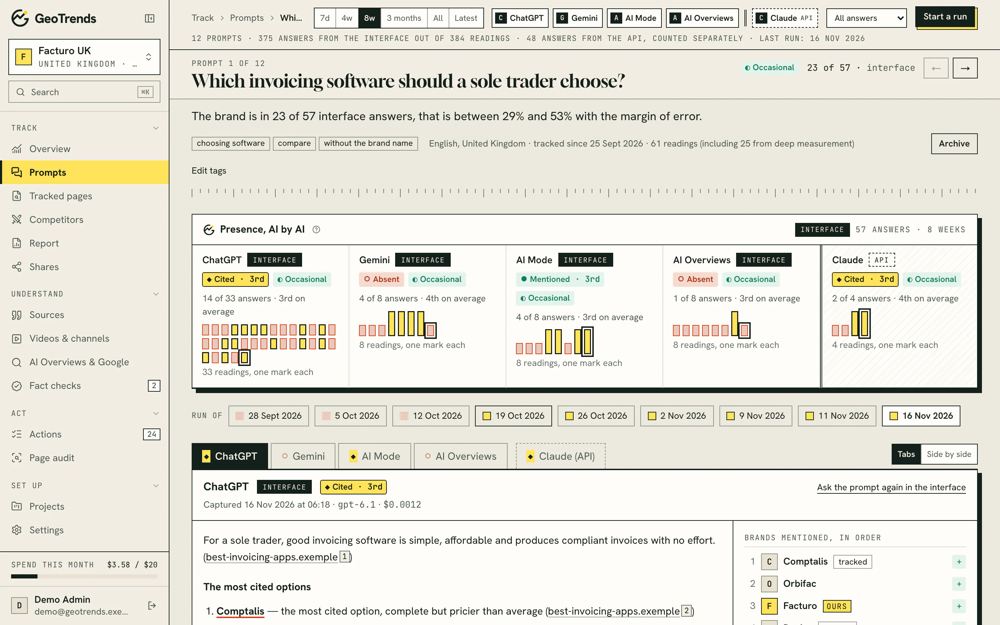
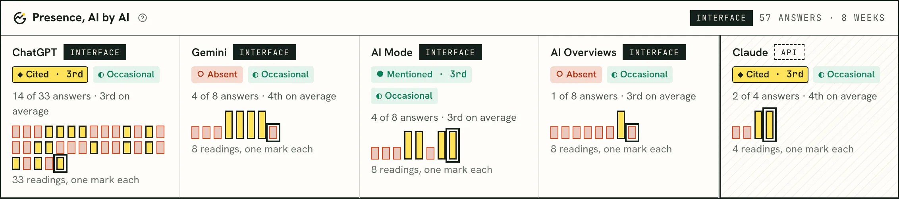
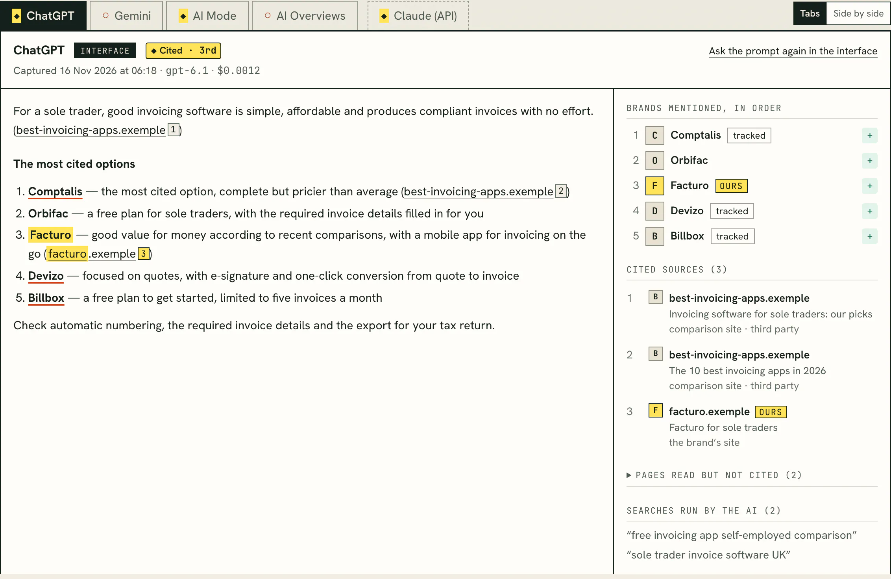

<!-- Page generated from the site documentation (src/site/docs) by scripts/exporter-docs.ts: do not edit it here. -->

# A prompt’s page

> Everything about one prompt: the verdict and its margin of error, the status for each AI, every full answer with its sources, who wins and thanks to which pages.

[← Documentation contents](../README.md) · [Lire cette page en français](../../fr/mesurer/fiche-question.md)

A prompt’s page is where you understand why the brand wins or loses on that precise prompt, and what to fix. You read the verdict, then the answers themselves, AI by AI, with their sources: they are the evidence behind every number in the tool.

To get there: click a prompt anywhere in the tool (the Prompts table, the overview’s coverage grid, an action’s evidence, an alert). Clicking a status or a square opens that AI’s answer directly. The ← and → arrows of the header move to the project’s previous or next prompt.

*A prompt’s page in the Facturo UK project: the verdict, presence AI by AI with one mark per reading, then the answers in tabs.*

## The header and the verdict

At the top, and still visible as you scroll: the prompt’s position in the project (“Prompt 3 of 10”, or “Archived prompt”), its text, its verdict and the count of interface answers. Below, a sentence gives the result with its margin of error: the brand is in so many interface answers out of so many, that is between two percentages, from 5 answers. With fewer than 3 answers, the sentence says it is too early; with fewer than 20, that the margin is still wide and a deep measurement narrows it.

Then come the tags: the topic (a click opens the prompts of that topic), the intent, and “with” or “without the brand name”. Then the market, the date since which the prompt has been tracked, and its number of readings, including those from deep measurement. **Archive** takes it out of tracking (its history stays); an archived prompt shows **Resume tracking**.

**Edit tags** opens two fields: the **Topic**, in one to three words, with the topics already used in the project, and the **Intent** (learn, compare, buy, or not set). **Save** is free, and a tag set by hand is no longer changed by the model.

## Presence, AI by AI

One box per AI, Claude apart. Each gives the status of the reading shown (or “Not run that day”), the AI’s verdict from 3 answers, the count of answers with the brand and the average position when known. Below, a strip: one mark per reading, highlighted when the brand is there. Clicking a mark opens that day’s answer. With a single reading, the box reminds you: it is a sample.

The **Run of** line picks the day shown, each day marked with a yellow square if the brand appears for at least one AI. By default, it is the latest run day.

*Presence, AI by AI, on one prompt: the status of the reading shown, the verdict, and a strip with one mark per reading, highlighted when the brand is there.*

## The answers

The answers of the chosen day are shown as **Tabs** (one AI at a time, full width) or **Side by side** (one column per AI). The choice is remembered; on a phone, it is always tabs. Each tab carries a sign: brand present, absent, or no answer.

At the top of each answer: the AI, its method, the status, the date and time of the reading, the model that answered and the cost of the reading. The **Ask the prompt again in the interface** link opens the AI on this prompt, so you can see for yourself. When the prompt was asked several times that day (deep measurement), “Answer 2 of 10 that day” and the previous and next links move between them.

The text is the one the AI wrote: it is never translated or corrected. The brand is highlighted, a tracked competitor is underlined, and each cited source carries its number. Next to it, what the tool draws from the answer:

| Block | What it contains |
| --- | --- |
| **Brands mentioned, in order** | The position of each brand, yours highlighted, the “tracked” label for a tracked competitor, a + or a − when the tone is positive (recommended) or negative (advised against). If the brand is missing, the list ends with “Facturo: absent”. |
| **Cited sources** | The sources numbered as in the text: the site or the YouTube channel, “ours” for a page of the brand, the title, the type of site and who owns it. |
| **Pages read but not cited** | The pages the AI opened without citing them, folded. Given by ChatGPT and Claude only. |
| **Searches run by the AI** | What the AI typed into a search engine before answering. ChatGPT and Claude only. |
| **Related questions** | The questions Google shows with its results. |
| **Google’s top 10 results** | For AI Overviews: the top ten classic results, your site highlighted, each marked “cited by the Overview” or “not cited”. |

A pending answer offers **Collect the answers**. A failure gives its reason. A missing AI Overview says so: Google showed no overview that day, which is not an absence of the brand.

*Answers side by side: each AI’s text with the brand highlighted, and on the right the brands mentioned and the cited sources.*

## On this prompt

This block uses all the interface answers of the period, not only those of the chosen day.

- **Who wins**: the most mentioned brands, with their count over the answers read, yours included.
- **Winning pages**: pages cited by at least two different AIs, excluding the brand’s pages. A click opens their sheet on the Sources screen.
- **Our pages**: the brand’s pages and videos cited, or read without being cited, on this prompt.
- **Related actions**: the work-list lines for which this prompt is the evidence, with **See in the work list**.

## Trend and history

**Trend for this prompt** draws the brand’s presence run day after run day: one line per interface AI and one for all of them, with the grey band of the margin of error. On a single prompt, the sample is small and the band wide. Claude has its own chart, dotted. Further down, the **Deep measurement** block asks the prompt several times in a row (see [Deep measurement](./deep-measurement.md)), then **Run history** gives one row per day, the most recent first, with the status for each AI. Clicking a day or a status opens the matching answer.

## Understanding a lost prompt

1. **Read the verdict and its margin.** “Absent” on 12 answers does not weigh the same as “absent” on 2. The sentence under the header gives the count.

2. **Open the most recent answer.** Tab by tab, read who is mentioned instead of Facturo, and at which position.

3. **Look at the sources.** The cited pages are the ones the AI relies on. An invoicing software comparison on a .exemple site comes up for three AIs? That is where you need to appear.

4. **Check your pages.** In **Our pages**, a page read but not cited was found: it lacks a clear answer to the prompt. For AI Overviews, check whether your site is in Google’s top ten results.

5. **Move to action.** **Related actions** shows what the work list suggests for this prompt.

## Limits

> [!WARNING]
> On a single prompt, a few answers per AI do not make a trend: the margin of error shows it. The brands mentioned, their position and the tone are read by a small model, except for ChatGPT; until reading is done, the block says so. Asking the prompt yourself will probably give another answer: an AI never answers the same way twice, and your browsing history may play a part. Pages read and searches are only known for ChatGPT and Claude.

**See also**

- [Deep measurement](./deep-measurement.md)
- [All answers](./answers.md)
- [Does ChatGPT cite my brand, and on which prompts?](../use-cases/does-chatgpt-cite-my-brand.md)
- [My page is read but not cited: what should I fix?](../use-cases/page-read-not-cited.md)

---

Updated: 2026-11-18 · [Read this page on the website](https://geotrends.io/en/docs/measure/prompt-page)
