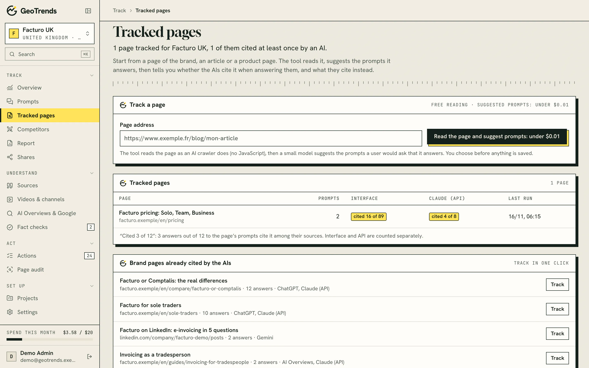
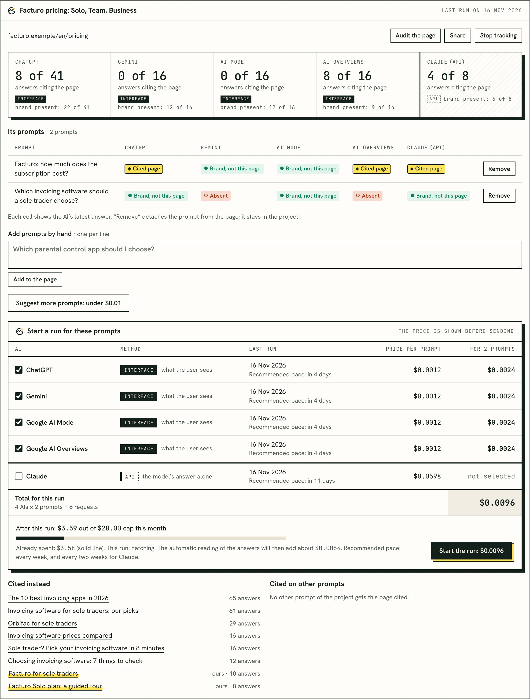

<!-- Page generated from the site documentation (src/site/docs) by scripts/exporter-docs.ts: do not edit it here. -->

# Tracked pages

> Start from a page of the brand: the tool reads it, suggests the prompts it answers, then tells you whether AIs cite it and what they cite instead.

[← Documentation contents](../README.md) · [Lire cette page en français](../../fr/mesurer/pages-suivies.md)

People often think in pages: a sponsored article, a product page, a comparison. The tool starts from prompts: it asks them to the AIs and notes the pages they cite. The **Tracked pages** screen (**Track** menu) bridges the two. You paste the address of a page of the brand; the tool reads it, suggests the prompts a user would ask that it answers, then shows, AI by AI, whether the answers to those prompts cite it.

*The Tracked pages screen: paste a page’s address, the list of tracked pages with their tally, and the brand’s pages already cited, to track in one click.*

## Tracking a page

1. **Paste the address.** In **Track a page**, the full address (https://…), then **Read the page and suggest prompts**. Other ways in: **Start from a page** on the Prompts screen, or **Track** on a page of the **Our pages** tab in Sources.

2. **Review the suggested prompts.** The tool reads the page as an AI crawler does, without JavaScript (free). A small model suggests up to six prompts, most without the brand’s name (less than a cent, logged in the cost journal). Untick the ones that do not fit, edit the text, **Remove** deletes one, and the field below **Adds** one by hand.

3. **Track the page.** **Track the page with … prompts** (free). The prompts join the project: they then count in its figures and its automatic runs. You can also **attach prompts already tracked**.

4. **Start the run.** On the page’s sheet, **Start a run for these prompts**, at the price shown ($0.0012 per prompt and per interface AI). Answers come back within minutes.

> [!NOTE]
> **Why prompts without the brand’s name**
>
> A prompt that names the brand almost always gets its site cited. What matters is whether the AI cites the page when the user does not know it yet: “Which parental control app should I choose?” rather than “Is app X any good?”.

## A page’s sheet

*A tracked page’s sheet: AI by AI, the answers that cite it; then each prompt with each AI’s latest answer, and what is cited instead.*

- **AI by AI**: “3 of 12 answers citing the page”, and below it the brand’s presence (named or another page cited). Claude, measured through its API, has its own tile.
- **Its prompts**: one row per prompt, one column per AI, with the latest answer: **Page cited**, **Brand, not this page**, **Read, not cited**, **Absent** or **No answer**. A click opens the answer.
- **Remove** detaches a prompt from the page; it stays in the project. **Add prompts by hand** (one per line) and **Suggest more prompts** complete the list.
- **Cited instead**: the pages cited in the answers that do not cite this one. That is where to look to understand what the AI prefers.
- **Cited on other prompts**: answers to other prompts of the project that also cite it.
- At the top: **Audit the page** (readable by AI crawlers?), **Share** (a private page for a client, on these prompts) and **Stop tracking** (its prompts stay in the project).

## Finding a page again

Quick search (⌘ K on a Mac, Ctrl K elsewhere) also finds pages: the ones you track lead to their sheet, other cited pages to their sheet in Sources. Type part of the address or the title.

## Limits

> [!WARNING]
> A page is only measured on its prompts: if an AI cites it for a prompt you do not track, the tool does not see it. Suggested prompts are a starting point, to be reviewed. A page whose text only shows with JavaScript cannot be read: the page audit says so.

**See also**

- [The Prompts screen](./prompts.md)
- [Cited sources](../understand/sources.md)
- [Page audit](../act/page-audit.md)
- [Share with a client](../steer/share-with-a-client.md)

---

Updated: 2026-11-20 · [Read this page on the website](https://geotrends.io/en/docs/measure/tracked-pages)
