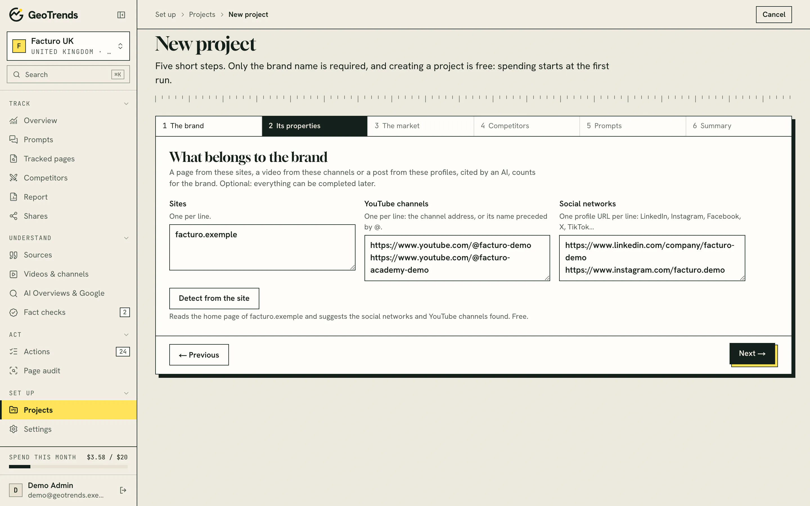
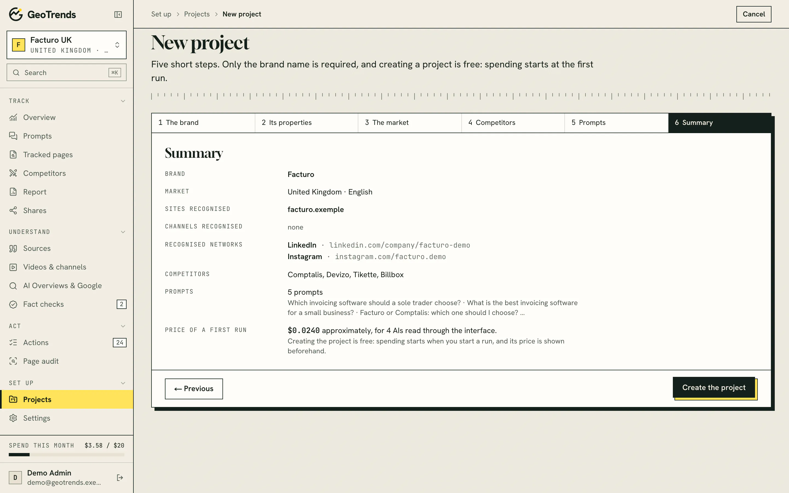

<!-- Page generated from the site documentation (src/site/docs) by scripts/exporter-docs.ts: do not edit it here. -->

# Create a project

> A project tracks one brand: its name, what it owns, its competitors, its prompts, the country and the language. Creating it is free; spending starts with a run.

[← Documentation contents](../README.md) · [Lire cette page en français](../../fr/projet/creer-un-projet.md)

Everything in the tool is read project by project. A project tracks one brand on one market: a country and a language. To track the same brand in another country, or another brand, you create another project. Creating a project is free: spending only starts with the first run, and its price is shown before sending.

To create one: the **New project** button at the top of the Projects screen, or the **New project** link at the bottom of the project list in the menu. The first project is created from the empty screen, with the same button.

*Creating a project: five short steps and a summary. Here, the brand step for Facturo UK.*

## The creation steps

The form has six tabs. Nothing is saved before the last button: you can go back, skip a step or click a tab directly once the brand name is filled in. The Enter key moves to the next step; it does not create the project.

| Step | What you enter |
| --- | --- |
| **The brand** | The **Brand name**, the only required field. This name is what the tool looks for in the text of the answers. Other spellings (acronym, name without spaces) are added later, on the project page. |
| **Its properties** | The brand’s **Sites**, **YouTube channels** and **Social networks**, one per line. A page of these sites, a video of these channels or a post of these profiles, cited by an AI, counts for the brand. The **Detect from the site** button reads the home page and suggests the profiles it finds. |
| **The market** | The **Country** the prompts are asked from and their **Language**. Default: France, French. |
| **Competitors** | One brand name per line. Optional: after the first run, the tool suggests the brands the AIs mention most. |
| **Prompts** | One prompt per line, the way a customer would ask an AI. Ten are enough to start. Under the field, the price of an interface run for these prompts updates with every line. |
| **Summary** | What the tool understood: the brand, the market, the **Sites recognised**, **Channels recognised** and **Recognised networks**, the competitors, the prompts and the **Price of a first run**. Then the **Create the project** button. |

> [!NOTE]
> **Country and language are chosen once**
>
> They can no longer be changed after the first run: the charts must stay comparable from one week to the next. To track Facturo UK in Ireland, create a second project. As long as no run has been sent, they can be corrected in the **Project settings** tab. See [Countries and languages](../reference/countries-and-languages.md).

The summary checks your entries without saving anything: a full address is reduced to its domain, a channel typed by its handle (“@FacturoUK”) is looked up on YouTube with its real name, a share link or a post is not taken for a profile. Anything not recognised is flagged before creation.

*The summary before creating the project: what the tool recognised (sites, channels, profiles) and the price of a first run.*

## The Projects screen

One card per project, with its market and its number of prompts, sites, channels, networks and competitors. The project shown across the tool carries the label “shown in the tool”; the others have a **Show this project** button. The same choice can be made in the menu, top left, with a search box once there are more than four projects.

| Card field | What it shows |
| --- | --- |
| **Last run** | The date of the last run, and the number of answers still pending. |
| **Visibility** | The share of interface answers where the brand is mentioned or cited, over the period set in the top bar. As a percentage from 5 answers, otherwise the count only (“2 out of 4”). |
| **Spend this month** | The project’s paid calls since the start of the month, and how many. |
| **Next recommended run** | Seven days after the last interface run, or “right now”. Below: “Automatic weekly run” or “Runs started by hand”. |

At the foot of each card, three links open the project page on the right tab: **Start a run**, **Prompts**, **Brand and properties**.

## Renaming or archiving a project

The **Project settings** tab of the project page has three blocks. **Project name** changes the **Name shown in the tool**; the name looked for in the answers stays the brand’s, and the cost journal follows the change. **Country and language** can only be edited as long as no run has been sent; after that the block is read-only. **Archive the project** removes it from the tool and stops its automatic runs; nothing is deleted, its history stays in the database.

## Creating the Facturo UK project, step by step

1. **Name the brand.** Type “Facturo”, the way the AIs write it. A name that is too short or too common will cause false matches: use the exact form of the brand.

2. **Declare what it owns.** Enter facturo.exemple, then click **Detect from the site**: the YouTube channels and profiles found on the home page are added to the fields. Review them and remove personal accounts.

3. **Choose the market.** United Kingdom and English for Facturo UK. This is the country the prompts will be asked from.

4. **Name two or three competitors.** Comptalis, Devizo. The others will come from the runs: the tool suggests the brands the AIs mention.

5. **Write about ten prompts.** Your customers’ prompts, with and without the brand name. See [Write the prompts to track](./prompts.md).

6. **Check the summary and create.** Check what was recognised, then **Create the project**. The project becomes the one shown in the tool and its page opens on the Runs tab, ready for a first run. It is named after the brand: rename it “Facturo UK” in **Project settings** to tell it from other markets.

## Limits

> [!WARNING]
> A new project takes the brand’s name, and two projects cannot have the same name. To track Facturo on a second market, first rename the existing project (“Facturo France”) in **Project settings**, then create the new one. The brand is recognised in the text by its name and its other spellings, as a whole word, regardless of case: a name that is also a common word will be matched by mistake in some answers. A forgotten property can be added later, history included.

**See also**

- [Sites, YouTube channels and social profiles](./sites-channels-profiles.md)
- [Write the prompts to track](./prompts.md)
- [Start a run](./start-a-run.md)
- [Am I tracking the right prompts?](../use-cases/tracking-the-right-prompts.md)

---

Updated: 2026-11-18 · [Read this page on the website](https://geotrends.io/en/docs/project/create-a-project)
