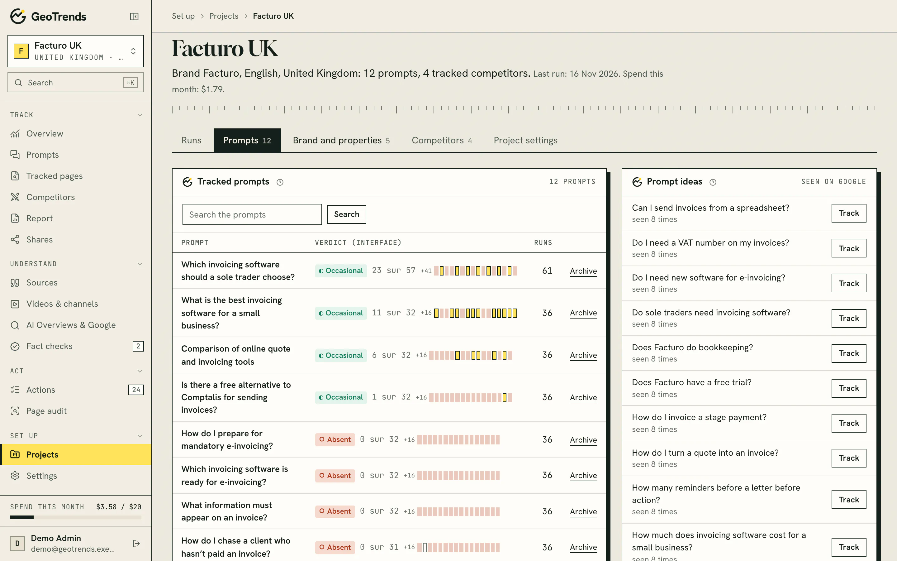

<!-- Page generated from the site documentation (src/site/docs) by scripts/exporter-docs.ts: do not edit it here. -->

# Write the prompts to track

> Prompts are what your customers ask the AIs: everything the tool measures depends on them. How to write them, add them, archive them, and where to find ideas.

[← Documentation contents](../README.md) · [Lire cette page en français](../../fr/projet/questions.md)

A prompt is what a potential customer asks an AI, in their own words. Each run asks every prompt of the project to each AI chosen: prompts decide what you measure, and what a run costs. Ten well-chosen prompts are worth more than fifty written in a hurry.

To get there: the **Prompts** tab of the project page. The **Add prompts** button of the Prompts screen and the **Write my prompts** button of empty screens lead there too. A prompt can also be tracked from the AI Overviews & Google screen, with **Add to the project**.

*The Prompts tab of the Facturo UK project: tracked prompts with their verdict, the add field, and the ideas seen on Google.*

## Writing good prompts

- **The way a customer would ask**, as a full sentence, in the project’s language: “Which invoicing software should a sole trader choose?” rather than “invoicing software sole trader”.
- **Mostly without the brand name.** These prompts tell you whether the AI thinks of Facturo when nobody mentions Facturo: they are the ones that bring new customers.
- **A few with the name**, to learn what the AI says about the brand: “Is Facturo suitable for a small business?”. The tool spots them on its own, as soon as the text contains the brand name.
- **One idea per prompt.** Two topics in the same sentence give an answer that measures neither.
- **The three intents**: learn (“how do I issue a compliant invoice?”), compare (“Comptalis or Devizo for a freelancer?”), buy (“cheap invoicing software with automatic reminders”).
- **Stable prompts.** A reworded prompt is a new prompt: its line starts again from zero.

| Prompt | What it measures |
| --- | --- |
| “Which invoicing software should a freelancer choose?” | Without the brand name, compare intent: does the AI think of Facturo, and whom does it cite instead? |
| “How do I chase a client who doesn’t pay?” | Without the name, learn intent: are your help pages used as sources? |
| “Is Facturo free?” | With the name: what the AI claims about the brand, to compare with the fact checks. |

## Tracked prompts

The **Tracked prompts** block lists the project’s prompts. For each one: its text (a click opens its page), its **Verdict (interface)** with the count of answers where the brand appears and one mark per reading, then the number of **Runs**. Beyond six prompts, a field lets you search the list.

The verdict follows the Prompts screen’s rule: “solid” from 6 interface answers out of 10, “occasional” below, “absent” at zero, “too early to tell” with fewer than 3 answers. See [The Prompts screen](../measure/prompts.md).

## Adding, removing, archiving

- **Add**: one prompt per line in **Add prompts**. The button says how many will be added, and the line next to it how much more each interface run will cost (4 AIs × $0.0012 per prompt). Adding is free: spending starts at the next run. A prompt already in the list is not added twice.
- **Remove**: a prompt that has never been run is simply removed, it has no history.
- **Archive**: a prompt already run can no longer be edited or deleted. Once archived, it is no longer run and no longer counts in the numbers; its history stays. A window asks you to confirm.
- **Resume**: the **Archived prompts** block lists archived prompts, with a button to put them back into tracking.

> [!NOTE]
> **Tags for new prompts**
>
> If automatic tagging is on in the Prompts screen, an added prompt gets a topic and an intent on its own, for about $0.00008. The line under the add field says so. It can be turned off in the Prompts screen. See [Topics and the topic map](../understand/topic-map.md).

## Prompt ideas

The **Prompt ideas** block (seen on Google) shows the “people also ask” questions Google displays under your prompts, recorded with the AI Overviews. They are real questions from users. Each idea says how many times it was seen; **Track** adds it to the project, for free, and each interface run will then cost $0.0048 more. Prompts already tracked are not suggested again. **All ideas, and the AI searches** opens the full list on the AI Overviews & Google screen, with the searches ChatGPT and Claude run before answering.

## Building Facturo’s list

1. **Write ten prompts.** Seven without the brand name, three with it. Start from the questions customers ask support or in meetings.

2. **Add them.** Paste them into **Add prompts**, one per line, then click **Add 10 prompts**.

3. **Start a first run.** **Runs** tab: the price is shown before sending. See [Start a run](./start-a-run.md).

4. **Complete with the ideas.** After the run, read **Prompt ideas** and track the ones that sound like your customers.

5. **Archive what does not help.** A prompt that tells nothing useful after a few runs should be archived: it costs money on every run.

## Limits

> [!WARNING]
> The tool does not say how many people ask a prompt: no AI publishes what it is asked. The text of a prompt cannot be corrected once it has been run: archive it and write another. “With or without the brand name” is deduced from the prompt’s text alone, by searching for the name. Google ideas only appear after an AI Overviews run.

**See also**

- [Am I tracking the right prompts?](../use-cases/tracking-the-right-prompts.md)
- [Branded or unbranded: how should I split my prompts?](../use-cases/branded-or-unbranded-prompts.md)
- [The Prompts screen](../measure/prompts.md)
- [AI Overviews and Google results](../understand/google.md)

---

Updated: 2026-11-18 · [Read this page on the website](https://geotrends.io/en/docs/project/prompts)
