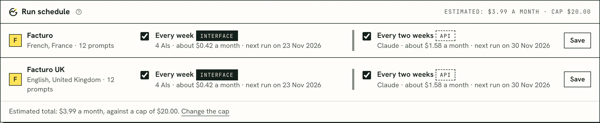

<!-- Page generated from the site documentation (src/site/docs) by scripts/exporter-docs.ts: do not edit it here. -->

# Automatic runs

> Every week for ChatGPT, Gemini and Google, every two weeks for Claude: once ticked, runs start on their own and pause when the monthly cap is reached.

[← Documentation contents](../README.md) · [Lire cette page en français](../../fr/projet/releves-automatiques.md)

An AI answer is a sample: repetition, week after week, is what makes a trend. Automatic runs give regular series without anyone having to think about them. The pace is fixed: every week for the four AIs read through the interface, every two weeks for Claude, which is more expensive to query. Nothing is on by default: you decide, project by project.

To get there: the **Automatic runs** block of the Runs tab, on the project page. The **Run schedule** block of the Settings screen sets the same boxes for all projects at once.

## The two boxes

| Box | What is sent | Estimate shown |
| --- | --- | --- |
| **Every week: ChatGPT, Gemini, Google AI Mode and AI Overviews** | All the project’s active prompts, to the four interface AIs, seven days after the previous automatic run. | Prompts × 4 AIs × ($0.0012 per reading + $0.0008 for reading the answer) × 4.33 weeks. For 10 prompts: about $0.35 a month. |
| **Every two weeks: Claude** | All active prompts, to Claude through its API, fourteen days after the previous run. | Prompts × (average price of a prompt to Claude + reading) × 2.17. For 10 prompts, with the $0.06 estimate: about $1.32 a month. |

Tick, then **Save**. The block shows “on” or “none yet”, and under each box the date of the last automatic run. The first one starts within half an hour of turning it on.

*The Settings screen: the Run schedule block gathers the automatic runs of every project, with the month’s estimate against the cap.*

## All projects in Settings

In **Run schedule**, one row per project: its market, its number of prompts, then the **Every week** (4 AIs, interface) and **Every two weeks** (Claude, API) boxes, each with its monthly estimate and, when ticked, the date of the next run (“within half an hour”, or a date). At the top of the block, the estimated total of all projects against the monthly cap; an admin can **Change the cap** in one click.

## What the server does every half hour

1. **Fetch the answers that are ready** for pending readings. Free.
2. **Start the runs that are due**: those of projects whose box is ticked and whose last automatic run is seven days old (fourteen for Claude).
3. **Read recent answers** with the small model: brands mentioned, position, tone. About $0.0008 per answer. Only answers less than three days old are read this way; older ones are read on demand, with the **Read the answers** button of the overview.
4. **Classify newly cited sites**, for projects where classification has been started once by hand on the Sources screen.
5. **Send the Monday report** to projects that asked for it, for free. Sending cannot be turned on until the e-mail service key (Resend) is installed: today, no e-mail goes out.

> [!NOTE]
> **The cap stops everything that costs money**
>
> Before each paid step, the task checks the month’s spend. If the cap is reached, automatic runs, reading and classification are paused, and resume on their own the next month, or as soon as the cap is raised. Fetching ready answers, which is free, carries on.

## Putting Facturo on automatic runs

1. **Do a first run by hand.** It lets you check the prompts and properties before paying every week. See [Start a run](./start-a-run.md).

2. **Tick the weekly box.** In **Automatic runs**, tick **Every week** and read the monthly estimate.

3. **Decide about Claude.** Tick **Every two weeks: Claude** if the model’s answer alone is useful to you. It is most of the spend.

4. **Save and check in Settings.** The **Run schedule** block shows the next run and the total of all projects against the cap.

## Limits

> [!WARNING]
> The pace cannot be changed: seven and fourteen days, with one hour of slack so the run does not drift from week to week. A run started by hand does not move the automatic run: the same week can have two. The monthly estimate assumes the same number of prompts over the whole period. Archiving the project stops its automatic runs.

**See also**

- [Start a run](./start-a-run.md)
- [Settings](../steer/settings.md)
- [The cost dashboard](../steer/costs.md)
- [A number moved: real change or noise?](../use-cases/real-change-or-noise.md)

---

Updated: 2026-11-18 · [Read this page on the website](https://geotrends.io/en/docs/project/scheduled-runs)
