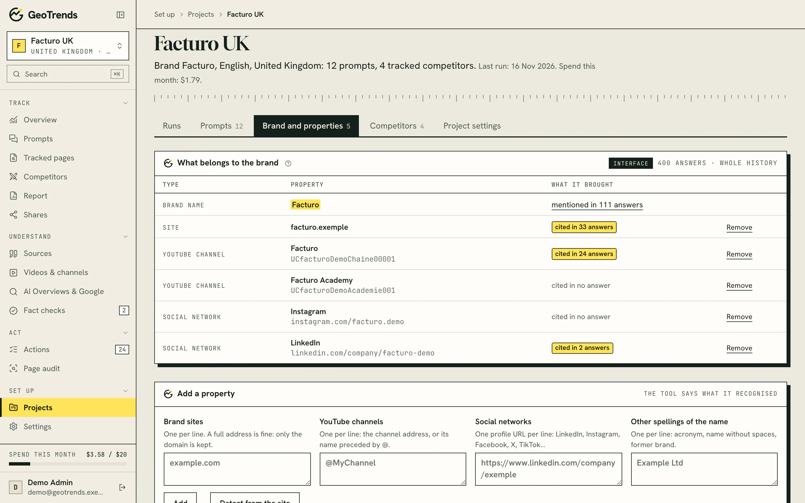

<!-- Page generated from the site documentation (src/site/docs) by scripts/exporter-docs.ts: do not edit it here. -->

# Sites, YouTube channels and social profiles

> Declare what belongs to the brand: its sites, YouTube channels, social profiles and other spellings of its name. A citation of any of them counts for the brand.

[← Documentation contents](../README.md) · [Lire cette page en français](../../fr/projet/sites-chaines-reseaux.md)

A brand is more than its website. When an AI cites a video from the Facturo Academy channel, or Facturo’s LinkedIn page, that is a citation of the brand. But the tool has to know that this channel and this profile are the brand’s: otherwise the video counts for youtube.com, in other words for someone else. This tab is where you tell it.

To get there: the **Brand and properties** tab of the project page, or the link of the same name on the project card in the Projects screen. The **Declare a channel** and **Manage channels** buttons of the Videos & channels screen lead there too. The same fields exist when creating the project.

*The page of the Facturo UK project, with its tabs: Runs, Prompts, Brand and properties, Competitors, Project settings.*

## What belongs to the brand

The table lists everything declared, with what each property brought over the whole history of interface readings. The first row is always the **Brand name**, with the number of answers that mention it.

| Type | What to enter | What counts for the brand |
| --- | --- | --- |
| **Site** | One domain per line. A full address works: only the domain is kept (“https://www.facturo.exemple/pricing” becomes facturo.exemple). | Any page of the domain and its subdomains (blog.facturo.exemple) cited as a source. |
| **YouTube channel** | The channel’s address, or its handle with @ (“@FacturoAcademy”). The tool looks it up on YouTube and keeps its real name. | Any video published by the channel and cited as a source. Each cited video is linked to its channel through YouTube’s public API, which is free. |
| **Social network** | The profile address: LinkedIn (company page or profile), Instagram, Facebook, X, TikTok, Pinterest, Threads, Bluesky or GitHub. | The profile and the pages under its address. They count as a page of the site, in the **Site cited** column. |
| **Name spelling** | An acronym, the name without spaces, a former brand name. One per line. | The text of the answers, like the brand name. |

The **What it brought** column says, for a site, a channel or a profile, in how many answers it is cited; for a name spelling, in how many answers it is written. A property that brought nothing says so too: “cited in no answer”. With nothing declared, the tab reminds you: only mentions of the name are detected.

> [!NOTE]
> **Everything is recalculated, the past included**
>
> The numbers are drawn from the answers kept in the database. An added property counts at once for every run already made, and a removed property stops counting everywhere, history included: the **Remove** confirmation says so. Nothing is paid again.

## Adding a property

The **Add a property** block has four fields: **Brand sites**, **YouTube channels**, **Social networks** and **Other spellings of the name**, one entry per line. After **Add**, the tool says what it understood: **Recognised and added**, with the cleaned domain and the real name of each channel; **Already declared, skipped**; **Not recognised**, with the entry to check. A share button or the address of a post is not taken for a profile.

### Detect from the site

The **Detect from the site** button reads the home page of the sites you typed, or of the sites already declared if the field is empty. It looks for links to social profiles and YouTube channels, and for the “sameAs” markup, a site’s official list of its profiles, whose entries come first. What it finds is added to the fields without being saved: you review, remove what is wrong, then click **Add**. Anything already declared is not suggested again. Reading is free.

> [!TIP]
> **Review before adding**
>
> A home page often carries personal accounts next to the brand’s: the founder’s X profile, an employee’s LinkedIn page. Once declared, they would count as citations of the brand. Keep only Facturo’s accounts.

## How the brand is recognised in an answer

- **Cited**: a page of a declared site, a page under a declared profile or a video of a declared channel is among the cited sources.
- **Mentioned**: the brand name, one of its other spellings or one of its domains appears in the text. The name is matched as a whole word, regardless of case.
- **Read**: one of its pages was opened by the AI without being cited. Only ChatGPT and Claude expose these pages read.

## Declaring Facturo’s properties

1. **Open the Brand and properties tab.** From the Facturo UK project page.

2. **Enter the sites.** facturo.exemple, and any other domain of the brand (a separate help site, for example). A subdomain is already covered by its domain.

3. **Run the detection.** **Detect from the site** fills the channel and network fields. Keep the Facturo channel, the Facturo Academy channel, the brand’s LinkedIn and Instagram profiles; remove the rest.

4. **Add the other spellings.** For example “Facturo.app” or a former name, if the AIs still use it.

5. **Click Add and read the summary.** Check the **Not recognised** line: a badly copied address or a channel that cannot be found ends up there.

## Limits

> [!WARNING]
> Detection only reads the home page, without running its JavaScript: a link displayed later escapes it. A post whose address does not contain the profile name (instagram.com/p/…, linkedin.com/posts/…) is not recognised as a page of the brand. Recognising channels and linking videos go through YouTube’s public API: without its key, a channel you enter stays “not recognised” (the key status is shown in Settings). Pages read without being cited are only known for ChatGPT and Claude.

**See also**

- [Videos and channels](../understand/videos.md)
- [Cited sources](../understand/sources.md)
- [Is my brand cited, mentioned or absent?](../use-cases/cited-mentioned-or-absent.md)
- [Choose your competitors](./competitors.md)

---

Updated: 2026-11-18 · [Read this page on the website](https://geotrends.io/en/docs/project/sites-channels-profiles)
