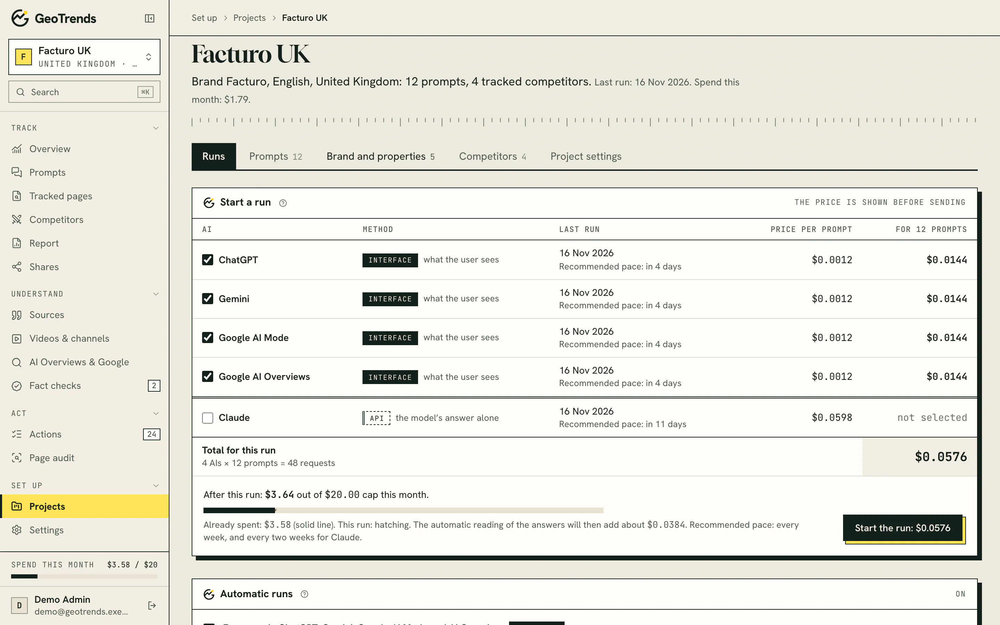
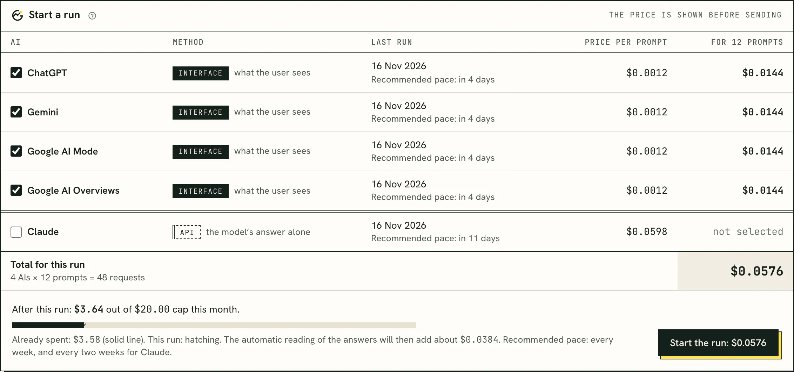

<!-- Page generated from the site documentation (src/site/docs) by scripts/exporter-docs.ts: do not edit it here. -->

# Start a run

> A run asks the project’s prompts to the AIs you tick. Each AI’s price is shown before sending and the monthly cap is checked: nothing leaves without your click.

[← Documentation contents](../README.md) · [Lire cette page en français](../../fr/projet/lancer-un-releve.md)

A run sends every active prompt of the project to the AIs you choose. Each prompt and AI pair gives one reading: an answer, with its sources, kept in the database. It is the only paid step of the measurement. This screen is where you decide on a run while seeing its price, AI by AI, before paying.

To get there: the **Runs** tab of the project page, the one that opens by default. The **Start a run** button of the top bar, on measurement screens, leads there, as do the **Prepare a run** buttons of empty screens. For a few prompts only, tick them on the Prompts screen; to ask one prompt several times, see [Deep measurement](../measure/deep-measurement.md).

*The Runs tab of the Facturo UK project: one row per AI with its method and price, the total of the run, then the month’s spend after the run.*

## The price table

One row per AI, with a checkbox. The four AIs read through the interface are ticked by default; Claude, queried through its API and much more expensive, is not. The total updates with every box you tick.

| Column | What it says |
| --- | --- |
| **AI** | ChatGPT, Gemini, Google AI Mode, Google AI Overviews, then Claude, set apart by a rule. |
| **Method** | “interface”, what the user sees, or “API”, the model’s answer alone. |
| **Last run** | The date of the last run sent to this AI, or “never run”. If the last run is less than 7 days old (14 for Claude), a red line gives the recommended pace: “in 3 days”, for example. |
| **Price per prompt** | $0.0012 for an interface AI, the price returned by the provider. For Claude, the average of what its last 30 readings actually cost; before the first one, an estimate of $0.06. |
| **For n prompts** | The price for all the project’s prompts, or “not selected”. |
| **Total for this run** | The number of AIs × the number of prompts = the number of requests, and their price. |

Under the table, a sentence and a gauge show what the month’s spend will become: what is already spent as a solid line, this run as hatching, against the monthly cap. The same line estimates what the automatic reading of the answers will add, about $0.0008 per answer. If the run would exceed the cap, the screen says so in red.

*The price table before sending: one row per AI, its method, its price per prompt and the total, then the month’s spending after the run.*

## Sending

The button carries the price: **Start the run: $0.0480**, for example. Above the confirmation threshold ($1 by default, set in Settings), a window asks you to confirm, with the number of requests and the AIs concerned: **Confirm sending**. Every request is logged in the cost journal, with the price returned by the provider, whether it succeeds or not.

> [!NOTE]
> **The monthly cap**
>
> If the month’s spend has already reached the cap ($20 by default, set by an admin in Admin › Costs), nothing is sent and a banner says so. A run that would only push spending over the cap is still sent, after the red warning: untick an AI if you do not want to go over.

## Answers coming back

After sending, the tab shows “Run sent.”, the number of answers back out of the number of requests, and a progress bar. Interface AIs answer within minutes, 45 at most; Claude answers in one to two minutes per batch, and its answers are added afterwards. While answers are expected, the screen refreshes by itself for ten minutes. After that, the **Collect the answers** button fetches them, for free, and the server’s background task does it anyway every half hour.

| Reading status | What it means | In the numbers |
| --- | --- | --- |
| **Answer back** | The answer is there, with its sources. | Counts, whether the brand is in it or not. |
| **No AI answer** | The AI displayed nothing. For AI Overviews: Google showed no overview on this prompt. | Left out: it is not an absence of the brand. |
| **Pending** | The prompt has gone out, the answer has not come back yet. | Not yet. |
| **Failed** | The provider could not record the answer, or it never arrived after six hours of waiting. | Does not count. The prompt is asked again at the next run. |

## The send log

At the bottom of the tab, **Send log** keeps one row per day and per AI: the **Date**, the **AI** (a click opens its answers), the **Method**, the number of **Prompts**, then **Answers back**, **No AI answer**, **Pending** and **Failed**, and the **Cost**. When a prompt was asked several times on the same day, the Prompts column says so (“30 requests”). At the top of the block: the project’s total number of requests and their price.

## Facturo’s first run

1. **Open the Runs tab.** From the project page, or with **Start a run** in the top bar.

2. **Choose the AIs.** Keep the four interface AIs. Tick Claude if you also want the model’s answer alone: its price is added to the total.

3. **Read the total and the gauge.** For ten prompts and four interface AIs: 40 requests at $0.0012, that is $0.0480, plus about $0.0320 of automatic reading.

4. **Start.** Click the button that carries the price. Confirm if the window opens.

5. **Wait for the answers.** Stay on the tab or come back later: the progress bar fills up. When everything is back, **See the answers** opens the Prompts screen.

## Limits

> [!WARNING]
> A run gives one answer per prompt and per AI: a sample, not the truth. The same prompt gets different answers from one day to the next, which is why running every week matters. Claude’s price is an average: a given run may cost slightly more or less, and the cost journal keeps the real price. A run that has been sent cannot be cancelled.

**See also**

- [Automatic runs](./scheduled-runs.md)
- [What a run costs](../get-started/costs.md)
- [The cost dashboard](../steer/costs.md)
- [How do I track a brand without going over budget?](../use-cases/tracking-on-a-budget.md)

---

Updated: 2026-11-18 · [Read this page on the website](https://geotrends.io/en/docs/project/start-a-run)
