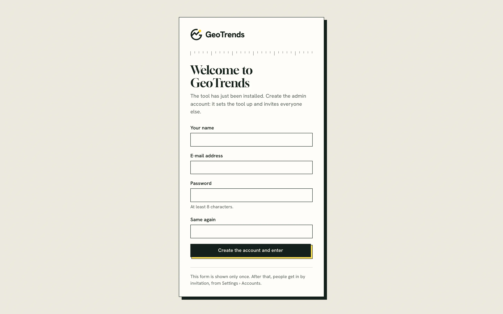
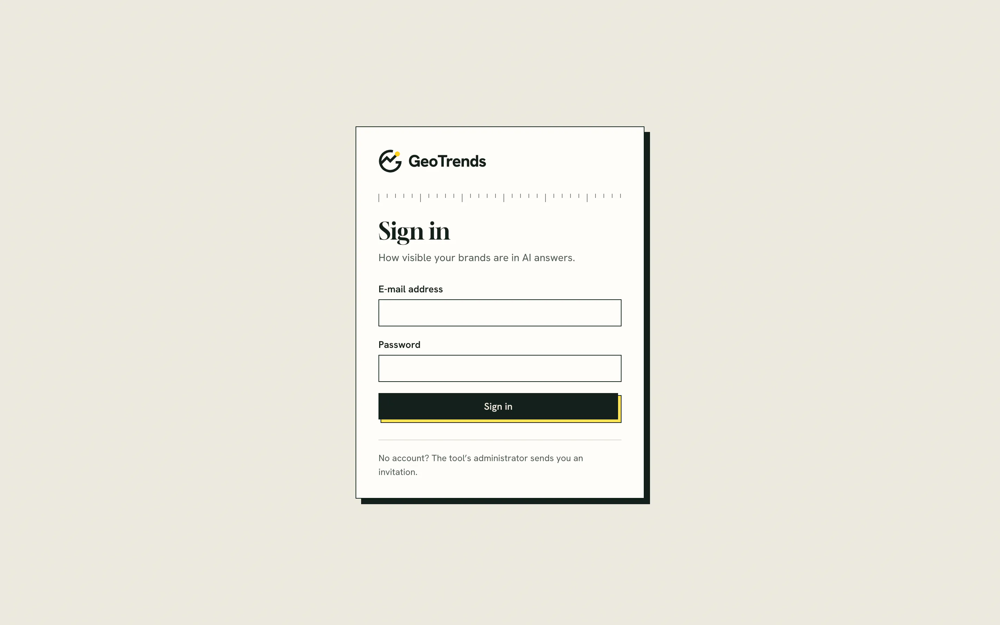
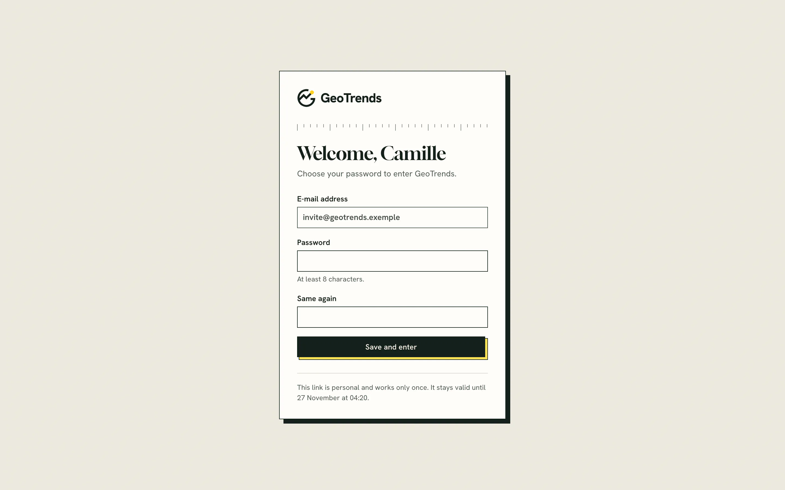

<!-- Page generated from the site documentation (src/site/docs) by scripts/exporter-docs.ts: do not edit it here. -->

# Accounts and sign-in

> The first account is created on first launch; after that each person is invited and chooses a password through a link. Two roles, the menu, quick search.

[← Documentation contents](../README.md) · [Lire cette page en français](../../fr/piloter/comptes.md)

Nobody signs up on their own in a GeoTrends installation. The first account, the admin’s, is created on first launch. After that, the administrator invites each person from **Settings › Accounts**; they get a personal link to choose a password. No password ever travels by e-mail. This page explains how to get in, what each role can do, and how to find your way once signed in.

## The first account

*On first launch, the sign-in page has you create the admin account.*

As long as no account exists, the sign-in page shows “Welcome to GeoTrends”: **Your name**, **E-mail address**, **Password** (at least eight characters, twice), then **Create the account and enter**. This account is an admin, and the tool takes you straight to creating the first project. The form is shown only once: as soon as an account exists, people only get in by invitation. So create it right after installing.

*The ordinary sign-in page: e-mail address and password.*

## Signing in

The address of your installation opens the sign-in page: **E-mail address**, **Password**, then **Sign in**. The tool opens on the overview. Until someone is signed in, the page follows the browser language; after that, it uses the language chosen for your account.

| Message | What it means |
| --- | --- |
| “Wrong e-mail address or password.” | One of the two does not match. Check the address, then the password. |
| “Too many attempts. Try again in a minute.” | More than ten attempts in one minute: sign-in is paused for a moment. |

> [!NOTE]
> **Forgotten password**
>
> Ask the administrator for a new link: one click in **Settings › Accounts** (**New-password link**). Open it, choose a new password, and the old one stops working. To change it without having forgotten it: **Settings › My password**.

## Getting in with an invitation

*The page opened by the invitation link: the address is filled in, all that is left is to choose the password.*

1. **Open the link you received.** The administrator’s e-mail contains a personal link. It works for **seven days**, **only once**.

2. **Choose a password.** At least eight characters, the same twice, then **Save and enter**. The tool opens straight on the overview.

3. **Sign in next time.** With **Sign in**, your e-mail address and that password.

A link already used, expired or replaced by a newer one shows “This link no longer works”: just ask the administrator for a new one.

## Two roles

| Role | What it allows |
| --- | --- |
| **Member** | Every screen of the tool, every project. A member can create a project, write prompts and start a paid run, within the monthly cap and after the confirmation required above the threshold. |
| **Admin** | On top of that: the **Admin › Costs** section, the **Spend this month** line at the bottom of the menu, the cost journal export, the link to change the cap and account management in Settings: invite, make a new link, remove access. |

The role is chosen at invitation time. It cannot be changed afterwards: to change it, remove access and invite the person again with the right role (nothing is lost, projects belong to no account). Every account sees every project, and every account will receive the Monday report once e-mail sending is possible.

## Finding your way in the tool

- **The menu** groups the screens by verb: **Track**, **Understand**, **Act**, **Set up**, and **Admin** for an admin. Each group folds with a click on its title; the **Collapse menu to icons** button keeps only the icons. These choices are remembered. On a phone, the menu opens as a drawer from the top-bar button.
- **The counters** in the menu flag what is waiting: pending answers next to Prompts, answers contradicting a fact next to Fact checks, actions to do next to Actions.
- **The project switcher**, at the top of the menu, shows the current project and its market. A click opens the list of projects, with the date of their last run, a search box when there are more than four, and the **All projects** and **New project** links. Picking a project changes every screen.
- **Quick search** opens with the **Search** button or the ⌘ K shortcut on a Mac, Ctrl K elsewhere. It jumps to a screen, a prompt, a brand (its answers), a site or a page (its sheet in Sources, or in Tracked pages if you track it). Arrows to choose, Enter to go, Esc to close.
- **Sign out**: the icon next to your name, at the bottom of the menu.

## Giving a new person access

1. **Invite.** In **Settings › Accounts** (admin), enter the name, the e-mail address and the role, then **Invite**. The account is created and a personal link appears.

2. **Send the link.** **Write the e-mail** opens your mail app with the message ready and the link in it; **Copy the link** and **Copy the e-mail text** work for any other mail app. The link is not shown again: send it right away, or make a new one.

3. **Choose a password.** The person opens the link, chooses a password and enters the tool. Their line in Settings goes from “Invitation pending” to “Last sign-in”.

4. **Choose a language.** In **Settings**, they choose Français or English: the choice follows their account.

5. **Choose the project.** At the top of the menu, they pick the project to show. They can then follow the screens without setting anything else.

## Removing access

In **Settings › Accounts**, **Remove access** then **Yes, remove**: the account, its open sessions and its pending link disappear at once. You cannot remove your own access, nor the last admin’s.

## Limits

> [!WARNING]
> There are no per-project rights: every account sees every project and can start a paid run. The monthly cap and the confirmation threshold are the only spending safeguards. The tool does not send the invitation itself: you send it from your own mail app. There is no self-service “forgot password” link, and no two-factor authentication.

**See also**

- [Settings](./settings.md)
- [The cost dashboard](./costs.md)
- [Quick start](../get-started/quick-start.md)

---

Updated: 2026-11-25 · [Read this page on the website](https://geotrends.io/en/docs/steer/accounts)
