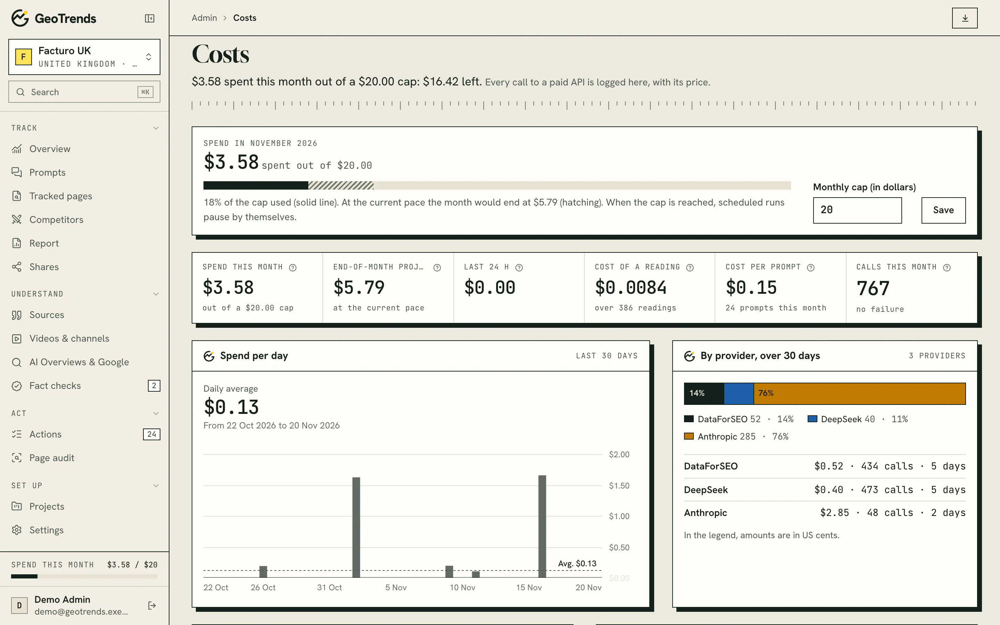

<!-- Page generated from the site documentation (src/site/docs) by scripts/exporter-docs.ts: do not edit it here. -->

# The cost dashboard

> Every paid call is logged in the cost journal. The Costs screen draws from it the month’s spend, its projection, the cap and the split by provider and project.

[← Documentation contents](../README.md) · [Lire cette page en français](../../fr/piloter/couts.md)

Every call to a paid API goes through the cost journal, with its price: a reading, reading an answer, classifying a site, tagging a prompt, checking facts. This screen reads that journal. It tells how much was spent this month, on what, for which project, and where the month will end. It is used to set the cap and to spot unusual spending.

> [!NOTE]
> **Admins only**
>
> The **Admin › Costs** section only appears for an admin account. An admin also sees, at the bottom of the menu, the **Spend this month** line: spend against the cap, with a thin bar; a click opens this screen. A member who opens the address lands on the overview.

*The Costs screen: the monthly cap and its gauge, the key figures, spend per day and the split by provider, by AI, by project and by type of call.*

## The monthly cap

The month starts on the 1st at midnight, Paris time. The first block gives the month’s spend against the cap ($20 by default), a solid gauge for what has been spent and hatching for the projection. The **Monthly cap (in dollars)** field changes it, from $0 to $5,000, with **Save**. The cap covers all projects together.

| Situation | What happens |
| --- | --- |
| Under the cap | Requests go out. Before a run, the project page shows the month’s spend after sending and warns if it would push past the cap. Sending is still possible: the cap is checked before each call. |
| Cap reached | No paid call goes out any more: no run, manual or automatic, no answer reading, no site classification, no tagging, no fact checking. Scheduled runs resume the next month, or as soon as the cap is raised. |
| Projection | The month’s spend extended at the pace of the days elapsed. It shows after one full day. If it exceeds the cap, the block says so. |

## Key figures

| Tile | What it counts |
| --- | --- |
| **Spend this month** | Sum of the paid calls logged since the start of the month, against the cap. |
| **End-of-month projection** | The month’s spend extended at the current pace. |
| **Last 24 h** | Paid calls of the last twenty-four hours. |
| **Cost of a reading** | Average cost of one recorded answer this month, all providers together, over successful readings. |
| **Cost per prompt** | The month’s spend divided by the number of prompts tracked, all projects. |
| **Calls this month** | Every paid call logged, successful or not, with the number of failures. |

## The breakdowns

- **Spend per day**: the last 30 days, days without calls included, with the daily average. Hovering a bar gives that day’s spend.
- **By provider, over 30 days**: DataForSEO (interface readings), Anthropic (Claude), DeepSeek (the small model that reads the answers). In the legend, amounts are in US cents.
- **By provider**, **By AI**, **By project** and **By type of call, this month**: the amount, the number of calls and each one’s share. The types of call are runs, answer analysis, site classification, prompt tags and fact checking.
- **Cost per project**: for each project, its prompts, its calls, its spend this month, its cost per prompt and its end-of-month forecast.

## The call journal

The **Latest calls** block shows the 40 most recent calls; **Failures only** shows only the failed ones. Columns: **Date** (Paris time), **Provider**, **Call**, **Project**, **AI**, **Duration**, **Status** (Success or Failed) and **Price**. The **Export** button in the top bar downloads the whole journal, with each call’s model and error message: see [CSV exports](./exports.md).

| Price | Where it comes from |
| --- | --- |
| No asterisk | The price returned by the provider for that call. This is the case for interface readings (DataForSEO). |
| With an asterisk (*) | The price computed from the rate card, as no amount was returned: input and output tokens, plus web searches for Claude. This is the case for Anthropic and DeepSeek. DeepSeek’s off-peak hours are counted at the full price: the journal never underestimates spending. |

A request refused by the provider is not billed: it is logged as failed, at $0. The average price of each call is detailed in [What a run costs](../get-started/costs.md).

## Keeping the month’s spend in check

1. **Read the projection.** If the cap block says the month would end above it, decide now: raise the cap, or slow the run schedule.

2. **Find what costs.** Look at **By project, this month** and **By type of call, this month**. Claude readings cost far more than an interface reading.

3. **Check the failures.** Open **Failures only**. A series of failures on one provider points to a refused key or a service outage: check the keys in Settings.

4. **Adjust.** Change the cap here, or each project’s automatic runs in **Settings › Run schedule**.

## Limits

> [!WARNING]
> The journal only knows the tool’s own calls: spending done elsewhere with the same keys does not appear, and the provider’s invoice prevails. Rate card prices were captured on a given date; if a provider changes its prices, the rate card has to be updated. The cap is checked before each request: a run started just below the cap can go slightly over it. Amounts are in US dollars, the providers’ billing currency.

**See also**

- [What a run costs](../get-started/costs.md)
- [Settings](./settings.md)
- [Automatic runs](../project/scheduled-runs.md)
- [How do I track a brand without going over budget?](../use-cases/tracking-on-a-budget.md)

---

Updated: 2026-11-18 · [Read this page on the website](https://geotrends.io/en/docs/steer/costs)
