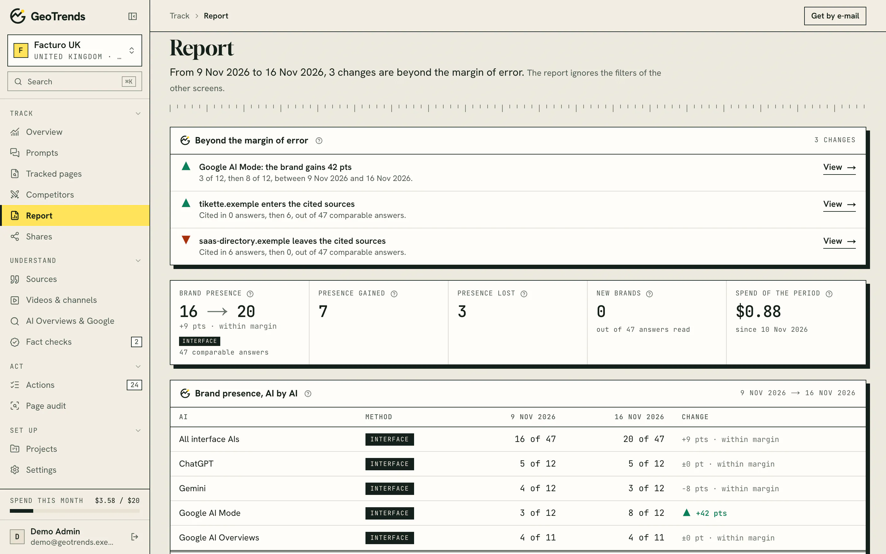

<!-- Page generated from the site documentation (src/site/docs) by scripts/exporter-docs.ts: do not edit it here. -->

# Report and alerts

> The report compares the last two run days: presence gained or lost, new brands, sources, spend. Alerts keep only the changes that exceed the margin of error.

[← Documentation contents](../README.md) · [Lire cette page en français](../../fr/piloter/rapport-et-alertes.md)

The report answers one question: what has changed since the previous run, and does it matter? It compares the project’s last two run days, on the same prompts and the same AIs, and only raises an alert for changes that exceed the margin of error. It is the screen for the weekly review. It costs nothing: everything is read from the database.

The report covers the project currently shown. It ignores the top-bar filters: it takes every AI and the whole history. The first four alerts also appear on the overview, with the **Everything that changed** link.

*The report of the Facturo UK project: changes beyond the margin of error, the figures of the period, then the brand’s presence AI by AI, between the last two run days.*

## What is compared

The report takes the last two days on which the project was recorded from the interface. For each prompt and AI pair that has an answer on both dates, it compares the answer before with the answer after: that is a **comparable answer**. A pair that was not asked again stays out of the comparison. A prompt that was not recorded therefore never looks like lost presence.

- If a prompt has several answers on the same day for one AI, only the last one of the day counts.
- Deep measurements stay out of the comparison: a prompt asked twenty-five times would weigh twenty-five times more.
- Claude, measured through its API, is compared separately, on its own last two run days. It is never added to interface readings.

> [!NOTE]
> **Two run days are needed**
>
> With a single day, the screen says “A single run day so far.” and offers **Prepare a run**. One date is a sample, not a change over time. The report fills in at the second run.

## Beyond the margin of error

The report’s first block: the only changes you can take as real. Each line carries ▲ (rise) or ▼ (drop), a title, the counts before and after, and a **View** link to the prompt, the AI or the source concerned. A brand settling in is always marked ▼: it is bad news for yours.

| Alert | When it appears |
| --- | --- |
| The brand’s visibility goes up or down | Across all comparable interface answers, the change between the two dates exceeds the margin of error. |
| An AI gains or loses the brand | The same rule, AI by AI. |
| Claude (API) gains or loses the brand | The same rule, on Claude’s answers, counted separately. |
| A brand is settling into the answers | A brand mentioned in the latest run, and in no answer of the previous one, with a change beyond the margin. The detail says whether it is already a tracked competitor. |
| A site enters or leaves the cited sources, or is cited more or less often | Counted as comparable answers citing that site, on both dates. |
| Google shows more or fewer AI Overviews | On the prompts recorded on both dates, the number of prompts with an AI Overview changes beyond the margin. |
| Presence goes up or down on a prompt | Calculated on all the prompt’s interface readings, before and since the last run day. In practice this only happens after a deep measurement: without one, a prompt does not have enough answers. |

When nothing exceeds the margin, the block says: “No change is beyond the margin of error between these two runs.” With one answer per prompt and per AI on each date, that is the most common case, and it is on purpose.

## The figures of the period

| Tile | What it counts |
| --- | --- |
| **Brand presence** | Answers where the brand is mentioned or cited, on the earlier date then the later one, over the comparable answers, with the change. Interface method. |
| **Presence gained** | Prompt and AI pairs where the brand came in between the two runs. |
| **Presence lost** | Prompt and AI pairs where the brand dropped out between the two runs. |
| **New brands** | Brands mentioned in the latest run and in no answer of the previous one, over the answers whose brands have been read. |
| **Spend of the period** | The project’s paid calls since the previous run, as logged in the cost journal. |

The **Brand presence, AI by AI** block gives an **All interface AIs** row, one row per AI, then Claude, separately, with its own dates. For each: the method, the count on each date (“3 out of 8”, for example) and the change, coloured only beyond the margin. If Claude was recorded only once, a line says so: nothing to compare.

## Presence gained or lost, prompt by prompt

Two lists side by side: **Presence gained** and **Presence lost**. Each line gives the prompt and the AI; a click opens the answer of the latest run. Twelve lines at most per list. Below, a line flags the prompts where Google shows an AI Overview for the first time, or no longer shows one. An Overview that is not shown is not an absence of the brand.

> [!TIP]
> Presence gained or lost rests on one answer on each date: it is a hint, not a trend. If the prompt matters to you, start a [deep measurement](../measure/deep-measurement.md) from its page before spending time on it.

## New brands, sources gained and lost

**Brands mentioned for the first time** lists the brands mentioned on the later date and in no answer of the earlier one, with their number of answers. The **Track** button makes one a competitor of the project: it is free and starts no run. A brand already tracked shows **Tracked**.

**Sources gained and lost** gives the **New sites** (cited on the later date, not on the earlier one) and the **Lost sites** (the reverse). The number is the count of comparable answers citing the site, before then after; it is coloured when the change exceeds the margin. The **Sources rising and falling, pages included** link opens the same calculation on the Sources screen.

## The three actions and the spend

**The three most useful actions** shows the first three lines of the work list, to do or in progress, each with its evidence. **Spend of the period** breaks down the project’s paid calls since the previous run by type of call, with the total, then recalls this month’s spend, all projects, against the cap.

## The report by e-mail

The **Get this report by e-mail** block (**Get by e-mail** button at the top of the screen) is meant to send the same report every Monday, in a short version, with a link to this screen. **Today, no e-mail is sent**: the key of the sending service (Resend) is missing, and the screen says so. The **See the e-mail as it will be sent** link opens the e-mail, built by the same function as the sending; nothing is sent.

- Once the key is installed, two buttons appear: **Turn on Monday sending** (then **Turn off Monday sending**) and **Send it to me now**, which sends it to your own address only, to see the result.
- Sending is off by default and is set project by project. It goes out on Monday from 8 am, Paris time, to every account of the tool. If a Monday is missed, it goes out at the next pass.
- Sending is free and is not logged in the cost journal. The e-mail is written in French.

## The Monday review

1. **Check the dates compared.** The headline says “From … to …” and how many changes exceed the margin. If the screen says there is only one run day, start a second one from the project page.

2. **Read the changes beyond the margin.** It is the only part of the report to take as real. Open each line with **View**.

3. **Go through the presence lost.** Open the answer: who is mentioned instead of Facturo, which page is cited? If the prompt matters, start a deep measurement.

4. **Track the new brands that matter.** A brand that comes back from one run to the next is worth tracking: it then enters share of voice and the head-to-head.

5. **Pick an action.** Take one of the three actions offered, or open the whole work list on the Actions screen.

## Limits

> [!WARNING]
> The report compares two dates: it is not a long trend, which is read on the overview chart. With one answer per prompt and per AI on each date, few changes exceed the margin of error. An alert says a change is real, not where it comes from: a model change, a competitor or your own fix can explain it. Finally, the Monday e-mail is not sent until the sending service key is installed.

**See also**

- [Overview](../measure/overview.md)
- [Deep measurement](../measure/deep-measurement.md)
- [Measurement method](../reference/method.md)
- [How do I prepare the Monday team meeting?](../use-cases/monday-team-meeting.md)

---

Updated: 2026-11-18 · [Read this page on the website](https://geotrends.io/en/docs/steer/report-and-alerts)
