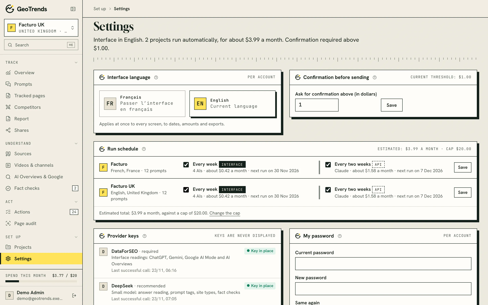
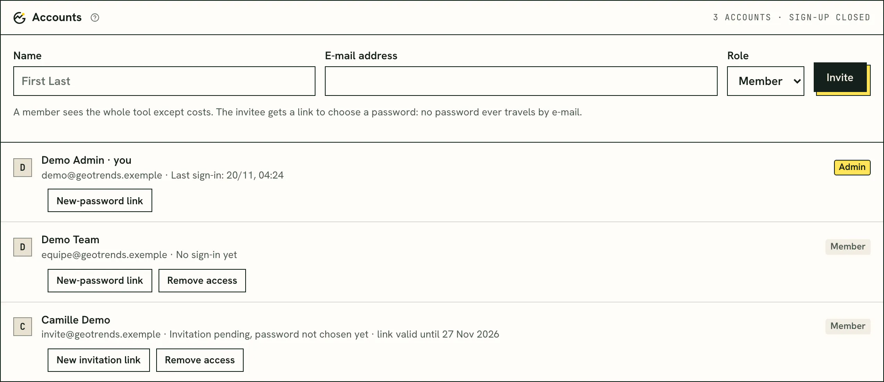

<!-- Page generated from the site documentation (src/site/docs) by scripts/exporter-docs.ts: do not edit it here. -->

# Settings

> Tool-wide settings: interface language, confirmation threshold, each project’s run schedule, the state of provider connections, your password and the team’s accounts.

[← Documentation contents](../README.md) · [Lire cette page en français](../../fr/piloter/reglages.md)

The Settings screen gathers what applies to the whole tool. It supports three decisions: which language to work in, from what amount a request asks for confirmation, and how often each project is recorded on its own. It also tells whether each provider is properly connected. Settings specific to a screen are on that screen.

The headline sums up the state: the interface language, the number of projects recorded automatically and their estimated monthly cost, and the confirmation threshold.

*The Settings screen: interface language, confirmation before sending, each project’s run schedule, then the provider connections.*

## Interface language

Two choices, **Français** or **English**. The choice belongs to your account and is remembered across sessions and devices. It applies at once to every screen, to dates, amounts (`$0.05` or `0,05 $`) and exports. It does not change the language of a project’s prompts, and AI answers are never translated.

## Confirmation before sending

The price of a run is always written on its button. Above the threshold, a dialog also asks you to confirm: “Send for …?”, with **Cancel** and **Confirm sending**. The threshold is $1 by default; the **Ask for confirmation above (in dollars)** field changes it, from $0 to $1,000. It applies to every account and to every paid request started by hand: a project run, a run for a selection of prompts, a deep measurement.

## Run schedule

One row per project, with two boxes, then **Save**. They are the same boxes as in the Runs tab of the project page: changing them here or there amounts to the same. Nothing is on by default.

| Box | What it does | Estimated monthly cost |
| --- | --- | --- |
| **Every week** (interface) | Asks all the project’s prompts every week to ChatGPT, Gemini, Google AI Mode and AI Overviews. | Prompts × 4 AIs × (price of an interface reading + reading the answer) × 4.33 weeks. |
| **Every two weeks** (API) | Asks the prompts to Claude, through its API, every other week. | Prompts × (average price of a prompt to Claude + reading) × 2.17 passes. |

When a box is ticked, the row says when the next run goes out: “within half an hour”, or on a date. Under the list, the estimated total for all projects is compared with the monthly cap; an admin gets the **Change the cap** link. Automatic runs pause on their own once the cap is reached. Details are in [Automatic runs](../project/scheduled-runs.md).

## Provider keys

| Provider | What it is for |
| --- | --- |
| DataForSEO | Interface readings: ChatGPT, Gemini, Google AI Mode and AI Overviews. Paid. The only key you cannot do without. |
| DeepSeek | The small model: reading answers, prompt tags, site types, fact checks. Paid, recommended. |
| Anthropic | Claude readings through its API, and the small model when there is no DeepSeek key. Paid. |
| YouTube | Details of cited videos and channel recognition. Free. |
| Resend | Sending the Monday report by e-mail. Free, turned on from the Report screen. |

Each row says **Key in place** or **Key missing**; the keys themselves are never displayed. They go in the installation’s `.env` file, not on this screen: a row with no key reminds you of the name to put there, and the tool must be restarted after a change. For a paid provider, the row also gives the date of the last successful call: that is what proves the key works. Free calls are not logged in the cost journal. Where to get each key: [Install GeoTrends](../get-started/install.md#keys).

## Accounts

## My password

Every account can change its password: **Current password**, **New password** (at least eight characters), **Same again**, then **Change password**. Your other open sessions (another browser, a phone) are signed out. If you forget it, ask the administrator for a new link.

*The Accounts block, for an admin: invite a person, then one line per account with its state, its role and its buttons.*

For an admin, the last block manages the tool’s accounts. At the top, **Invite**: name, e-mail address and role (**Member** or **Admin**). The account is created and a personal link appears, with **Write the e-mail** (your mail app opens with the message ready), **Copy the link** and **Copy the e-mail text**. The link works for seven days, only once, and is not shown again.

| State shown | What it means |
| --- | --- |
| “Invitation pending, password not chosen yet” | The link was created, the person has not opened it yet. The date says until when it works. |
| “Password not chosen yet, link expired” | Seven days have passed: **New invitation link** makes another one. |
| “New-password link pending” | A link was made again for someone who already had a password (forgotten). |
| “Last sign-in: …” | The person got in; the date is their last sign-in. |

On each line, **New-password link** (or **New invitation link**) makes a new link and voids the previous one; **Remove access**, confirmed with **Yes, remove**, deletes the account and signs out its sessions. See [Accounts and sign-in](./accounts.md).

## Where the other settings are

| Setting | Where it is |
| --- | --- |
| Monthly spending cap | Admin › Costs (admins). |
| Project name, country and language, archiving | Project page, **Project settings** tab. |
| Automatic classification of new sites | Sources screen. |
| Automatic tagging of added prompts | Prompts screen. |
| Fact checks | Fact checks screen. |
| Monday report sending | Report screen. |

## Putting a project on automatic runs

1. **Check the connections.** DataForSEO must have its key in place, and Anthropic too if Claude is to be recorded.

2. **Tick the schedule.** On the project’s row, tick **Every week**, and **Every two weeks** for Claude if needed, then **Save**. The first run goes out within half an hour.

3. **Compare with the cap.** Read the estimated total under the list. If it exceeds the monthly cap, the month’s last runs will not go out.

4. **Set the confirmation threshold.** It only concerns requests started by hand; automatic runs go out without a confirmation dialog.

## Limits

> [!WARNING]
> Monthly costs are estimates: Claude’s price is the average of its last thirty readings, and answer reading is counted at its average price. A key “in place” is not necessarily valid: only the date of the last successful call shows it. Keys are changed on the server, not from this screen.

**See also**

- [Automatic runs](../project/scheduled-runs.md)
- [The cost dashboard](./costs.md)
- [Accounts and sign-in](./accounts.md)
- [Countries and languages](../reference/countries-and-languages.md)

---

Updated: 2026-11-25 · [Read this page on the website](https://geotrends.io/en/docs/steer/settings)
