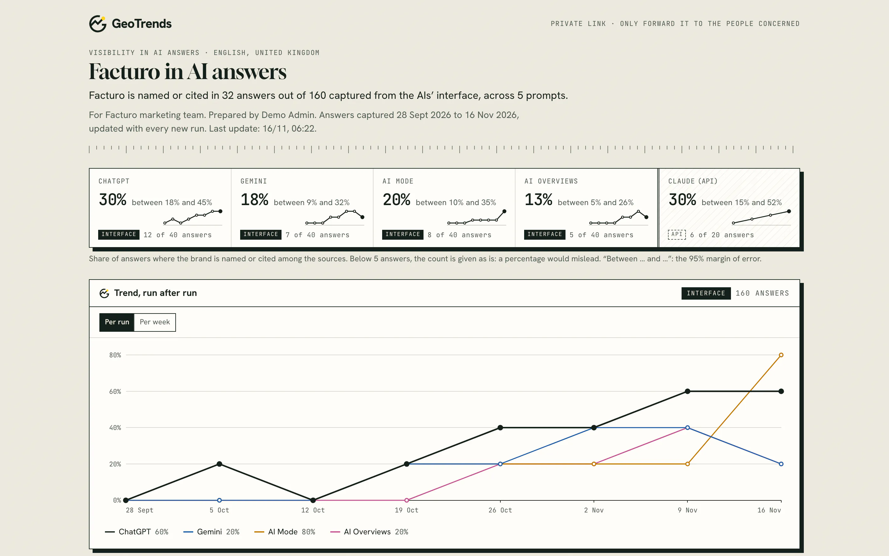
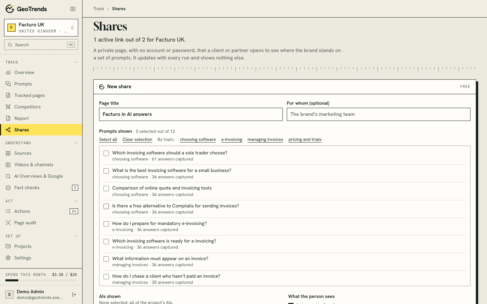

<!-- Page generated from the site documentation (src/site/docs) by scripts/exporter-docs.ts: do not edit it here. -->

# Share with a client

> A private link, with no account, that a client or partner opens to see where their brand stands on a set of prompts. Updated with every run, turned off in one click.

[← Documentation contents](../README.md) · [Lire cette page en français](../../fr/piloter/partager-avec-un-client.md)

A client wants to know whether AIs cite their brand, without getting into the tool. The **Shares** screen (**Track** menu) creates a private page for them on a set of prompts of the current project. They open it with a plain link, no account and no password. The page updates itself with every new run and shows nothing but those prompts. It costs nothing: it reads runs already made.

*The page the client sees: the brand AI by AI, the trend, then prompt-by-prompt detail, with the brand’s pages highlighted.*

## Creating a link

1. **Choose the prompts.** On **Prompts**, select the set to show then **Share**; or open **Shares › New share** and tick them in the list (**Select all**, or a topic in one click).

2. **Set up the page.** The **title**, **for whom** (optional), the **AIs shown** (none ticked: all of the project’s), the **page language**, and what the person sees: an **excerpt of each answer**, the **brands named** instead of the brand. An **end date** is possible.

3. **Send the link.** **Create the share link**, then **Copy the link** and send it with the mail app of your choice. **Open the page** shows it as the client will see it.

*The Shares screen: the form for a new share, then the list of links with their state, their openings and their buttons.*

## What the client sees

- **The brand, AI by AI**: the share of answers where it is named or cited, with the number of answers, the margin of error and a small trend line. Below five answers, the count is given as is (“2 of 3”): a percentage would mislead.
- **The trend**, run after run, as soon as there are two run days. Claude, measured through its API, has its own curve: it is never added to the AIs captured from their interface.
- **Prompt by prompt**: for each AI, the state of its latest answer (cited, named, read, absent), the tally of all its answers to the prompt, the pages it cites (the brand’s highlighted), and depending on your choices the brands named and an excerpt of the answer.
- **The method**, at the bottom, in plain words: interface or API, from which country, why an answer is a sample.

> [!NOTE]
> **What is never there**
>
> The project’s other prompts, the other projects, the costs, prompts archived since, the tool’s menu. The page is not offered to search engines, and every link is impossible to guess.

## Following and managing links

| On a link’s line | What it does |
| --- | --- |
| “opened 3 times, last on …” | Openings by someone not signed in to the tool. Yours do not count. |
| **Edit** | Changes the prompts, the AIs, the language or the options. The address stays the same: the client sees the changes next time they open it. |
| **Turn the link off** | The page no longer opens, at once. **Turn the link back on** restores it at the same address. |
| **Change the address** | Makes a new address and voids the old one, for instance if the link travelled too far. The opening counter starts again from zero. |
| **Delete** | Removes the share and its settings, after confirmation. |

A link turned off, expired or replaced shows “This link is no longer active” and suggests asking for a new one. Shares belong to the project: every account of the tool sees them and can manage them.

## Limits

> [!WARNING]
> The page shows answers as they were captured: it promises no citation and adds no commentary. There is no per-link password: anyone with the address can open the page while it is active. Turn it off when the client no longer needs it.

**See also**

- [The Prompts screen](../measure/prompts.md)
- [Measurement method](../reference/method.md)
- [Report and alerts](./report-and-alerts.md)

---

Updated: 2026-11-19 · [Read this page on the website](https://geotrends.io/en/docs/steer/share-with-a-client)
