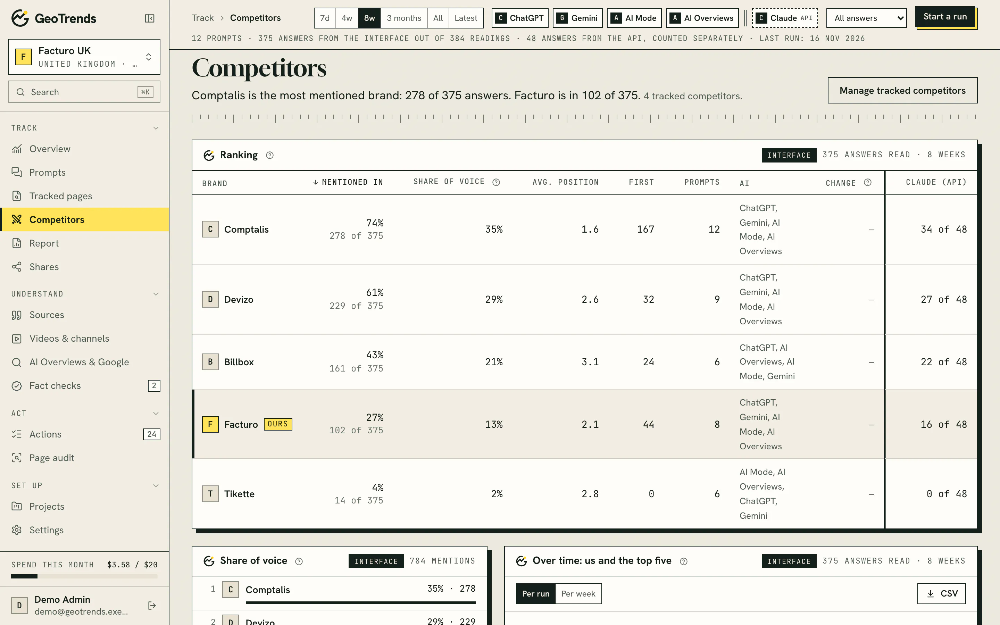

<!-- Page generated from the site documentation (src/site/docs) by scripts/exporter-docs.ts: do not edit it here. -->

# Competitors and share of voice

> Which brands the AIs mention on your prompts, at what position and in what share of the answers: ranking, share of voice, head-to-head, prompt by prompt.

[← Documentation contents](../README.md) · [Lire cette page en français](../../fr/comprendre/concurrents.md)

The Competitors screen answers one question: when a customer asks your prompts, which brands do the AIs recommend, and where does yours stand? It helps you choose whom to work against, and on which prompts.

You also get there from the overview, through **Full ranking** or **All competitors**. At the top right, **Manage tracked competitors** opens the Competitors tab of the project page, where each competitor’s site is also declared.

*The Competitors screen of the Facturo UK project: the ranking of Facturo against Comptalis, Devizo, Tikette and Billbox, then share of voice and its trend.*

## What everything is counted on

Every number on the screen is counted on the **answers read**: the interface answers whose mentioned brands are known, in order. ChatGPT returns its brands itself; for the other AIs, they are extracted from the text by the automatic reading. While some answers are not read, a banner offers **Read the answers**, with its price. Claude, measured through its API, has its own column and is never part of a total.

A mention that contains a tracked competitor’s name counts for it: “Comptalis Invoicing” counts for Comptalis. The comparison ignores case, accents and punctuation, and the competitor’s name must be at least three letters long.

## The ranking

The **Ranking** block orders your brand and the tracked competitors, from most to least mentioned. With no tracked competitor, the screen first offers **Track your first competitors**, with the list of spotted brands.

| Column | Definition |
| --- | --- |
| **Brand** | A click opens the answers that mention it. |
| **Mentioned in** | Share of the answers read that mention the brand, with the count (“9 out of 30”, for example). |
| **Share of voice** | Mentions of the brand relative to those of your brand and the tracked competitors. |
| **Avg. position** | Average place of the brand in the list of brands mentioned, when it is mentioned. |
| **First** | Number of answers where it is the first brand mentioned. |
| **Prompts** | Number of prompts where it is mentioned at least once. |
| **AI** | The interface AIs that mention it. |
| **Change** | Change from the previous period, coloured only beyond the margin of error. |
| **Claude (API)** | Claude answers that mention it, out of the Claude answers read. Counted separately. |

## Share of voice and trend

The **Share of voice** block relates your mentions to those of the tracked competitors: it only exists with at least one tracked competitor, and it changes as soon as you add one. Next to it, **Over time: us and the top five** draws, run after run, the share of the answers read that mention each brand: yours and up to five others (tracked competitors first, otherwise the most mentioned brands). The **CSV** button exports the chart’s data.

**Position at which each brand is mentioned** counts, for your brand and those five others, the answers where it is named 1st, 2nd, 3rd, or 4th and beyond. The last column, **Never mentioned**, gives the answers read where it does not appear. The darker the cell, the higher the number.

## Prompt by prompt, AI by AI

One row per prompt, one column per AI, with each AI’s latest reading. The **View** choice changes what each cell says:

| View | What the cell shows |
| --- | --- |
| **Our position** | Your brand’s position (1st, 2nd…), “present” if it is mentioned without a known position, “absent” otherwise. A click opens the answer. |
| **Named first** | The brand mentioned first in the answer. |
| **Versus a competitor** | The **Versus** choice picks the competitor. The cell says “We lead”, “Comptalis leads” (with both positions), “Only us”, “Only Comptalis” or “Neither”. |

A dot means there is no answer to read: prompt not run yet, or no AI Overview. “not read”: the brands of this answer are not known yet. The **Coverage** column counts the interface AIs where your brand appears, out of those that answered.

## Head-to-head

The **Head-to-head** block puts metrics in rows and brands in columns: your brand and up to four competitors. The best cell of each row carries a green rule.

- **Mentioned in (share of answers read)**, **Named first**, **Avg. position when mentioned** (the smallest wins).
- **Prompts where it appears** and **Interface AIs mentioning it**, out of the total number of prompts and AIs.
- **Positive mentions**, once the tone has been read: answers that recommend the brand, out of those whose tone is known.
- A last row, set apart: **Claude (API): answers mentioning it**.

## Spotted brands

The **Brands spotted, not tracked yet** block lists the other brands the AIs mention on your prompts, with their **Answers**, **First**, **Avg. position**, **Prompts** and **Claude (API)**. Clicking a row opens its sheet: the description picked up in the answers, the prompts where it is mentioned, and **See the answers mentioning it**.

- **Track** makes it a competitor of the project: it enters the ranking, share of voice and head-to-head. It is free and starts no run.
- **Dismiss** removes it from this list without changing any figure: useful for a generic name or a tool that is not a competitor.
- **See dismissed brands** shows the ones you dismissed; **Restore** brings them back.

## Knowing whom to work against

1. **Read the headline sentence.** It says which brand is mentioned most, out of how many answers read, and where yours stands.

2. **Track three to five competitors.** In **Brands spotted, not tracked yet**, click **Track** on the ones that come back most often and are real competitors. The ranking and share of voice fill in at once, with no new run.

3. **Compare share of voice and its change.** A coloured change is real; a grey one stays within the margin of error.

4. **Find the prompts where a competitor leads.** In the grid, choose **Versus a competitor**, then the competitor. The “Comptalis leads” or “Only Comptalis” cells are the prompts to win back.

5. **Understand what it is mentioned for.** Open the answer from the grid, then the Sources screen: the pages cited next to the competitor tell you where you need to appear.

## Limits

> [!WARNING]
> Brands, their position and the tone are read from the text by a small model, except for ChatGPT: on an ambiguous answer it can be wrong, and every cell links back to the original text. Share of voice only counts tracked competitors: it changes when the list changes. With one answer per prompt and per AI on each date, changes often stay within the margin of error. To look only at the answers that mention a competitor, use the **Versus** filter in the top bar.

**See also**

- [Choose your competitors](../project/competitors.md)
- [Cited sources](./sources.md)
- [Who is cited instead of me?](../use-cases/who-is-cited-instead-of-me.md)
- [Which competitor is moving in on my topics?](../use-cases/competitor-moving-in.md)

---

Updated: 2026-11-18 · [Read this page on the website](https://geotrends.io/en/docs/understand/competitors)
