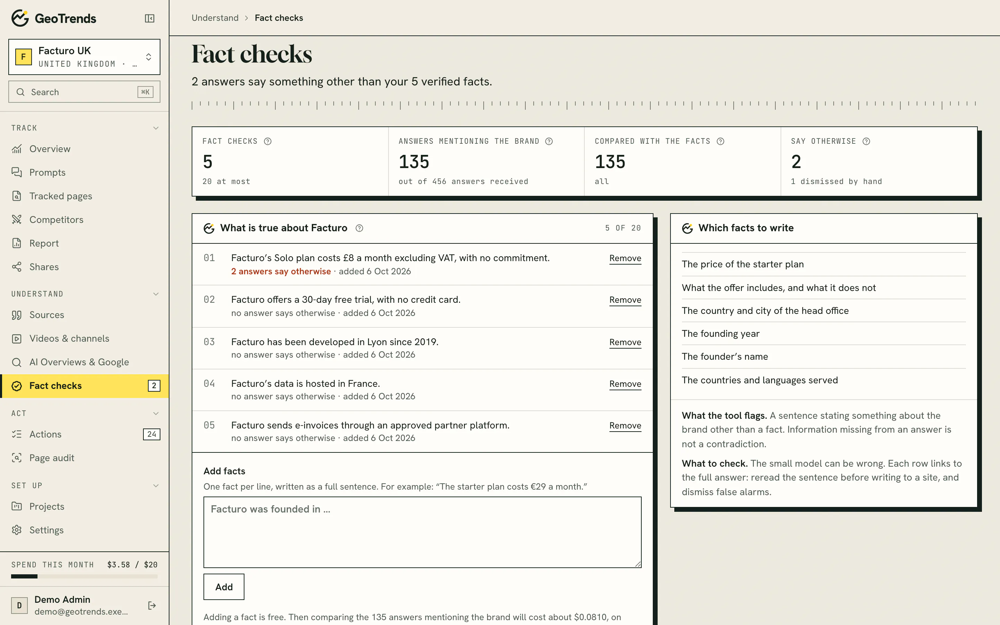
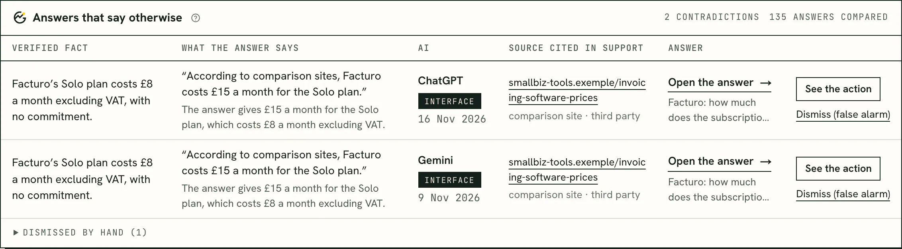

<!-- Page generated from the site documentation (src/site/docs) by scripts/exporter-docs.ts: do not edit it here. -->

# Fact checks

> You write what is true about the brand: price, offer, country, dates. The tool flags the AI answers that say otherwise, with the sentence and the source at fault.

[← Documentation contents](../README.md) · [Lire cette page en français](../../fr/comprendre/faits-verifies.md)

An AI can mention the brand and get it wrong: an old price, an offer that no longer exists, the wrong country. The Fact checks screen compares the answers with what you hold to be true, and tells you which ones say otherwise. It helps you decide which of your pages to fix, or which site to warn.

In the menu, a number next to **Fact checks** counts the answers that contradict a fact, excluding dismissed false alarms. Each contradiction is also a line of the work list, “Correct a wrong fact”.

*The Fact checks screen of the Facturo UK project: the facts entered, then the answers that say otherwise, with the sentence at fault and the source cited in support.*

## Key figures

| Tile | What it counts |
| --- | --- |
| **Fact checks** | What you wrote as true about the brand. 20 at most per project. |
| **Answers mentioning the brand** | The answers received where the brand is mentioned, out of all answers received. Only those can contradict it. |
| **Compared with the facts** | Answers already reread by the small model to look for a contradiction, or the number left to compare. |
| **Say otherwise** | Answers where a sentence states something about the brand other than a verified fact, with the number of false alarms dismissed by hand. |

> [!NOTE]
> **Interface and API counted together, here only**
>
> Everywhere else the two methods stay separate. Here no share is measured: sentences are reread. A mistake written by Claude, queried through its API, is therefore flagged too, and each row carries its method stamp. Answers to archived prompts are reread as well, whatever the period chosen.

## Writing the facts

The **What is true about Facturo** block lists the facts entered. To add some, fill in **Add facts**: one fact per line, written as a full sentence, for example “The starter plan costs £25 a month.” A line shorter than eight characters, or already entered, is ignored. Adding a fact is free. **Remove** deletes a fact, and the contradictions found against it go with it.

One sentence per fact, precise and checkable: five to twenty facts are enough. The **Which facts to write** block suggests six topics:

- The price of the starter plan
- What the offer includes, and what it does not
- The country and city of the head office
- The founding year
- The founder’s name
- The countries and languages served

## Comparing the answers with the facts

When answers mentioning the brand have not been compared yet, a banner offers **Check the answers**, with its price (about $0.0006 per answer). The small model rereads each one and picks out the sentences that contradict a fact. It is a paid call, logged in the cost journal, sent only on your click.

- Answers that do not mention the brand are not reread: they cannot contradict it.
- After a fact is added, the answers already compared are compared again, to take the new fact into account: the banner comes back.
- Upcoming answers are compared with the facts during their automatic reading, with no extra call.

## Answers that say otherwise

| Column | What it shows |
| --- | --- |
| **Verified fact** | The fact contradicted. |
| **What the answer says** | The answer’s sentence, copied word for word, and a short explanation: what the answer says, and what is true. |
| **AI** | The AI, its method stamp (interface or API) and the reading’s date. |
| **Source cited in support** | The page the sentence relies on, with its type and owner, or “no source cited in support”. |
| **Answer** | **Open the answer** shows the full text, on the right date and the right AI. |

At the end of each row, **See the action** opens the work-list line, and **Dismiss (false alarm)** removes the contradiction: it leaves the work list and does not come back at the next reading. Dismissed rows stay visible, folded, under **Dismissed by hand**; **Put back in the list** brings them back.

*The answers that contradict a fact check: the sentence found, the AI, the source cited in support and the link to the answer.*

## Getting wrong information corrected

1. **Write five to ten facts.** Start with what changes often and is costly when wrong: the price, the offer, the countries served.

2. **Check the answers.** Click **Check the answers**: the price is written on the button. The answers come back compared within moments.

3. **Reread each sentence.** **Open the answer** shows the sentence in context. If the small model got it wrong, **Dismiss (false alarm)**.

4. **Go back to the source.** If a source is cited in support, that is what needs correcting: your page if it is yours, otherwise the site that publishes it.

5. **Log the outreach.** **See the action** opens the line’s sheet: log the correction request you sent, then mark the line “Done” once the page is corrected.

## Limits

> [!WARNING]
> The small model can be wrong both ways: flag a correct sentence, or miss a mistake. Every row links to the full answer: reread before writing to a site. Information missing from an answer is not a contradiction, and neither is a sentence that says the same thing in other words. Getting the source corrected does not guarantee the AI will change its answer: the next measurement will tell.

**See also**

- [The work list](../act/work-list.md)
- [Following up an action and its outreach](../act/outreach.md)
- [An AI keeps saying something wrong about my brand: what can I do?](../use-cases/wrong-information.md)

---

Updated: 2026-11-18 · [Read this page on the website](https://geotrends.io/en/docs/understand/fact-checks)
