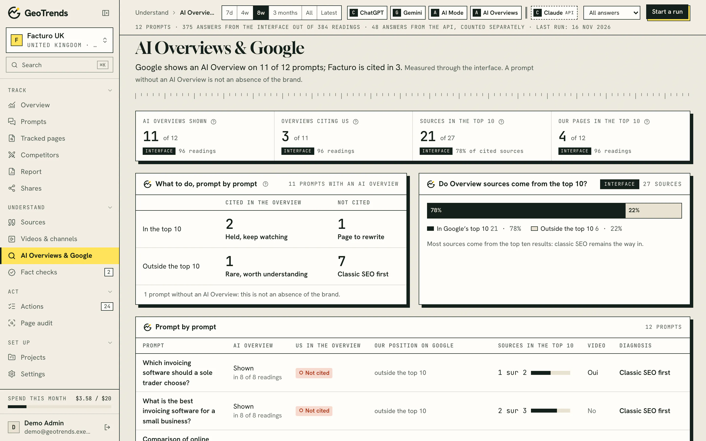

<!-- Page generated from the site documentation (src/site/docs) by scripts/exporter-docs.ts: do not edit it here. -->

# AI Overviews and Google results

> Google AI Overviews against the top ten results of the same search: one instruction per prompt, the share of ranked sources, and ideas for new prompts.

[← Documentation contents](../README.md) · [Lire cette page en français](../../fr/comprendre/google.md)

When Google shows an AI Overview, it places it above its classic results. An AI Overview reading keeps both: the overview’s text with its sources, and the top ten results of the same search. The screen compares them to answer one question: if the brand is missing from the overview, is it a classic SEO problem, or a page problem?

You also get there through the **AI Overviews** tile on the overview. The prompt ideas block, at the bottom, is opened by **See prompt ideas** on the Prompts screen and by **All ideas, and the AI searches** on the project page.

*The AI Overviews & Google screen of the Facturo UK project: the key figures, the “What to do, prompt by prompt” table and the share of sources coming from the top ten results.*

> [!NOTE]
> **A prompt without an overview is not an absence**
>
> Google does not show an AI Overview on every search. A prompt with none comes back “No overview”: it is never counted as an absence of the brand, and the table files it separately.

## Key figures

| Tile | What it counts |
| --- | --- |
| **AI Overviews shown** | Number of prompts for which Google shows an AI Overview, out of the prompts recorded. |
| **Overviews citing us** | Number of prompts whose AI Overview cites a page or a video of the brand, out of those with an overview. |
| **Sources in the top 10** | Among the sources cited by AI Overviews, those that are also in Google’s top ten results, with their share. |
| **Our pages in the top 10** | Number of prompts for which a page of the brand is in Google’s top ten results. |

Everything is measured through the interface, on the AI Overview readings of the period; each tile says how many readings it rests on.

## What to do, prompt by prompt

Two questions are enough: is the brand in Google’s top ten results, and does the Overview cite it? Crossing them gives four cells, each with its number of prompts and its instruction. Clicking a cell filters the table below. Under the table, a line counts the prompts with no AI Overview.

|  | Cited in the Overview | Not cited |
| --- | --- | --- |
| **In the top 10** | **Held, keep watching** | **Page to rewrite**: the page is found, it lacks a clear answer. |
| **Outside the top 10** | **Rare, worth understanding**: cited without ranking well. | **Classic SEO first** |

The **Do Overview sources come from the top 10?** block splits all overview sources in two: in Google’s top ten, or outside it. If most come from the top ten, the screen concludes that classic SEO remains the way in; otherwise, that ranking well is not enough.

## The table, prompt by prompt

| Column | What it shows |
| --- | --- |
| **AI Overview** | “Shown” in so many readings out of so many, “No overview”, or “not captured”. |
| **Us in the Overview** | “Cited” (with the count when there are several readings) or “Not cited”. |
| **Our position on Google** | The rank of the brand’s page in the classic results, with its address, or “outside the top 10”. |
| **Sources in the top 10** | How many of the overview’s sources are also in the top ten results. |
| **Video** | Does the overview cite a video? |
| **Diagnosis** | The instruction for this prompt, drawn from the latest overview reading (see below). |

| Diagnosis | When |
| --- | --- |
| **Held, keep watching** | In the top 10 and cited by the Overview. |
| **Page to rewrite** | In the top 10 but not cited: the page is found, it lacks a clear answer. |
| **Rare, worth understanding** | Cited by the Overview without being in the top 10. |
| **Classic SEO first** | Neither in the top 10 nor cited. |
| **No Overview: not worth working on for Google** | Google shows no AI Overview on this prompt. |
| **Not captured yet** | AI Overviews have not been captured for this prompt. |

## Prompt ideas to track

The last block suggests prompts you do not track yet, drawn from the runs. Two lists, to choose from:

- **People also ask**: the questions Google shows under your prompts. These are real questions from users. The **Under the prompt** column says under which of yours it appeared.
- **AI searches**: what the AI itself types into a search engine before answering. It is known for ChatGPT and Claude. These are topics worth writing for.

The **Seen** column counts how many times the idea came back. **Add to the project** makes it a tracked prompt: it is free, and every later run will cost a little more (the price per prompt is in the help bubble). Prompts already tracked or archived are not suggested again.

## Reading the screen in four steps

1. **Record the AI Overviews.** When you start a run, keep the **Google AI Overviews** row ticked. The overview reading also brings back the top ten results.

2. **Start with “Page to rewrite”.** These are the prompts where your page already ranks well without being reused. Each one becomes a line of the work list, with the page’s rank; the page audit tells you whether something blocks it from being read.

3. **Handle “Classic SEO first”.** As long as the page does not rank better, the overview has little chance of reusing it. The work list offers a “Work on SEO” line for each one.

4. **Track the right prompts.** Browse **People also ask** and add to the project the ones your customers really ask.

## Limits

> [!WARNING]
> A prompt’s diagnosis comes from its latest overview reading: one results page, on one date. Google does not always show an overview for the same search from one day to the next. The top ten results are those of that page, from the project’s country and in its language. Ranking well or writing well does not guarantee a citation: the screen shows where the obstacle is, not how to get cited.

**See also**

- [The work list](../act/work-list.md)
- [Page audit](../act/page-audit.md)
- [Write the prompts to track](../project/prompts.md)
- [Am I tracking the right prompts?](../use-cases/tracking-the-right-prompts.md)

---

Updated: 2026-11-18 · [Read this page on the website](https://geotrends.io/en/docs/understand/google)
