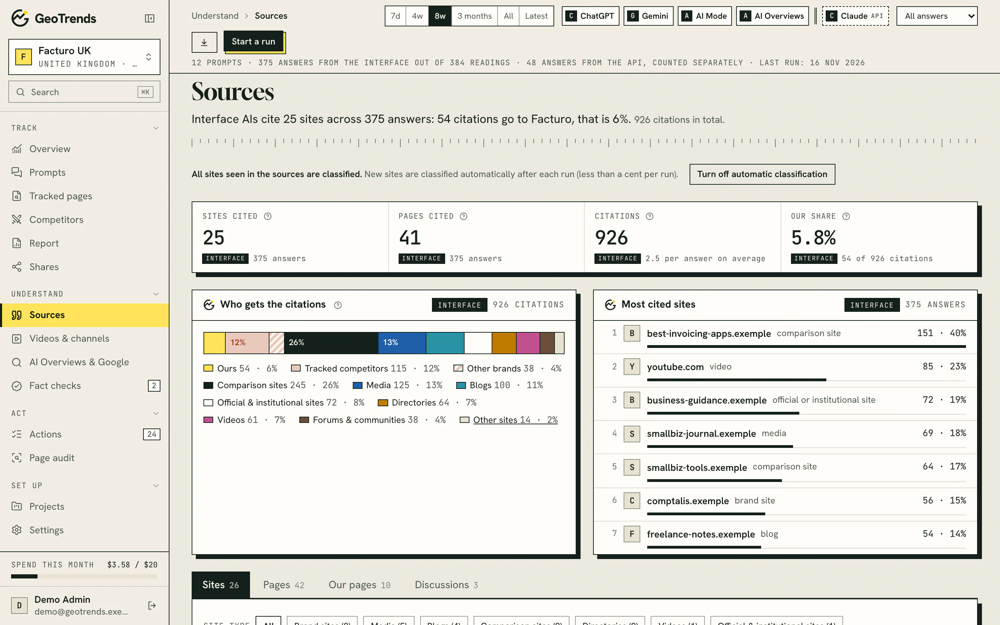

<!-- Page generated from the site documentation (src/site/docs) by scripts/exporter-docs.ts: do not edit it here. -->

# Cited sources

> The sites and pages the AIs cite to answer your prompts: their type, who owns them, your own pages, and which of them moved up or down at the latest run.

[← Documentation contents](../README.md) · [Lire cette page en français](../../fr/comprendre/sources.md)

An AI that answers relies on pages, which it displays as sources. The Sources screen gathers those pages, prompt by prompt and AI by AI, to answer one question: which sites write the answer, and where should the brand appear? Everything comes from the runs already stored.

You also get there from the overview: **All sources**, a click on a part of **Who gets the citations** (the screen opens filtered), or the **Owned sources** tile (the Our pages tab). Quick search finds a site and opens its sheet directly.

*The Sources screen of the Facturo UK project: the key figures, the split of citations by beneficiary and site type, then the table of cited sites.*

## Key figures

| Tile | What it counts |
| --- | --- |
| **Sites cited** | Number of different sites cited as sources by the interface AIs, over so many answers. |
| **Pages cited** | Number of different pages cited as sources. |
| **Citations** | Total number of cited sources, across all interface answers, with the average per answer. |
| **Our share** | Share of citations that go to a page of the site, a post from a declared profile or a video of the brand. A click opens those pages. |

All these numbers are measured through the interface. The sources cited by Claude, queried through its API, are counted separately: the method line at the foot of the tables says so.

## Each site’s type, and who owns it

Every cited site carries a type. It is decided in this order: a correction made by hand; the classification stored in the database, done once by a small model from the site’s name and the titles of its pages; well-known platforms (YouTube or Vimeo for video, LinkedIn or Instagram for social networks, Reddit, Quora or Trustpilot for forums, government domains for official sites); a site whose name is that of a brand mentioned in the answers, filed as “brand site”. Everything else shows as **unclassified**: nothing is guessed.

| Type | Examples |
| --- | --- |
| **comparison site** | A ranking or comparison of software, such as comparatif-logiciels.exemple. |
| **media** | A newspaper, a magazine, a news site. |
| **directory** | A list of providers, a software marketplace. |
| **blog** | An expert’s or a freelancer’s blog. |
| **forum or community** | A discussion thread, a review platform. |
| **video** | A video, which counts for the channel that published it. |
| **social network** | A LinkedIn, Instagram or X post… |
| **official or institutional site** | A government body, a public organisation. |
| **shop** | An online store. |
| **brand site** | A brand’s site: yours, a competitor’s or another one. |
| **other** | Whatever fits nowhere else. |

Each citation also benefits someone: **Ours** (a page of the site, of a declared profile, or a video from one of your channels), **Tracked competitor** (its declared site, or a domain bearing its name), **Other brand**, or **Third party**. A site’s type is stored once for every project; who owns it is decided project by project.

> [!NOTE]
> **Classifying the sites**
>
> While some sites are not classified, a banner offers **Classify the sites**, with its price (about $0.00005 per site). It is a paid call, logged in the cost journal, sent only on your click. After that first click, new sites are classified automatically after each run; **Turn off automatic classification** stops it, in the same place.

## Who gets the citations

The split bar divides all citations: to you, to the tracked competitors, to other brands, then to third parties, grouped by site type. Clicking a part filters the tables below; **Show all** removes the filter. Next to it, **Most cited sites** ranks the seven sites that come back most, with their share of answers.

## The four tables

### Sites

One site per row, with a **Site type** filter and a search box. The columns: **Site**, **Type**, **Owner**, **Answers** (interface answers that cite the site, and their share), **AIs citing it**, **Prompts**, **Pages** and **Change**: the comparable answers citing the site at the last run versus the previous one (“new”, “lost”, +2…), coloured only beyond the margin of error.

### Pages

One page per row: **Page**, **Type**, **Owner**, **Answers**, **Without us** (answers that cite the page without mentioning or citing the brand: where you need to get in), **AI**, **Prompts** and **Published** (for a video). The **Only pages cited without us** button keeps only other people’s pages where the brand is missing.

### Our pages

The brand’s pages and videos: **Cited** (number of answers citing it), **Read, not cited** (the AI opened it without keeping it), **On Google** (its rank in the top ten results, on which prompt), **Pages cited instead** (what the AI cited in the same answer) and the **Audit** button, which opens the page audit. **Track** opens [Tracked pages](../measure/tracked-pages.md) with its address: the tool suggests the prompts it answers. For a video, the address may carry the moment cited.

### Discussions

The forum threads and social network posts that are cited: **Thread or post**, **Platform**, **Answers**, **AI**, **Prompts**. These are places where you can reply.

## A site’s or a page’s sheet

Clicking a row opens its sheet, on the side:

- **Answers citing it**: each answer, with its AI and date, opens the full text.
- **Brands mentioned in these answers**: these are the brands of the answers, not of the page, whose content is not read.
- **Citations per run day**, and for a site, the link to **its cited pages**.
- **Type of** this site: a type choice and, for a brand site, the **Owning brand**. **Correct the type** takes precedence over the small model, for every project.
- For a page that is not yours: **Add to the work list**, free. The page stays there, even if it is cited only once. If it is already there, the sheet says so.

## Sources going up and down

This block compares the last run day with the previous one, on the prompt and AI pairs that have an answer on both dates only: otherwise a source would look lost because a prompt was not asked again. The **Compare** choice switches from sites to pages. Four lists: **New**, **Rising**, **Falling**, **Lost**. Each number is a number of answers citing the source; it is coloured only when the change exceeds the margin of error. With a single run day, the block says so and waits for the second.

## Finding where to appear

1. **Classify the sites once.** Click **Classify the sites** if the banner is there. The price is written on the button.

2. **Read the third parties’ share.** In **Who gets the citations**, click the part of comparison sites, media or directories: those are the places where you can ask for a spot.

3. **Keep only the pages without you.** Open the **Pages** tab, then **Only pages cited without us**. Sort on **Without us**.

4. **Open the sheet and add it to the work.** Check the answers citing it, correct the type if it is wrong, then **Add to the work list**.

5. **Look at your own pages.** In **Our pages**, a page **Read, not cited** has already been found: **Audit** tells you whether something stops it from being reused.

## Limits

> [!WARNING]
> Only the sources cited by interface AIs feed the numbers; Claude (API) is counted separately. Pages read but not cited are only known for the AIs that return them (ChatGPT and Claude). The content of cited pages is not read: the tool knows a page is cited, not what it says. A site’s type comes from a small model that can be wrong: a manual correction takes precedence. One answer per prompt and per AI on each date makes small samples: an uncoloured movement is a hint, not a trend.

**See also**

- [The work list](../act/work-list.md)
- [Page audit](../act/page-audit.md)
- [Which page should I get into first?](../use-cases/pages-to-appear-on.md)
- [My page is read but not cited: what should I fix?](../use-cases/page-read-not-cited.md)

---

Updated: 2026-11-20 · [Read this page on the website](https://geotrends.io/en/docs/understand/sources)
