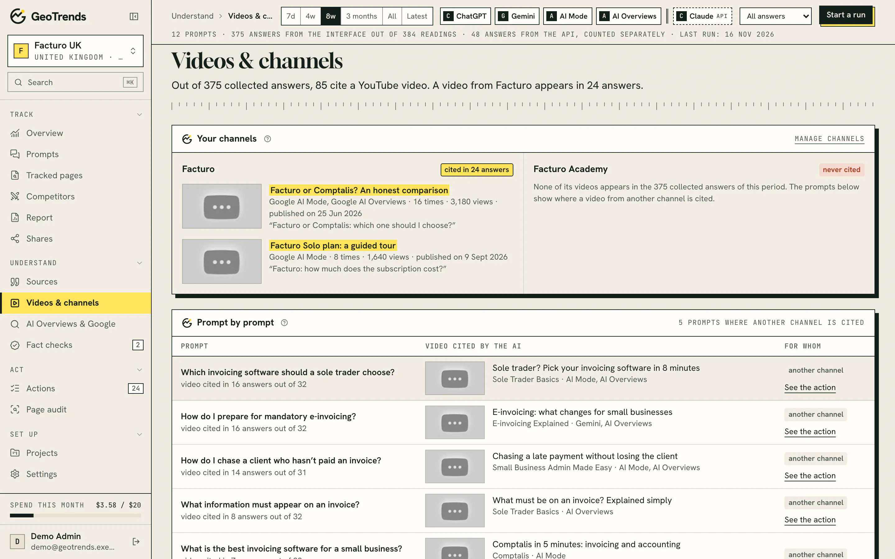

<!-- Page generated from the site documentation (src/site/docs) by scripts/exporter-docs.ts: do not edit it here. -->

# Videos and channels

> Whether the AIs cite your YouTube channels, on which prompts a video from another channel takes the spot, and which other channels come back most often.

[← Documentation contents](../README.md) · [Lire cette page en français](../../fr/comprendre/videos.md)

AIs also cite YouTube videos. A cited video counts for the channel that published it, not for youtube.com: if the channel is the brand’s, the citation counts for the brand. The Videos & channels screen answers three questions: are your channels cited? On which prompts does another video take the spot? Which channels are cited instead of you?

The **Manage channels** link opens the Brand and properties tab of the project page, where channels are declared. From the work list, a “Shoot a video” line leads back to the same prompts.

*The Videos & channels screen of the Facturo UK project: the card of each declared channel (Facturo, Facturo Academy), then the prompts where a video is cited.*

## A single unit: the recorded answer

The whole screen counts in answers: how many recorded answers cite a video, and which one. Only interface readings count: a video cited by Claude, queried through its API, is not what a person sees. The headline sentence gives the count: out of so many recorded answers, so many cite a YouTube video, and a video of the brand appears in so many answers. When only Google cites videos (AI Mode or AI Overviews), the sentence says so.

Each cited video is linked to its channel, with its title, view count and publication date, through YouTube’s public API (free). Thumbnails come from YouTube’s public address, with no extra call.

## Your channels

One card per declared channel, even if it is never cited. The card says “cited in so many answers” or “never cited”. For each cited video: its thumbnail, its title, the AIs that cite it, the number of citations, its views, its publication date, and the **Moment cited** when the address kept by the AI points to a precise moment of the video.

With no channel declared, the screen shows “No YouTube channel is declared for the brand.” and the **Declare a channel** button. The cited videos are still listed below.

## Prompt by prompt

The prompts for which an AI cites at least one video. At the top, those where the cited video is not yours: a video on the same topic has a chance to get in.

| Column | What it shows |
| --- | --- |
| **Prompt** | The prompt’s text, and “video cited in so many answers out of so many”. |
| **Video cited by the AI** | Up to three videos, with their thumbnail, their channel and the AIs that cite them. Clicking an AI opens the answer. |
| **For whom** | “you” if one of your videos is cited, otherwise “another channel”. **See the action** opens the matching line of the work list. |

## Other channels cited

The channels of other creators or brands with a cited video, with their **Answers**, **Videos**, **Prompts**, the AIs that cite them (**Cited by**) and their **Most cited video**. Those that come back often are your YouTube competitors on these prompts.

## Choosing the next video

1. **Declare your channels.** On the project page, **Brand and properties** tab, add each channel (Facturo, Facturo Academy) by its address or its name preceded by @. Otherwise one of your videos would count for someone else.

2. **Read your cards.** A channel “never cited” does not mean the brand is absent from the answers: it may be there through its site or its name.

3. **Spot the prompts taken by another channel.** In **Prompt by prompt**, the “another channel” rows are at the top. Look at the topic, the length and the moment cited of the video that was kept.

4. **Move to action.** **See the action** opens the “Shoot a video on …” line of the work list. Mark it “In progress”, then “Done” once the video is online: the tool will compare before and after.

## Limits

> [!WARNING]
> Numbers are often small: few answers cite a video, and often only on Google. Views are those of the day the video was linked, not today’s. A video only counts for the brand if its channel is declared. Publishing a video on a topic does not guarantee an AI will cite it: the screen shows where the spot is taken, not how to win it for certain.

**See also**

- [Sites, YouTube channels and social profiles](../project/sites-channels-profiles.md)
- [The work list](../act/work-list.md)
- [Which YouTube videos should I make?](../use-cases/videos-to-make.md)

---

Updated: 2026-11-18 · [Read this page on the website](https://geotrends.io/en/docs/understand/videos)
