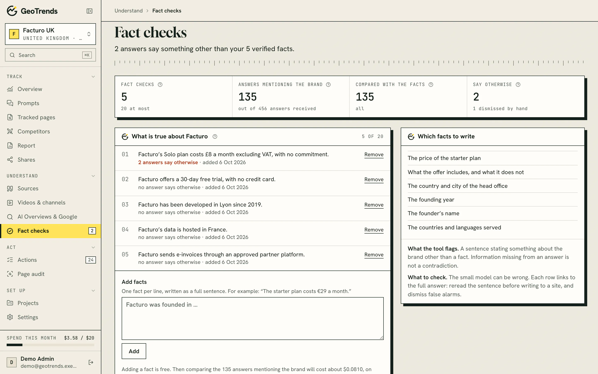

<!-- Page generated from the site documentation (src/site/docs) by scripts/exporter-docs.ts: do not edit it here. -->

# Branded or unbranded: how should I split my prompts?

> A prompt that contains the brand name does not measure the same thing as one that does not. How to spot them, read them apart and balance them in a project.

[← Documentation contents](../README.md) · [Lire cette page en français](../../fr/cas-usage/questions-avec-ou-sans-marque.md)

“Is Facturo right for sole traders?”: the AI almost has to talk about Facturo, and what matters is what it says. “Which invoicing software should a sole trader choose?”: this is where a customer who does not know you yet discovers you, or discovers Comptalis. Both kinds of prompt are useful, but they do not answer the same question.

## What you need

- Prompts of both kinds in the project. The tool sorts them on its own, with no paid call: a prompt is “with the brand name” if its text contains that name, “without” otherwise.
- A few readings on each prompt, so that verdicts move past “too early to tell”.
- For branded prompts: a few verified facts about the brand, entered on the **Fact checks** screen.

## Steps

1. **See the split.** Open **Prompts**, then **Filter and group**. The **Brand name** filter offers **Without** and **With**, each with its number of prompts. In the table, a prompt that contains the name carries the tag “with the brand name”.

   

2. **Read your place on unbranded prompts.** Choose **Without**. The table keeps only these prompts: count the solid, occasional and absent verdicts, and look at the **Named first** column. This is your real place against Comptalis, Devizo or Tikette, with customers who were not looking for Facturo.

3. **Read what the AIs say about you on branded prompts.** Choose **With**, then open a prompt. Each answer is shown as the AI wrote it, with the brand highlighted. On **Overview**, the **Tone used for Facturo** block splits the mentions into positive, neutral and negative.

4. **Check the facts.** Branded prompts are where the AI says the most about the brand: price, plans, target customers. The **Fact checks** screen compares the answers that name the brand with the facts you wrote, and lists those that say otherwise.

   

5. **Adjust the list.** Keep a few branded prompts, the ones a customer asks before buying: price, reviews, comparison with a competitor. Put most of the effort on unbranded prompts, drawing on **Prompt ideas to track** on the **AI Overviews & Google** screen.

## The decision it supports

Which prompts to judge progress on: unbranded prompts to know whether new customers come across you, branded prompts to know whether what the AIs say about you is right. The tool sets no ratio; a list made mostly of unbranded prompts gives a lower visibility, but a more honest one.

> [!WARNING]
> **Before you act**
>
> The **Brand name** filter only exists on the **Prompts** screen: the overview, competitors and topic map count both kinds together, and a branded prompt pulls visibility up. The sorting only looks for the main name: a prompt that uses only another spelling of the name, or only a competitor’s name, is filed as “without”.

**See also**

- [The Prompts screen](../measure/prompts.md)
- [Fact checks](../understand/fact-checks.md)
- [Measurement method](../reference/method.md)
- [Am I tracking the right prompts?](./tracking-the-right-prompts.md)
- [An AI keeps saying something wrong about my brand: what can I do?](./wrong-information.md)

---

Updated: 2026-11-18 · [Read this page on the website](https://geotrends.io/en/use-cases/branded-or-unbranded-prompts)
