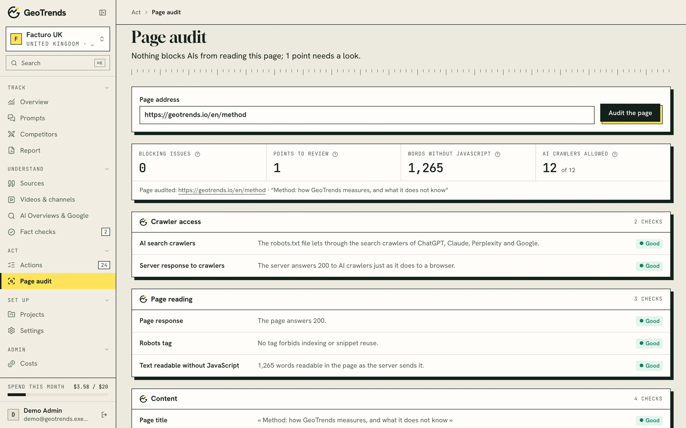

<!-- Page generated from the site documentation (src/site/docs) by scripts/exporter-docs.ts: do not edit it here. -->

# Can AI crawlers read my page?

> A free audit of one page: what robots.txt allows, what the server answers to AI crawlers, the text readable without JavaScript, and what hinders citation.

[← Documentation contents](../README.md) · [Lire cette page en français](../../fr/cas-usage/robots-des-ia.md)

The pricing page on facturo.exemple is never cited, nor even read, although it answers exactly “How much does invoicing software cost?”. Before rewriting it, rule out a simpler cause: AI crawlers may not have access to it, or may find nothing to read there.

## What you need

- The full address of a public page. The audit reads it directly: no paid call, nothing to install.
- If the page is yours, access to the site or its host to fix what the audit finds.

## Steps

1. **Run the audit.** Open **Page audit**, paste the address into **Page address**, then **Audit the page**. From **Actions**, the **Audit this page** link and, on **Sources**, tab **Our pages**, the **Audit** link fill in the address for you.

2. **Read the summary.** Four numbers at the top: **AI crawlers allowed** (out of the twelve crawlers checked), **Words without JavaScript**, **Blocking issues** and **Points to review**. A sentence says whether anything prevents AIs from reading the page.

   

3. **Check crawler by crawler.** The **Crawler by crawler** table gives, for each crawler, what it is for, the **Site rule** taken from robots.txt (allowed or blocked) and the **Server response**. The response is tested for the search crawlers of ChatGPT, Claude, Perplexity and Google, presenting itself under their name. A server that answers 200 to a browser but refuses these crawlers points to a firewall or host blocking them, even if robots.txt allows them.

4. **Fix the blocking issues.** **Blocking issues** prevent an AI from reading or reusing the page: search crawlers disallowed by robots.txt or refused by the server, a page that does not answer 200, a tag forbidding indexing or snippets, almost no text without JavaScript. Fix them first.

5. **Review the rest.** **Points to review** do not block reading, but make the page harder to cite: no main heading or several, few subheadings, little text without JavaScript, no structured data, a missing or old date, a canonical address pointing elsewhere. Other lines are given for information: lists and tables, author, training crawlers, the llms.txt file (nothing proves AIs use it).

## The decision it supports

Whether the problem is technical, for whoever runs the site, or editorial, to be handled by rewriting the page. Blocking training crawlers (GPTBot, ClaudeBot, Google-Extended) is a legitimate choice: it does not prevent citations. Blocking search crawlers does.

> [!WARNING]
> **Before you act**
>
> The audit says what prevents a page from being read, not whether it will be cited. It reads one page at a time, without crawling the site. The server response test runs from our server, under each crawler’s name: a firewall that also checks the source address may treat the real crawler differently. Training crawlers are only checked in robots.txt.

**See also**

- [Page audit](../act/page-audit.md)
- [AI engines tracked](../reference/ai-engines.md)
- [My page is read but not cited: what should I fix?](./page-read-not-cited.md)
- [Is my brand cited, mentioned or absent?](./cited-mentioned-or-absent.md)

---

Updated: 2026-11-18 · [Read this page on the website](https://geotrends.io/en/use-cases/can-ai-crawlers-read-my-page)
