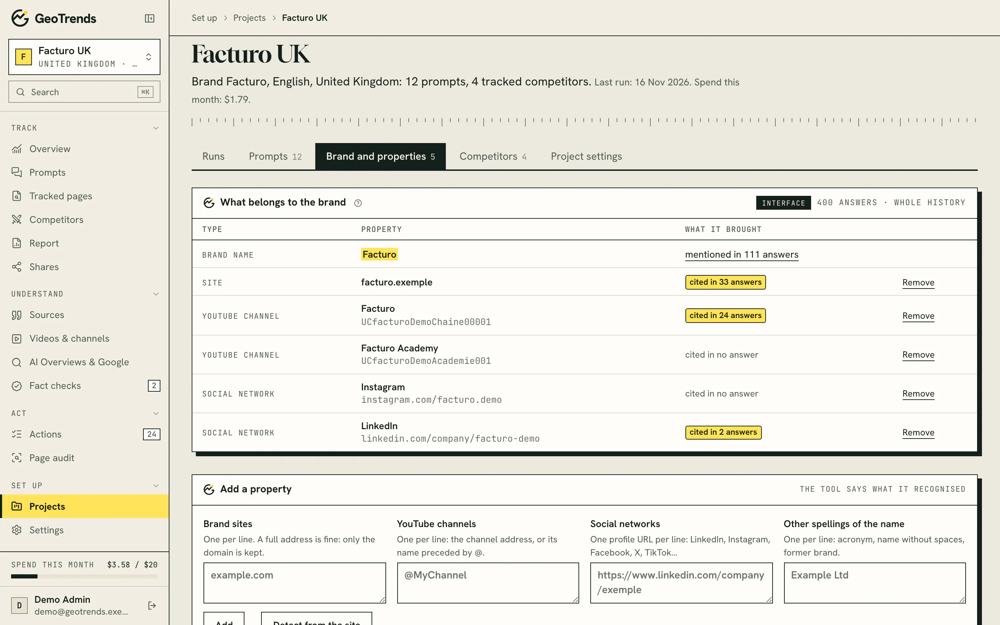

<!-- Page generated from the site documentation (src/site/docs) by scripts/exporter-docs.ts: do not edit it here. -->

# Is my brand cited, mentioned or absent?

> Site cited, video cited, name only, page read but not cited: four ways of being in an AI answer, which are not read the same way and not fixed the same way.

[← Documentation contents](../README.md) · [Lire cette page en français](../../fr/cas-usage/citee-nommee-ou-absente.md)

Being in an AI answer can mean several things. The AI cites a page of facturo.exemple or a video from the Facturo channel as a source. It writes “Facturo” in its text without relying on your pages. Or it opens one of your pages and does not keep it. Each case calls for different work: first you need to know which one is yours.

## What you need

- Everything the brand owns, declared in the project: its sites, its YouTube channels, its social profiles, the other spellings of its name.
- Answers received. A prompt with no answer, or with no AI Overview on Google, is not counted.

## Steps

1. **Declare what the brand owns.** Open the project page, tab **Brand and properties**: **Brand sites**, **YouTube channels** (Facturo, Facturo Academy), **Social networks**, **Other spellings of the name**. The **Detect from the site** button reads the home page and suggests the profiles it finds; nothing is added until you review it. A page published under a declared profile, on LinkedIn for example, counts as a brand page.

   

2. **Read the state of each answer.** On **Prompts**, each cell carries a state, explained under the table. **Cited**: a page or video of the brand is among the sources. **Mentioned**: the name is in the text, with no brand page cited. **Read**: a brand page was opened by the AI but not cited. **Absent**: the AI answered without the brand. **No overview**: Google displayed nothing, which is not an absence.

   

3. **See where visibility comes from.** On **Overview**, **Visibility** counts the answers where Facturo is mentioned or cited. The **Owned sources** tile counts citations of your pages and videos. Further down, the **Where visibility comes from** block splits the answers with the brand three ways: **Through the site**, **Through the YouTube channel**, **By name only**.

   

4. **Find your pages one by one.** Open **Sources**, tab **Our pages**. Each page or video of the brand is listed with the number of answers where it is **Cited**, the number of times it was **Read, not cited**, its place **On Google** and the **Pages cited instead**.

5. **Check on a single prompt.** On a prompt page, the **On this prompt** block lists **Our pages**: those that were cited, and those that were read but not cited. The answers open just below, AI by AI, with the brand highlighted in the text.

## The decision it supports

| What you see | What it means | Where to work |
| --- | --- | --- |
| Cited | One of your pages serves as evidence for the AI. | Keep the page up to date, and watch it. |
| Mentioned only | The AI knows the brand, but relies on other pages. | The pages it cites: get into them, or write better than them. |
| Read, not cited | Your page is found, then set aside. | Rewrite it: a clear answer, at the top of the page. |
| Absent | Neither your name nor your pages. | The pages cited instead of you, starting with comparison sites. |

> [!WARNING]
> **Before you act**
>
> Only ChatGPT and Claude say which pages they read without citing: on Gemini and Google, the “read” state does not exist. The name is searched as a whole word, with its other spellings: a namesake would count too, so read a few answers before concluding. A property missing from the project turns a Facturo citation into an absence.

**See also**

- [Sites, YouTube channels and social profiles](../project/sites-channels-profiles.md)
- [Key concepts](../get-started/key-concepts.md)
- [Cited sources](../understand/sources.md)
- [My page is read but not cited: what should I fix?](./page-read-not-cited.md)
- [Which page should I get into first?](./pages-to-appear-on.md)

---

Updated: 2026-11-18 · [Read this page on the website](https://geotrends.io/en/use-cases/cited-mentioned-or-absent)
