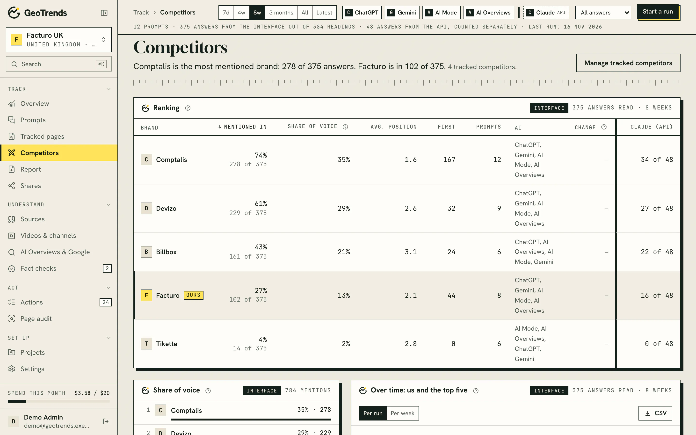

<!-- Page generated from the site documentation (src/site/docs) by scripts/exporter-docs.ts: do not edit it here. -->

# Which competitor is moving in on my topics?

> Spot the brand that is rising in AI answers, check that the rise is beyond the margin of error, then see on which prompts and thanks to which pages.

[← Documentation contents](../README.md) · [Lire cette page en français](../../fr/cas-usage/concurrent-qui-s-installe.md)

Two months ago, Tikette hardly ever appeared in answers about invoicing for freelancers. For a few runs now, its name keeps coming back. Before reacting, you need to know whether the rise is real, on which prompts it plays out, on which AIs, and which pages carry it.

## What you need

- Several weeks of runs: a rise is read between two periods, not between two days.
- The competitor tracked in the project, with its site declared if you know it: its cited pages are then attributed to it.
- Answers whose brands have been read.

## Steps

1. **Spot who is rising.** Open **Competitors** and choose a long enough period in the top bar, eight weeks or three months. In the **Ranking** table, the **Change** column compares each brand with the previous period; it is coloured only when the change is beyond the margin of error. The **Over time: us and the top five** chart plots the share of answers read that mention each brand, run after run.

   

2. **Spot the newcomers.** Open **Report**. The **New brands** tile and the **Brands mentioned for the first time** block list the brands mentioned in the latest run and in no answer of the previous one. An unknown name that keeps coming back from one report to the next deserves tracking: the **Track** button is on the same row.

3. **Stand face to face.** In the top bar, the **Versus** filter keeps only the answers that mention Tikette. Every screen is recomputed: Facturo’s visibility becomes its presence when Tikette is named, and the source list becomes that of the answers where Tikette appears. **All answers** removes the filter.

4. **See the prompts where it gets ahead.** On **Competitors**, the **Prompt by prompt, AI by AI** grid, set to **Versus a competitor** and then to Tikette, tells you for each prompt and each AI who is ahead. The **Head-to-head** table compares the two brands metric by metric.

5. **Find the pages that carry it.** Open **Sources**. In the **Who gets the citations** bar, clicking the “Tracked competitors” share filters the tables to competitors’ pages. On the **Pages** tab, a page’s sheet gives the brands mentioned in the answers that cite it: a third-party comparison page is often what brings a brand in.

## The decision it supports

Whether to respond, and where. A rise beyond the margin, concentrated on a few prompts and carried by a few pages, can be worked on: get into the same comparison pages, write a better answer on those prompts. A rise within the margin is watched at the next run.

> [!WARNING]
> **Before you act**
>
> A rise beyond the margin says the competitor is mentioned more often, not why. “For the first time” is read against the previous run only. Brands for AIs other than ChatGPT come from automatic reading, which can mix up two similar names. The **Versus** filter applies to every screen until you remove it.

**See also**

- [Competitors and share of voice](../understand/competitors.md)
- [Report and alerts](../steer/report-and-alerts.md)
- [Cited sources](../understand/sources.md)
- [Who is cited instead of me?](./who-is-cited-instead-of-me.md)
- [A number moved: real change or noise?](./real-change-or-noise.md)

---

Updated: 2026-11-18 · [Read this page on the website](https://geotrends.io/en/use-cases/competitor-moving-in)
