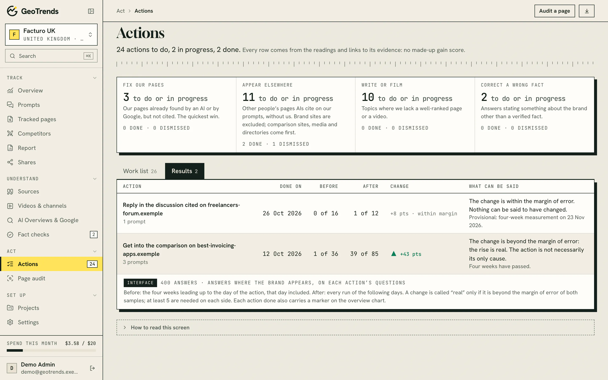

<!-- Page generated from the site documentation (src/site/docs) by scripts/exporter-docs.ts: do not edit it here. -->

# Did my fix make a difference?

> Mark an action as done, read the brand’s presence before and after on the prompts concerned, and know what can be said about it, and what cannot.

[← Documentation contents](../README.md) · [Lire cette page en français](../../fr/cas-usage/effet-d-une-correction.md)

Five weeks ago, after several exchanges, comparatif-logiciels.exemple added Facturo to its comparison page. Since then, the brand seems to come up more often on the prompts where that page is cited. The team asks whether the effort paid off. The honest answer comes in two parts: what the numbers show, then what they do not prove.

## What you need

- An action from the work list marked “done”, with the right date.
- Interface readings in the four weeks before that date, and after it: at least 5 answers on each side.
- Time: the result stays provisional until four weeks have passed.

## Steps

1. **Mark the action done, on the right date.** On **Actions**, set the row to **Done**. In its sheet, the **Done on** field takes today’s date; correct it if the change happened on another day, for example the day the comparison page was updated. Write down what was done in **Note**.

2. **Read the before and after.** The action sheet shows **Before and after, on** the prompts concerned, in interface readings: **The four weeks before** and **Since …**, each as “k of n” answers where Facturo appears, then the change and a sentence saying whether it is beyond the margin of error. Before four weeks, the sheet says the result is provisional.

3. **Compare all the actions done.** The **Results** tab gathers the actions done: **Done on**, **Before**, **After**, **Change** and **What can be said**. An action that left the list, because the page is no longer cited without you, keeps its sheet, note and result there.

   

4. **Look for the trace in the answers.** Open the prompts concerned and read the answers after the date. Is the page you got into cited in the answers that now name Facturo? On the **Answers** screen, the **Presence** filter separates answers with and without the brand. This trace, more than the number, is what links the action to the change.

5. **Place the action on the chart.** On **Overview**, an “Action done” marker sits on the chart that day. Look at the other markers around it: a model change in the same period blurs the reading. If readings are too few, a **Deep measurement** on a prompt concerned adds answers on the “after” side.

   

## The decision it supports

Keep going the same way, for example by targeting other comparison pages, wait for the four-week measurement, or change approach. The result of an action is there to steer the next ones, not to hand out credit.

> [!WARNING]
> **Before you act**
>
> A change after an action is evidence for investigation, not proof that the action caused it. During the same weeks, a model may have changed, a competitor may have fallen back, another page may have moved. The tool compares the action’s prompts with themselves, with no control group. Even beyond the margin, it says: “the action is not necessarily its only cause”.

**See also**

- [Measuring after an action](../act/measure-after-action.md)
- [The work list](../act/work-list.md)
- [Measurement method](../reference/method.md)
- [A number moved: real change or noise?](./real-change-or-noise.md)
- [Which page should I get into first?](./pages-to-appear-on.md)

---

Updated: 2026-11-18 · [Read this page on the website](https://geotrends.io/en/use-cases/did-my-fix-work)
