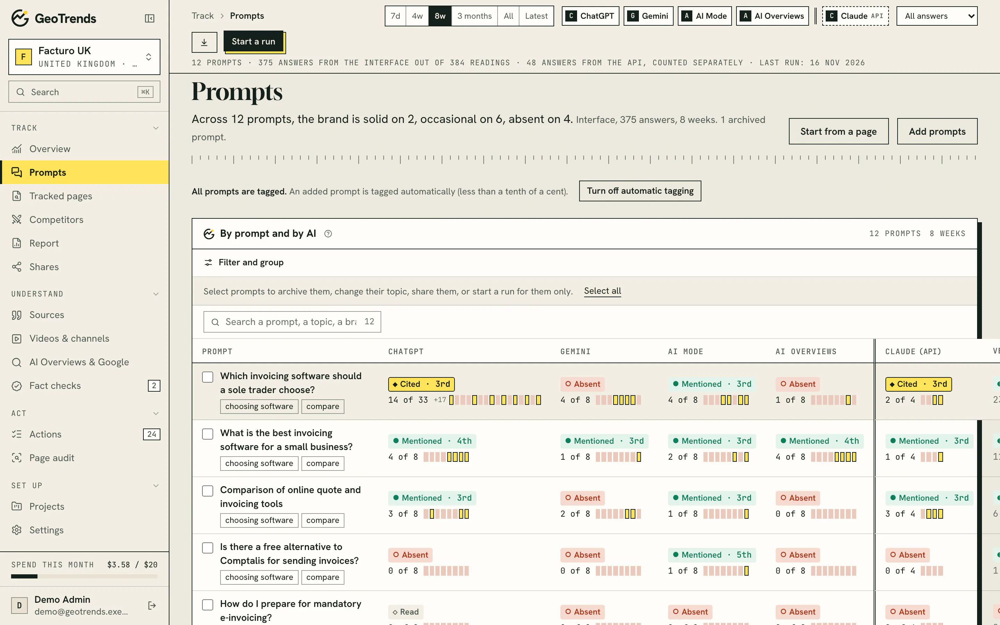
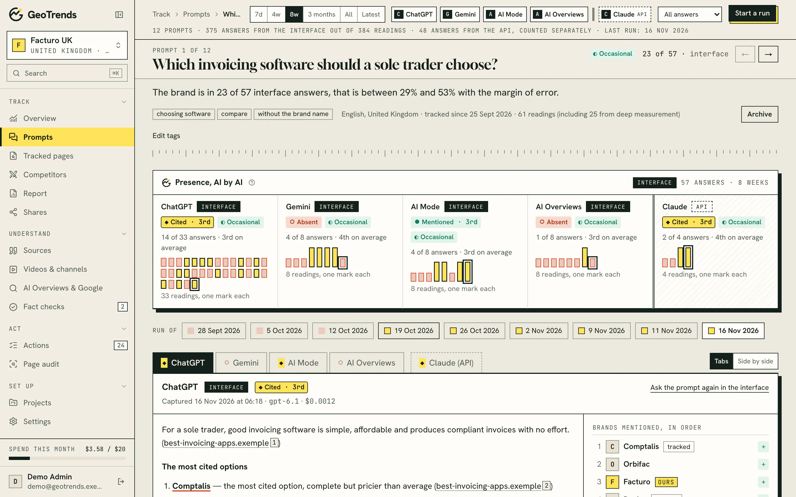
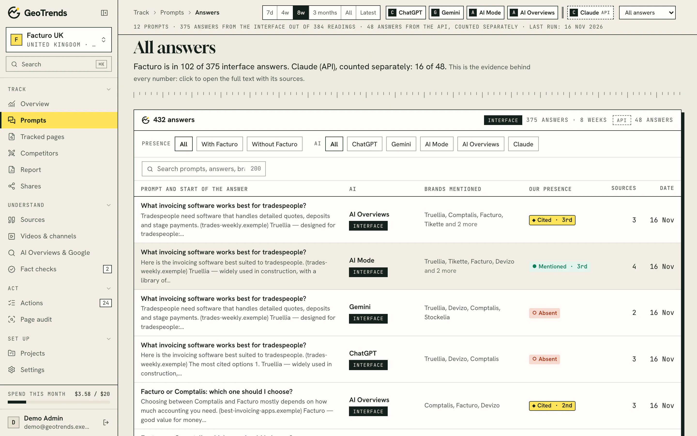

<!-- Page generated from the site documentation (src/site/docs) by scripts/exporter-docs.ts: do not edit it here. -->

# Does ChatGPT cite my brand, and on which prompts?

> ChatGPT’s number, then the list of prompts where it cites, mentions or ignores the brand, down to the text of each answer with its sources and searches.

[← Documentation contents](../README.md) · [Lire cette page en français](../../fr/cas-usage/chatgpt-cite-t-il-ma-marque.md)

A customer tells you they found Facturo “by asking ChatGPT”. Another says ChatGPT recommended Comptalis. Before drawing any conclusion, you need to know what ChatGPT really answers on your prompts: where it cites Facturo, where it mentions it without citing it, and where it ignores it.

## What you need

- ChatGPT readings on the project’s prompts. A percentage shows from 5 answers, a verdict on a prompt from 3.
- The brand’s site, YouTube channels and social profiles declared in the project: without them, a Facturo page that gets cited does not count for Facturo.

## Steps

1. **Read ChatGPT’s number.** On **Overview**, the **Presence, AI by AI** table gives ChatGPT’s row: its **Visibility** over the period, with the number of answers, then how Facturo appears: **Site cited**, **Video cited**, **Name only** and **Read, not cited**. Clicking “ChatGPT” opens all its answers.

2. **See the prompts one by one.** Open **Prompts**. The ChatGPT column gives the latest state of each prompt: cited, mentioned, read or absent. When a prompt has several readings, a count such as “3 of 5” and one tick per reading show underneath. Click the header to sort the column; click a state to open the answer.

   

3. **Open an answer.** The prompt page opens with its verdict and Facturo’s presence, AI by AI. Further down, choose ChatGPT: the text is what ChatGPT displayed, never translated: Facturo is highlighted, a tracked competitor is underlined, each source carries its number. Below: **Cited sources**, **Pages read but not cited** and **Searches run by the AI**. The **Ask the prompt again in the interface** link lets you check for yourself.

   

4. **Gather all its answers.** The **Answers** screen, opened from ChatGPT’s name, filters by **Presence** (with or without Facturo) and by **AI**. Choose “Without Facturo”: this is the list of ChatGPT answers where you are missing, each with its prompt and the brands it mentions.

   

5. **Read the whole tool from ChatGPT’s point of view.** In the top bar, hide the other AIs with the **AI** filter. The **Competitors** and **Sources** screens and the topic map then count ChatGPT only: who it names instead of you, which pages it cites.

## The decision it supports

- The prompts where ChatGPT ignores Facturo: work on these first, starting from the pages it cites.
- The prompts where it reads a Facturo page without citing it: the page is found, it needs rewriting.
- The prompts where it mentions Facturo without citing it: it knows the brand, but does not rely on your pages.

> [!WARNING]
> **Before you act**
>
> With one run a week, a prompt has few answers: an “absent” verdict on three answers is a signal, not a certainty. ChatGPT is captured without forcing its web search, from a neutral session: a signed-in customer may read something else. When OpenAI changes model, a marker shows it on the overview chart; a change that day may come from there.

**See also**

- [A prompt’s page](../measure/prompt-page.md)
- [All answers](../measure/answers.md)
- [AI engines tracked](../reference/ai-engines.md)
- [Is my brand cited, mentioned or absent?](./cited-mentioned-or-absent.md)
- [My page is read but not cited: what should I fix?](./page-read-not-cited.md)

---

Updated: 2026-11-18 · [Read this page on the website](https://geotrends.io/en/use-cases/does-chatgpt-cite-my-brand)
