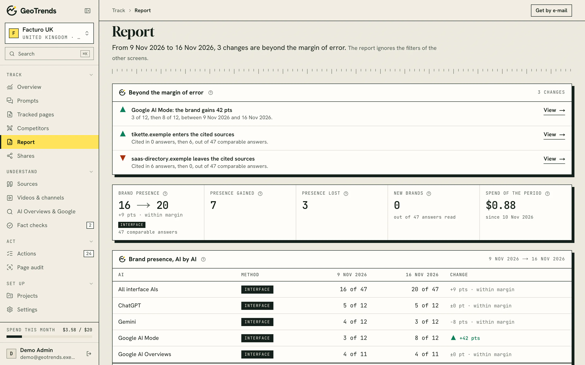
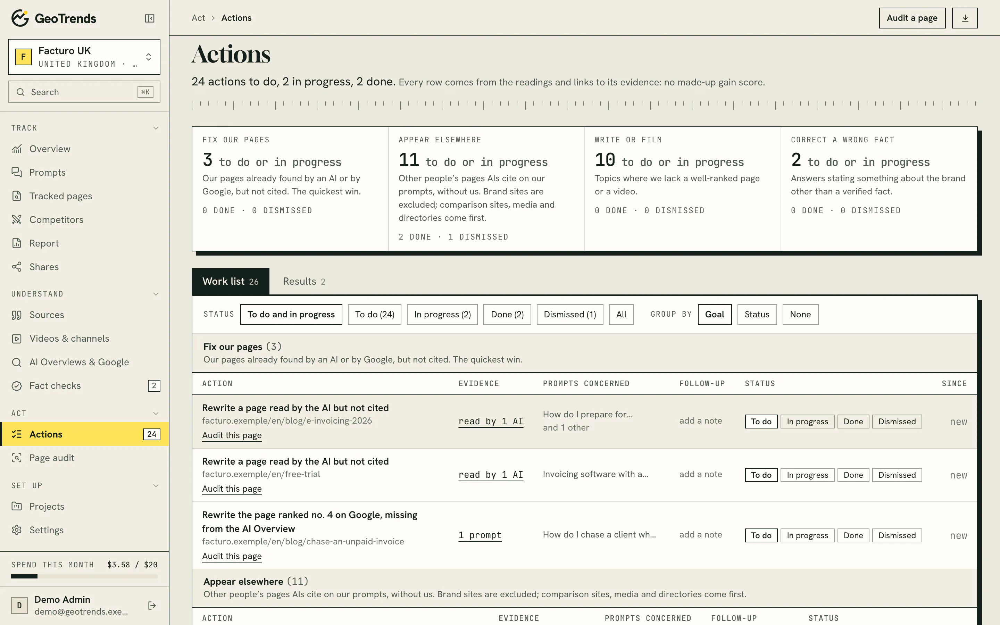

<!-- Page generated from the site documentation (src/site/docs) by scripts/exporter-docs.ts: do not edit it here. -->

# How do I prepare the Monday team meeting?

> The report compares the last two runs, the work list says what to do, the exports hold the data: an agenda in fifteen minutes, without the noise.

[← Documentation contents](../README.md) · [Lire cette page en français](../../fr/cas-usage/point-du-lundi.md)

Every Monday, the Facturo UK team spends fifteen minutes on its presence in AI answers. Without preparation, the meeting comments on every point of visibility gained or lost. With the report, it starts from what really changed, and ends with who does what this week.

## What you need

- At least two run days: the report compares the last two. With automatic runs turned on, they arrive every week without a thought.
- An up-to-date work list: action statuses, their notes and their outreach.

## Steps

1. **Start from the report.** Open **Report**. It compares the project’s last two run days, ignoring the filters of the other screens. At the top, **Beyond the margin of error**: the only changes that can be taken as real. Then come the tiles (**Brand presence**, **Presence gained**, **Presence lost**, **New brands**, **Spend of the period**) and **Brand presence, AI by AI**.

   

2. **Read the clues, without dwelling on them.** **Presence gained or lost, prompt by prompt**, **Brands mentioned for the first time** and **Sources gained and lost** give leads. With one answer per prompt and per AI at each date, these are clues: note the ones that recur from week to week, or run a deep measurement on the prompt.

3. **Set the week’s actions.** The block **The three most useful actions** takes the top of the work list. On **Actions**, go through the rows **In progress**, their **Outreach** and the replies received; decide who picks up what, and set to **Done** whatever is. The **Results** tab shows the before and after of actions already done.

   

4. **Export what you need to keep.** The **Export** button in the top bar downloads the screen’s data as CSV: one row per captured answer from **Overview** or **Prompts**, the sources from **Sources**, the work list from **Actions**. Each chart also has its own download. Admin accounts export every paid call from **Costs**.

5. **See the Monday e-mail.** At the bottom of the report, **Get this report by e-mail** shows the short version planned for the team, with **See the e-mail as it will be sent**. Today, the e-mail is not sent: the sending service key is not installed, and the screen says so. The report is read on screen, or shared through its exports.

## The decision it supports

The agenda: what changed beyond the margin, and why you think so; the three actions of the week and who owns them; the outreach to follow up. Everything else waits for the next run.

> [!WARNING]
> **Before you act**
>
> The report compares two dates, not two periods: for a trend, read **Overview** over four or eight weeks. Deep measurements are left out of its comparison. There is no PDF export and no public share link: exports are CSV files, and the tool remains limited to the team’s accounts.

**See also**

- [Report and alerts](../steer/report-and-alerts.md)
- [CSV exports](../steer/exports.md)
- [The work list](../act/work-list.md)
- [A number moved: real change or noise?](./real-change-or-noise.md)
- [Did my fix make a difference?](./did-my-fix-work.md)

---

Updated: 2026-11-18 · [Read this page on the website](https://geotrends.io/en/use-cases/monday-team-meeting)
