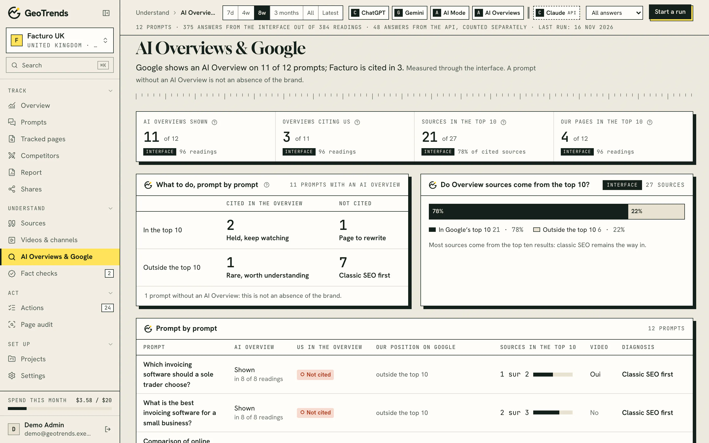
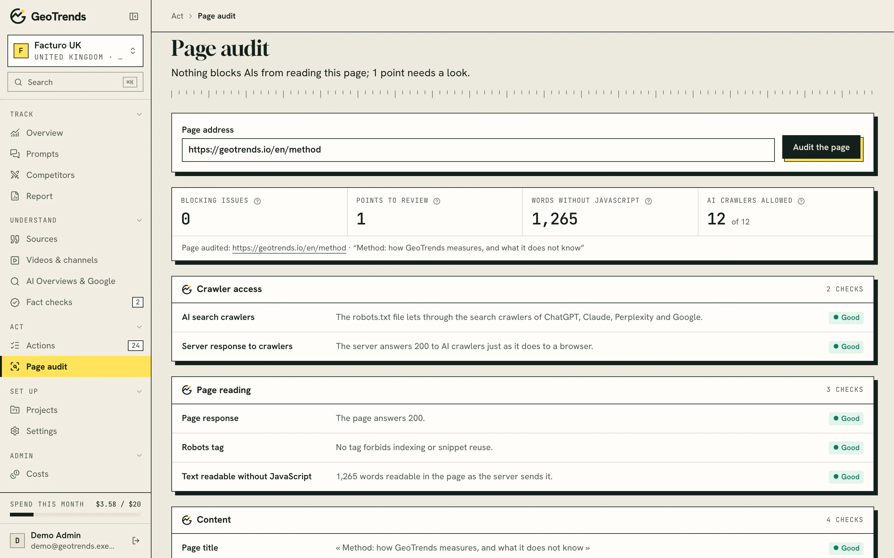

<!-- Page generated from the site documentation (src/site/docs) by scripts/exporter-docs.ts: do not edit it here. -->

# My page is read but not cited: what should I fix?

> An AI opens your page then cites someone else’s, or Google ranks it without using it in its AI Overview: how to spot it, compare, and rewrite the page.

[← Documentation contents](../README.md) · [Lire cette page en français](../../fr/cas-usage/page-lue-pas-citee.md)

ChatGPT opens the “Invoicing as a sole trader” page on facturo.exemple, then answers by citing a comparison page and a competitor’s page. Your page was found: that is the hard part. It was set aside: that is what needs fixing. It is often the quickest win in the work list.

## What you need

- ChatGPT or Claude readings: they are the only AIs that say which pages they read without citing them.
- For the Google case: AI Overviews readings, which also bring back the top ten classic results.
- The brand’s site declared in the project.

## Steps

1. **Find your pages that were set aside.** Open **Sources**, tab **Our pages**. For each Facturo page: the number of answers where it is **Cited**, the number of times it was **Read, not cited**, its place **On Google** for your prompts, and the **Pages cited instead**.

2. **Compare with the pages cited instead.** Open the pages cited instead of yours, then the page of the prompt concerned. The **Winning pages** block lists the pages cited by two AIs or more. Look at what they have that yours lacks: an answer in the first lines, a table, a price, a date.

3. **Spot the Google case.** Open **AI Overviews & Google**. The **What to do, prompt by prompt** table crosses two questions: are you in the top ten results, and does the Overview cite you? The **Page to rewrite** cell counts the prompts where your page ranks well but is missing from the Overview. One click filters the detail.

   

4. **Open the work-list row and audit the page.** On **Actions**, the **Fix our pages** group holds “Rewrite a page read by the AI but not cited” and “Rewrite the page ranked no. … on Google, missing from the AI Overview”. The **Audit this page** link runs **Page audit**: first the **Blocking issues**, then the **Points to review** (main heading, subheadings, text readable without JavaScript, structured data, date).

   

5. **Rewrite, then mark the action done.** Rewrite the page so that it answers the prompt at the top, clearly, with what the pages cited instead provide. Then set the row to **Done**, on the date it went live: the tool will compare Facturo’s presence on these prompts before and after.

## The decision it supports

Which page to rewrite first, and in which direction. A page read by several AIs, or ranked in the top ten without being used, comes before a page that is never found: that one has an SEO problem first.

> [!WARNING]
> **Before you act**
>
> Gemini and Google do not say which pages they read: on them, a page that was set aside cannot be seen. A page read only once may have been read by chance. The audit says what prevents an AI from reading or reusing the page, not whether it will be cited. And a rise after the rewrite is a clue to check, not proof that the rewrite caused it.

**See also**

- [Cited sources](../understand/sources.md)
- [AI Overviews and Google results](../understand/google.md)
- [Page audit](../act/page-audit.md)
- [Can AI crawlers read my page?](./can-ai-crawlers-read-my-page.md)
- [Did my fix make a difference?](./did-my-fix-work.md)

---

Updated: 2026-11-18 · [Read this page on the website](https://geotrends.io/en/use-cases/page-read-not-cited)
