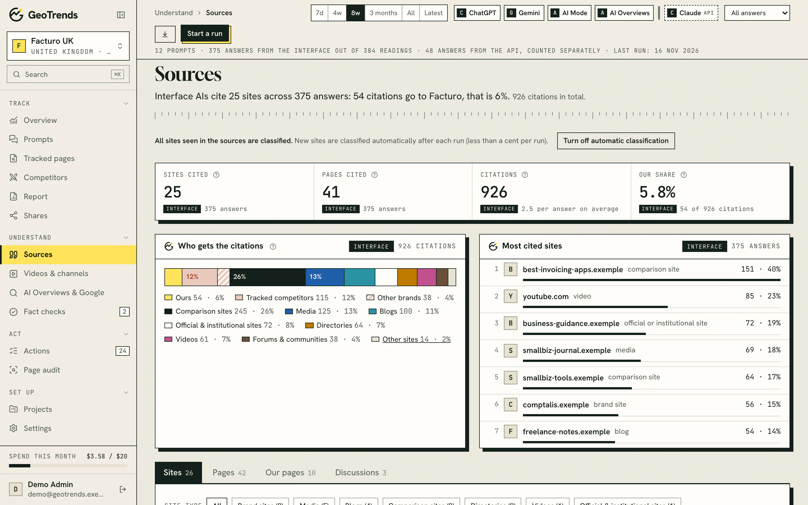
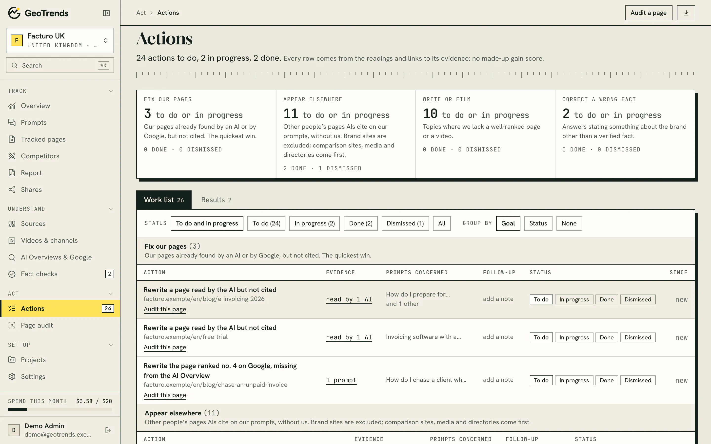

<!-- Page generated from the site documentation (src/site/docs) by scripts/exporter-docs.ts: do not edit it here. -->

# Which page should I get into first?

> The pages AIs cite on your prompts without you, sorted by site type, and how to choose the one where you ask for a place, then follow up on the outreach.

[← Documentation contents](../README.md) · [Lire cette page en français](../../fr/cas-usage/pages-ou-apparaitre.md)

On your prompts, AIs cite pages from other sites: a software comparison, a media article, a directory, a forum thread. Facturo is not in them. You cannot write to everyone. You need to choose the page where a place counts most, and start there.

## What you need

- Interface readings with their cited sources.
- Sites classified by type. Classification is started once, with one click, for a few cents; new sites are then classified automatically.
- Facturo’s site and properties declared, so the tool knows which pages are yours.

## Steps

1. **Classify the cited sites.** Open **Sources**. If some sites are not classified yet, the banner offers **Classify the sites**, with its price. Each site gets a type (comparison site, media, blog, forum, directory, brand site, official site, shop) and an owner: ours, tracked competitor, other brand or third party. The **Who gets the citations** bar shows the split. A wrong type is corrected by hand on the site’s sheet.

   

2. **List the pages cited without you.** Go to the **Pages** tab and choose **Only pages cited without us**. Each row gives the **Page**, its **Type**, its **Owner**, the number of **Answers** that cite it, the **Without us** column (those where Facturo does not appear) and the **AIs** that cite it. Sort by **Without us**.

3. **Open a page’s sheet.** Clicking a row opens the sheet: the answers that cite the page, the brands mentioned in those answers, the site type. If the page is not in the work list yet, the **Add to the work list** button puts it there.

4. **Read the work list.** Open **Actions**. The **Appear elsewhere** group gathers other people’s pages that AIs cite without you; brand sites are excluded, and comparison sites, media and directories come first. Each row says what to do, for example “Get into the comparison on comparatif-logiciels.exemple”, and the **Evidence** column counts the answers and AIs concerned.

   

5. **Start the outreach and log it.** Open the row you picked and set it to **In progress**. Under **Outreach**, log each message: the type of outreach (**Inclusion request**, **Test offer**, **Reply in a thread**…), the date, the person contacted, what was asked, then **Add to the log**. When the reply comes, mark it: **Positive reply**, **Declined** or **No answer**.

## The decision it supports

Which page to start with: the one cited without you in the most answers, by the most AIs, on a site where you can ask for a place (a comparison site, a media outlet, a directory). For forum threads, the **Discussions** tab lists the places where you can still reply.

> [!WARNING]
> **Before you act**
>
> The content of cited pages is not read: the brands on the sheet are those of the answers, not of the page. The tool does not know a page’s traffic, since it has no link with Google Analytics or Search Console. A page cited in a single answer may be cited by chance. And getting into a comparison does not guarantee being cited: the next measurement will tell.

**See also**

- [Cited sources](../understand/sources.md)
- [The work list](../act/work-list.md)
- [Following up an action and its outreach](../act/outreach.md)
- [Who is cited instead of me?](./who-is-cited-instead-of-me.md)
- [Did my fix make a difference?](./did-my-fix-work.md)

---

Updated: 2026-11-18 · [Read this page on the website](https://geotrends.io/en/use-cases/pages-to-appear-on)
