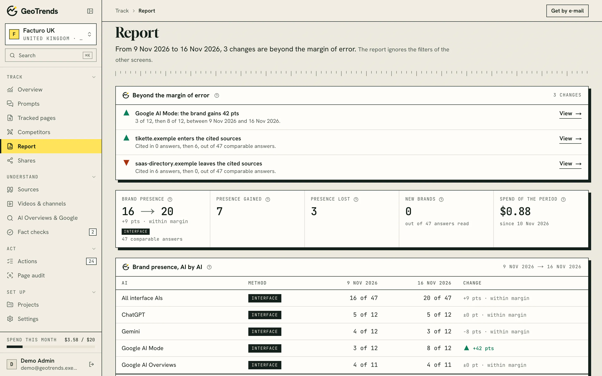
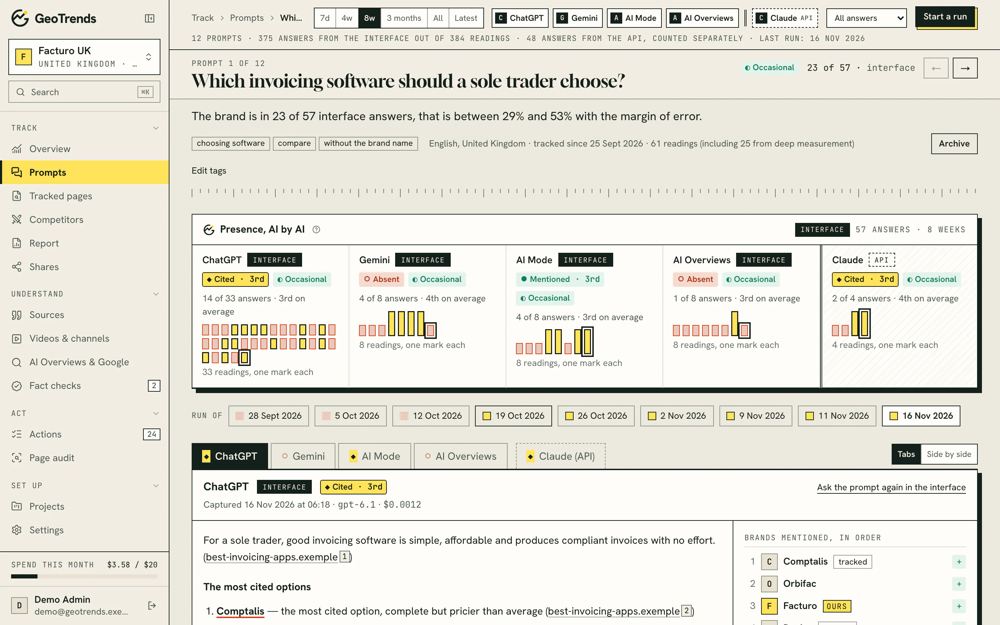

<!-- Page generated from the site documentation (src/site/docs) by scripts/exporter-docs.ts: do not edit it here. -->

# A number moved: real change or noise?

> Margin of error, coloured changes, chart markers and deep measurement: how to tell whether a rise or a drop in visibility is real before you react to it.

[← Documentation contents](../README.md) · [Lire cette page en français](../../fr/cas-usage/evolution-ou-bruit.md)

On Monday, Facturo’s visibility lost a few points. The week before, it had gained some. An AI answer is a draw: asked twice, the same prompt does not get the same answer. Before looking for a cause, you need to know whether the change is larger than chance alone can explain.

## What you need

- At least two run days, so there is something to compare.
- Enough answers on each side: below 5, the tool shows no percentage and does not qualify the change.

## Steps

1. **Look at the colour of the change.** On **Overview**, each tile compares the chosen period with the one before. The change is coloured only when it is beyond the margin of error; otherwise it reads “within margin” or “too few readings”. The **Visibility** help bubble gives the margin: “between … and …”. Change the period in the top bar to compare four weeks with four weeks, rather than one run with another.

2. **Read the chart with its band.** The **Trend, run after run** chart puts one point per run day, joined by straight segments, never smoothed. Around the main line, a grey band shows the margin of error: two points whose bands overlap cannot be told apart. The **Previous period** option adds the same metric, dotted.

   

3. **Read the markers.** Markers sit on the chart: a model change (“ChatGPT switched model: … became …”), an action marked done, a deep measurement. A change that falls on the day of a model switch may come from there, not from you.

4. **Keep only what is beyond the margin.** Open **Report**. It compares the last two run days, on the prompt and AI pairs that have an answer on both dates. The **Beyond the margin of error** block lists only real changes; **Presence gained or lost, prompt by prompt** gives clues to be confirmed. The **Alerts** on the overview follow the same rule.

   

5. **Settle a single prompt.** A single prompt has too few answers for a clear verdict. On its page, the **Deep measurement** block asks it 5, 10 or 25 times in a row to the interface AIs you tick, with the price shown before sending. The verdict and the margin are recomputed; these readings count for this prompt only, not in the overall numbers.

   

## The decision it supports

React or wait. A change within the margin asks for nothing but the next run. A change beyond the margin deserves an investigation: which AI, which prompts, which marker that day, which competitor rose at the same time.

> [!WARNING]
> **Before you act**
>
> A “real” change says the number moved, not why: a new model, a competitor, a page edited elsewhere or your own fix can all explain it. The margin is computed at 95%: out of twenty flagged changes, one may still come from chance. The report and the alerts ignore the top-bar filters; the tiles follow them.

**See also**

- [Measurement method](../reference/method.md)
- [Deep measurement](../measure/deep-measurement.md)
- [Report and alerts](../steer/report-and-alerts.md)
- [Overview](../measure/overview.md)
- [Did my fix make a difference?](./did-my-fix-work.md)

---

Updated: 2026-11-18 · [Read this page on the website](https://geotrends.io/en/use-cases/real-change-or-noise)
