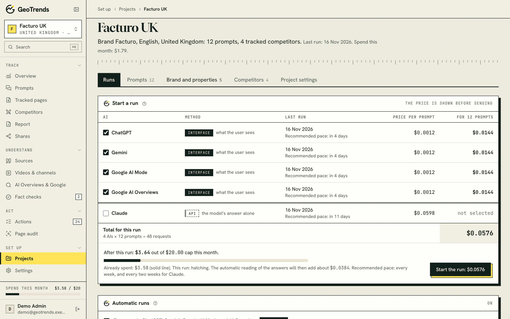
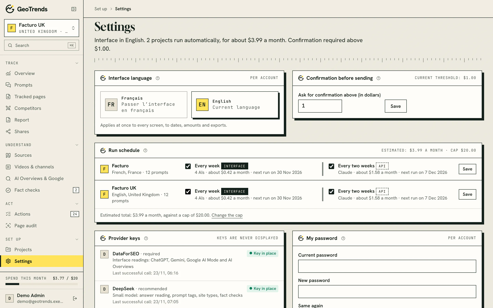
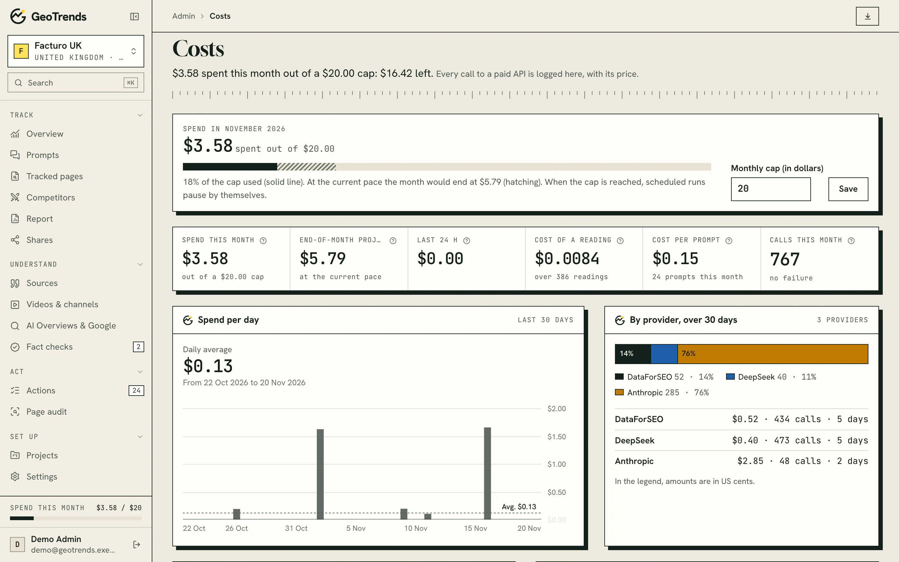

<!-- Page generated from the site documentation (src/site/docs) by scripts/exporter-docs.ts: do not edit it here. -->

# How do I track a brand without going over budget?

> Price shown before each send, pace of automatic runs, confirmation threshold and monthly cap: set a project’s spending before it happens, not after.

[← Documentation contents](../README.md) · [Lire cette page en français](../../fr/cas-usage/budget-de-suivi.md)

Facturo UK joins the projects already tracked, and the monthly budget stays the same. Each prompt costs a little at every run, each AI has its price, and Claude costs much more than the others. Everything is set before sending: nothing goes out without a click, or without a schedule you turned on.

## What you need

- The project’s list of prompts: the price of a run is proportional to their number.
- An admin account to change the monthly cap, shared by all projects; it is $20 until someone changes it.

## Steps

1. **Read the price before sending.** Open the project page, tab **Runs**. The **Start a run** block gives, for each AI, its **Price per prompt** ($0.0012 through the interface, about $0.06 for Claude), the date of the **Last run** and the recommended pace. Tick the AIs you want: the **Total for this run** and the month’s spend after sending appear, and the **Start the run** button carries the price.

   

2. **Choose the automatic pace.** In the same tab, **Automatic runs** offers two boxes: **Every week: ChatGPT, Gemini, Google AI Mode and AI Overviews**, and **Every two weeks: Claude**. Each shows its estimated monthly cost for the project’s prompts. Leave Claude unticked if the budget is tight: the four interface AIs show what your customers see.

3. **Check the total across projects.** Open **Settings**. **Run schedule** lists the projects with automatic runs, with their estimated cost and the total against the cap. **Confirmation before sending** sets the amount above which a send asks for one more confirmation; it is $1 by default.

   

4. **Hold the cap.** In **Costs** (admin accounts), the top of the screen shows the month’s spend against the cap, with a bar; the **Monthly cap (in dollars)** field changes it. The **End-of-month projection** tile extends the spend at the pace of the days elapsed; **By project, this month** and **By AI, this month** show where the money goes. When the cap is reached, scheduled runs pause on their own and nothing can be sent. The month’s spend stays visible in the menu, with its bar.

   

5. **Trim the list.** On **Prompts**, archive the prompts that no longer help: they are no longer captured. Before a **Deep measurement**, the price is shown too: 25 sends on four AIs means a hundred readings for a single prompt.

## The decision it supports

How many prompts to track, on which AIs and at what pace, for an amount known in advance. And where to cut if the month slips: Claude first, then the least useful prompts, rather than the pace of the interface AIs, which carries the trend.

> [!WARNING]
> **Before you act**
>
> Claude’s price is an average of recent calls: it varies with the length of answers and the number of searches. Automatic reading of answers and other small calls (tags, site classification, facts) add a few cents; everything is logged in the cost journal. The cap applies to the whole tool: there is no per-project cap.

**See also**

- [What a run costs](../get-started/costs.md)
- [The cost dashboard](../steer/costs.md)
- [Start a run](../project/start-a-run.md)
- [Automatic runs](../project/scheduled-runs.md)
- [Which AI engines should I look at first, and why is Claude kept apart?](./which-ai-engines-first.md)

---

Updated: 2026-11-18 · [Read this page on the website](https://geotrends.io/en/use-cases/tracking-on-a-budget)
