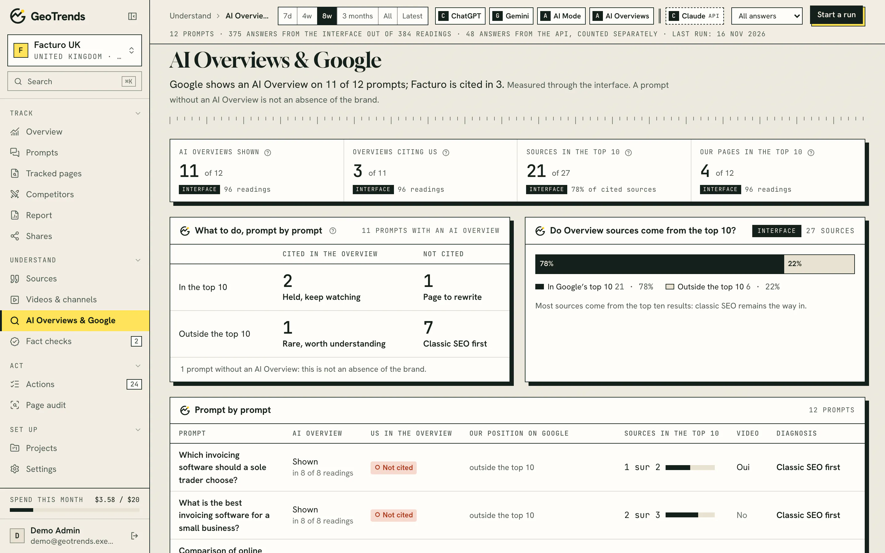
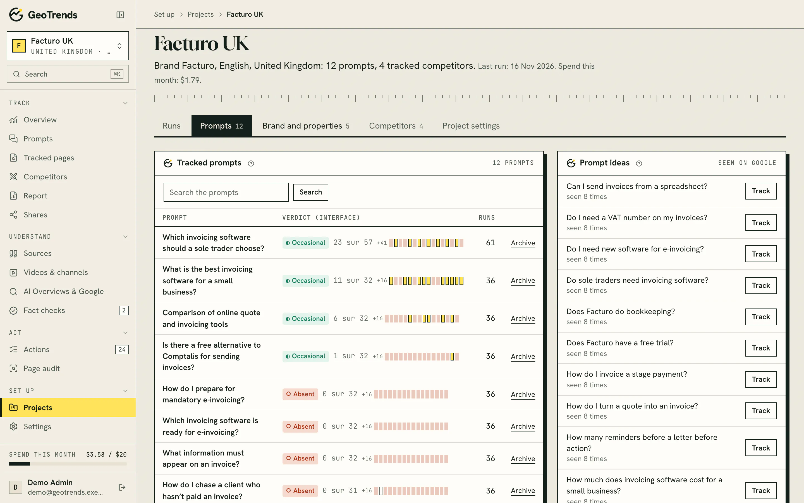

<!-- Page generated from the site documentation (src/site/docs) by scripts/exporter-docs.ts: do not edit it here. -->

# Am I tracking the right prompts?

> Check that your prompts are the ones your customers ask: verdicts, brand named first, ideas from Google and the AIs, prompts to add or to archive.

[← Documentation contents](../README.md) · [Lire cette page en français](../../fr/cas-usage/suivre-les-bonnes-questions.md)

You wrote a first list of prompts when you created the Facturo UK project. A few runs later, a doubt sets in: do these prompts sound like what your customers really ask AI assistants, or like what you would like them to ask? Every number in the tool rests on this list. It deserves a second look.

## What you need

- A project with its prompts, and at least two or three runs. Before that, every prompt carries the verdict “too early to tell”.
- A run that includes Google AI Overviews: it brings back the “People also ask” questions.
- Readings from ChatGPT or Claude, to see the searches the AI runs on its own before answering.

## Steps

1. **Read the verdicts, prompt by prompt.** Open **Prompts**. Each row shows the latest state on each AI, then the **Verdict** over the period (solid, occasional, absent) and the brand **Named first**. A prompt where Facturo is absent is not a bad prompt: it is often the one to win. Look at who is named first instead: if it is never an invoicing tool, the prompt may not mean what you think.

   

2. **See what people actually ask.** Open **AI Overviews & Google**, block **Prompt ideas to track**. It lists the “People also ask” questions Google shows under your prompts, and the searches ChatGPT or Claude typed before answering, most frequent first. These are real wordings, not yours.

   

3. **Add the prompts you keep.** The **Add to the project** button takes an idea as it is. To write your own prompts, open the project page, tab **Prompts**: one prompt per line, the way a customer would ask an AI. Adding a prompt is free; spending starts at the next run.

   

4. **Archive what no longer helps.** In **Prompts**, tick the prompts that no longer matter, then **Archive the selected prompts**. They are no longer captured and no longer count in the numbers; their history stays, and they can be resumed at any time. A prompt that already has readings cannot be edited: to reword it, archive it and write a new one.

5. **Check the balance of the list.** Open **Filter and group** above the table. The **Intent** (learn, compare, buy), **Topic** and **Brand name** filters show how the list is spread. A list made only of “buy” prompts, or of prompts that already contain the word Facturo, says little about your place with customers who do not know you yet.

## The decision it supports

Which prompts to keep, which to add, which to archive. And therefore what visibility, share of voice and the work list will be computed on in the weeks that follow.

> [!WARNING]
> **Before you act**
>
> The tool shows no search volume: no AI engine publishes what it is asked, and Google’s “People also ask” questions are real questions with no known frequency. Changing the list also changes the base of the numbers: to compare two periods, compare periods with the same list, or read the prompts one by one.

**See also**

- [Write the prompts to track](../project/prompts.md)
- [The Prompts screen](../measure/prompts.md)
- [AI Overviews and Google results](../understand/google.md)
- [Branded or unbranded: how should I split my prompts?](./branded-or-unbranded-prompts.md)

---

Updated: 2026-11-18 · [Read this page on the website](https://geotrends.io/en/use-cases/tracking-the-right-prompts)
