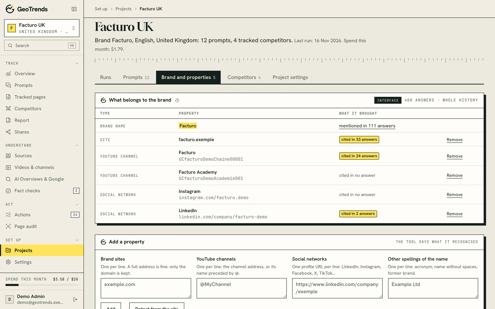
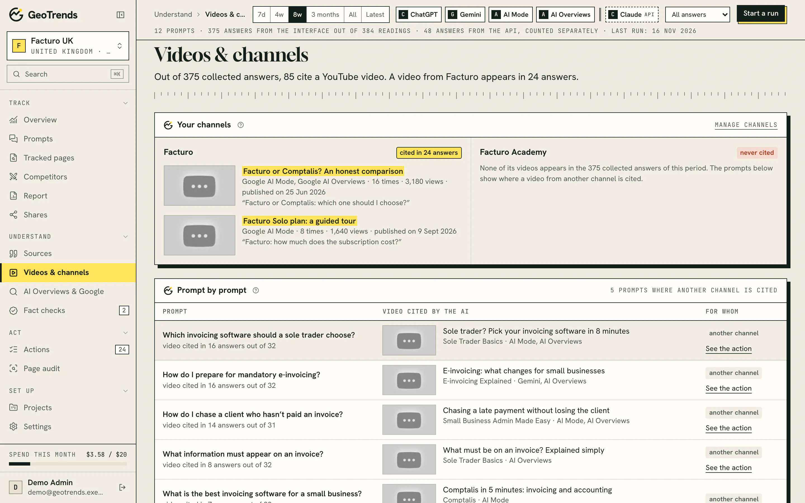

<!-- Page generated from the site documentation (src/site/docs) by scripts/exporter-docs.ts: do not edit it here. -->

# Which YouTube videos should I make?

> The prompts where AIs cite a YouTube video that is not yours, the channels that take the spot, and how to turn that into a list of videos to make.

[← Documentation contents](../README.md) · [Lire cette page en français](../../fr/cas-usage/videos-a-tourner.md)

Facturo has two channels, “Facturo” and “Facturo Academy”, and a list of video ideas longer than the time available to shoot them. Some AIs, Google first, cite YouTube videos in their answers. The ones they cite on your prompts tell you which subjects to film first.

## What you need

- The brand’s YouTube channels declared in the project. A cited video counts for the channel that published it: without the declaration, a Facturo Academy video would count for “youtube.com”.
- Runs whose answers cite videos. The title, channel, date and views of each cited video are read for free.

## Steps

1. **Declare the channels.** Open the project page, tab **Brand and properties**, section **YouTube channels**: one channel per line, its address or its name preceded by @. The **Detect from the site** button also suggests the channels linked from the home page.

   

2. **See whether your channels are cited.** Open **Videos & channels**. The **Your channels** block gives one card per declared channel, even one never cited: the number of answers that cite one of its videos, and its most cited video.

   

3. **Spot the prompts where another video is cited.** The **Prompt by prompt** block lists the prompts for which an AI cites at least one YouTube video, with the thumbnail, the channel, the views and, when the address gives it, the passage cited. The **For whom** column says whether the video is yours. At the top, the prompts where the cited video belongs to another channel.

4. **Know the competing channels.** The **Other channels cited** block gathers the channels of other creators or brands with a cited video. Those that keep coming back are your YouTube competitors on these prompts, even when they are not software companies.

5. **Go through the work list.** On **Actions**, the **Write or film** group holds a “Shoot a video on …” row for each prompt where AIs cite videos and none of yours. The row lists the cited videos, their channel and their views. The **See the action** link on the videos screen leads there too.

## The decision it supports

Which subjects to film first: the prompts where AIs already cite videos, none of them Facturo’s. And from which angle: that of the cited videos, their length, the passage that serves as the answer. A prompt where no AI cites a video is probably not won through YouTube.

> [!WARNING]
> **Before you act**
>
> Not every AI cites videos: over some periods only Google does, and the screen says so. Cited videos are often few enough to count on one hand: the screen counts captured answers, with no percentage. A published video will not necessarily be cited; the next measurement will tell, without proving the video is the cause.

**See also**

- [Videos and channels](../understand/videos.md)
- [Sites, YouTube channels and social profiles](../project/sites-channels-profiles.md)
- [The work list](../act/work-list.md)
- [Is my brand cited, mentioned or absent?](./cited-mentioned-or-absent.md)
- [Did my fix make a difference?](./did-my-fix-work.md)

---

Updated: 2026-11-18 · [Read this page on the website](https://geotrends.io/en/use-cases/videos-to-make)
