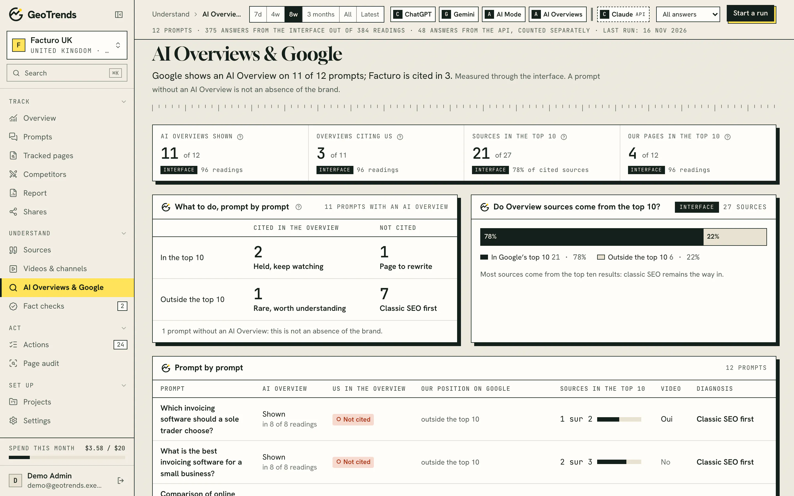
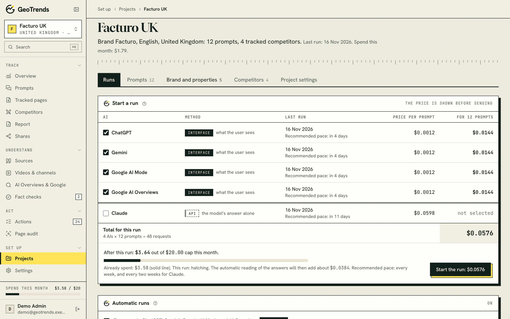

<!-- Page generated from the site documentation (src/site/docs) by scripts/exporter-docs.ts: do not edit it here. -->

# Which AI engines should I look at first, and why is Claude kept apart?

> Four AI engines read through the interface, one through its API: how to compare them, where to start, and why Claude’s number is never added to the others.

[← Documentation contents](../README.md) · [Lire cette page en français](../../fr/cas-usage/quelles-ia-regarder.md)

GeoTrends captures five AI engines. Four through their interface, as a person sees them: ChatGPT, Gemini, Google AI Mode and Google AI Overviews. The fifth, Claude, through its API: the answer of the bare model. With a few hours a week for Facturo, you have to choose where to look first.

## What you need

- At least one run of the four interface AIs on the project’s prompts.
- For the Claude reference point: Claude readings, ticked when you start a run or scheduled every two weeks.

## Steps

1. **Compare the interface AIs.** Open **Overview**. The tiles at the top cover the four interface AIs together. Further down, the **Presence, AI by AI** table gives one row per AI, never adding them up: **Runs**, **Visibility**, **Change**, **Site cited**, **Video cited**, **Name only**, **Read, not cited**. The “strongest” and “weakest” labels only show when at least two AIs have enough answers to be compared. Under each name, the model that answered.

   

2. **Look at Google separately.** Open **AI Overviews & Google**. The **AI Overviews shown** tile tells you on how many prompts Google displays an AI Overview. A prompt with no Overview is left out of the calculation: it is not an absence of Facturo, and not a prompt to work on for Google. The **What to do, prompt by prompt** block crosses Google’s top ten results with the Overview’s sources.

   

3. **Read one AI on its own.** In the top bar, the **AI** filter hides or shows each AI. A hidden AI leaves the numbers of every screen, and nothing is deleted: handy to read ChatGPT alone, then Gemini alone.

4. **Read Claude separately.** On **Overview**, the **Claude (API)** tile and the **Claude, measured through its API** block have their own number and their own dotted line. In tables, Claude’s column is set apart by a double rule. Its number tells you whether the model knows Facturo and recommends it; it does not tell you what the Claude app displays.

5. **Choose the pace and the price.** Open the project page, tab **Runs**. The price per prompt of each AI is shown before anything is sent: $0.0012 through the interface, about $0.06 for Claude. The **Automatic runs** block offers every week for the four interface AIs, every two weeks for Claude.

   

## The decision it supports

Which AI to start working on: usually the interface AI where Facturo is weakest, while keeping an eye on ChatGPT because it also reports the pages it read without citing and the searches it ran. For Google, only work on the prompts where an AI Overview shows. And whether to pay for Claude: useful as a reference point on the model, not as a measure of what your customers see.

> [!WARNING]
> **Before you act**
>
> Perplexity and Copilot are not tracked. Claude is queried through its API with web search turned on: a gap between Claude and ChatGPT may come from the method as much as from the model. Gemini and Google report neither the pages read without being cited nor the searches they ran. Every reading starts from a neutral session with no history: a signed-in person may get a different answer.

**See also**

- [AI engines tracked](../reference/ai-engines.md)
- [Measurement method](../reference/method.md)
- [Overview](../measure/overview.md)
- [Automatic runs](../project/scheduled-runs.md)
- [Does ChatGPT cite my brand, and on which prompts?](./does-chatgpt-cite-my-brand.md)

---

Updated: 2026-11-18 · [Read this page on the website](https://geotrends.io/en/use-cases/which-ai-engines-first)
