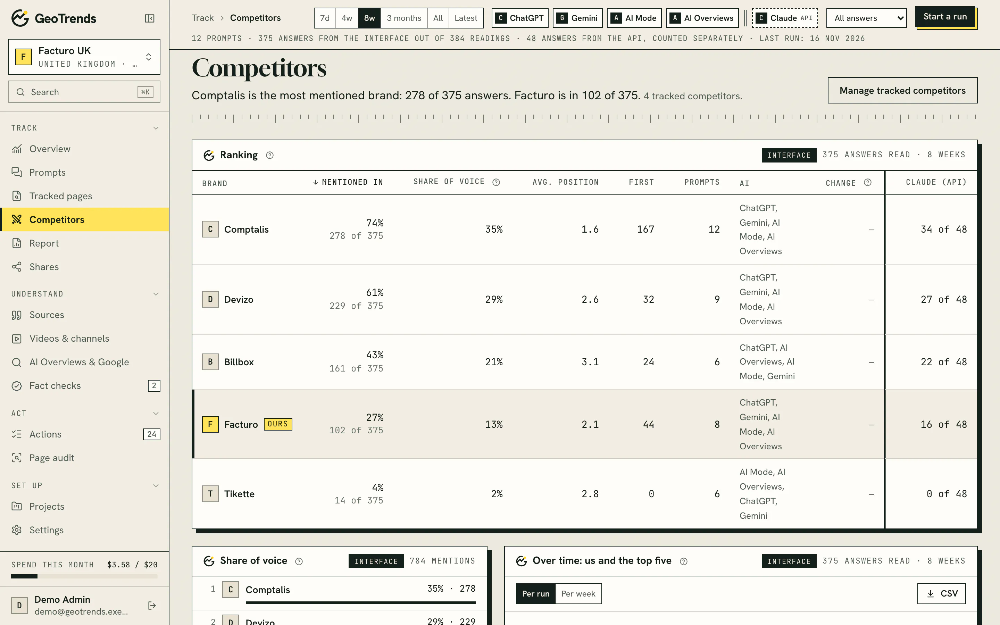

<!-- Page generated from the site documentation (src/site/docs) by scripts/exporter-docs.ts: do not edit it here. -->

# Who is cited instead of me?

> The brands AIs name on your prompts, the ones to track as competitors, their position, their share of voice, and the pages that get them cited instead of you.

[← Documentation contents](../README.md) · [Lire cette page en français](../../fr/cas-usage/qui-est-cite-a-ma-place.md)

On “Which invoicing software should a sole trader choose?”, Facturo does not appear. Someone is bound to appear in its place. You had Comptalis and Devizo in mind; the AIs may name others. You need to know who, on which prompts, and thanks to which pages.

## What you need

- Answers whose brands have been read. ChatGPT returns them with its answer; for the other AIs, automatic reading extracts them after each run.
- At least one tracked competitor, so that share of voice can be computed. Tracking a brand is free and starts no run.

## Steps

1. **See who is mentioned instead of you.** On **Overview**, the **Mentioned instead of us** block lists the other brands named by interface AIs, with their number of answers, how often they are named first and their average position. The **Track** button makes one a competitor of the project.

2. **Choose the competitors to track.** Open **Competitors**. The **Brands spotted, not tracked yet** block offers **Track** or **Dismiss** for each brand mentioned. Dismissing removes the brand from the list without changing any number. Track Comptalis, Devizo, Tikette, Billbox, and any brand you discover here.

   

3. **Read the ranking.** The **Ranking** table puts Facturo and the tracked competitors side by side: **Mentioned in**, **Share of voice**, **Avg. position**, **First**, **Prompts**, **AI**, **Change**. The **Head-to-head** table further down takes each metric as a row, one brand per column, and marks the best cell of each row with a green rule.

4. **See who wins each prompt.** On **Prompts**, the **Named first** column gives, for each prompt, the brand most often named first. On **Competitors**, the **Prompt by prompt, AI by AI** grid, set to **Named first**, shows it AI by AI.

5. **Find the pages that get them cited.** Open **Sources**, tab **Pages**, and select **Only pages cited without us**. The **Without us** column counts the answers that cite the page without naming or citing Facturo. Clicking a row opens its sheet: the answers that cite it and the brands mentioned alongside.

## The decision it supports

Which brands to track as competitors, and which to dismiss. On which prompts each one takes your place, on which AIs. And which pages, often comparison sites, you would need to get into or to write in order to enter these answers.

> [!WARNING]
> **Before you act**
>
> An answer whose brands have not been read yet is left out of the rankings: automatic reading can get a spelling or a similar name wrong, so open a few answers to check. The brands attached to a cited page are those of the answer: the page’s own content is not read. Claude, measured through its API, has its own column and is never part of a total.

**See also**

- [Competitors and share of voice](../understand/competitors.md)
- [Choose your competitors](../project/competitors.md)
- [Cited sources](../understand/sources.md)
- [Which competitor is moving in on my topics?](./competitor-moving-in.md)
- [Which page should I get into first?](./pages-to-appear-on.md)

---

Updated: 2026-11-18 · [Read this page on the website](https://geotrends.io/en/use-cases/who-is-cited-instead-of-me)
