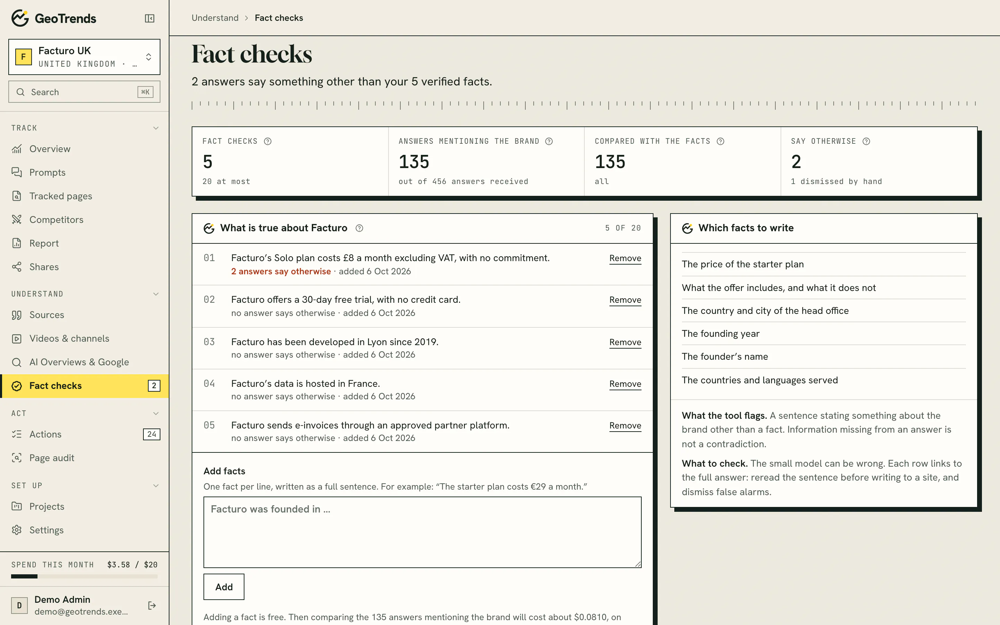

<!-- Page generated from the site documentation (src/site/docs) by scripts/exporter-docs.ts: do not edit it here. -->

# An AI keeps saying something wrong about my brand: what can I do?

> Write down what is true about the brand, spot the answers that say otherwise, trace the page used as a source, then fix it or ask its author for a correction.

[← Documentation contents](../README.md) · [Lire cette page en français](../../fr/cas-usage/information-fausse.md)

A prospect writes that Facturo “costs more than expected”. They read a price in an AI answer, and that price has not been yours for a long time. An error repeated by an AI spreads quietly: you need to spot it, find where it comes from, and fix it at the source.

## What you need

- Verified facts about the brand, written by you: a price, a plan, a country, a founding date. Twenty at most per project; entering them is free.
- Answers that name Facturo. Prompts that contain the brand name produce the most.
- One paid click to compare the answers already captured; later ones are compared during their automatic reading, at no extra cost.

## Steps

1. **Write down what is true.** Open **Fact checks**. In **What is true about Facturo**, write one fact per line, as a full sentence, precise and checkable: the price of the starter plan, the countries served, the founding date. The **Which facts to write** block gives examples. Five to twenty facts are enough.

2. **Compare the answers with the facts.** The **Check the answers** button shows its price before you click. A small model rereads each answer that names Facturo and picks out the sentences that contradict a fact. Answers that do not name the brand are not reread: they cannot contradict it.

3. **Read the contradictions.** The **Answers that say otherwise** table gives, for each sentence, the **Verified fact** contradicted, **What the answer says**, the AI and its method (interface or API), the **Source cited in support**, a link to the full answer and the **Next step**. A false alarm is set aside with **Dismiss (false alarm)**.

   

4. **Trace the source.** If the sentence relies on a page of facturo.exemple, fix your page: an old, forgotten price list is enough to mislead an AI. If the page belongs to another site, its author can correct it. If no source is cited, check that your own pages state the fact clearly, somewhere easy to find.

5. **Follow the correction.** Each contradiction is also a row in **Actions**, in the **Correct a wrong fact** group. Log the **Correction request** you sent under **Outreach**, then set the row to **Done** once the source is fixed. The next runs will tell whether the sentence comes back.

## The decision it supports

Who must fix what: your team if the source is yours, the author of a third-party page otherwise, and a clearer page on your side when the AI cites nothing. And which errors come first: those that recur across several AIs, or that concern the price.

> [!WARNING]
> **Before you act**
>
> The small model can be wrong: reread the sentence in the full answer before writing to a site. Information missing from an answer is not a contradiction. Here, interface and API are counted together, because sentences are reread rather than a share measured; each row states its method. A corrected source can take time to disappear from answers, and nothing guarantees that it will.

**See also**

- [Fact checks](../understand/fact-checks.md)
- [Following up an action and its outreach](../act/outreach.md)
- [The work list](../act/work-list.md)
- [Branded or unbranded: how should I split my prompts?](./branded-or-unbranded-prompts.md)
- [Did my fix make a difference?](./did-my-fix-work.md)

---

Updated: 2026-11-18 · [Read this page on the website](https://geotrends.io/en/use-cases/wrong-information)
