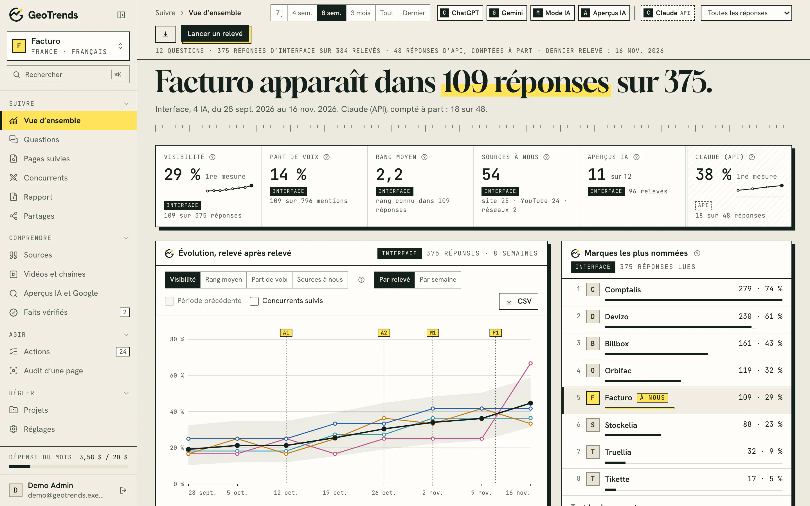

<!-- Page générée depuis la documentation du site (src/site/docs) par scripts/exporter-docs.ts : ne pas la modifier ici. -->

# Qu’est-ce que GeoTrends ?

> GeoTrends relève ce que ChatGPT, Gemini, Claude et Google répondent à vos clients, dit si votre marque y figure, qui est cité à sa place et quoi corriger.

[Read this page in English](../en/README.md)

Quand un client demande à une IA « quel logiciel de facturation choisir pour un indépendant ? », la réponse nomme quelques marques et cite quelques pages. GeoTrends pose ces questions à votre place, garde chaque réponse avec ses sources, et dit si votre marque y figure. C’est un outil de **GEO** (Generative Engine Optimization) : le référencement dans les réponses des IA.

Il sert à trois choses : **mesurer** la place de la marque, IA par IA et question par question ; **comprendre** qui est cité à sa place et grâce à quelles pages ; **agir** à partir d’une liste de travail tirée des relevés, puis mesurer de nouveau.

*La vue d’ensemble du projet d’exemple Facturo : la visibilité, la part de voix, le rang moyen et leur évolution, chaque chiffre avec sa méthode et son nombre de réponses.*

## Ce que fait l’outil

- **Il pose vos questions aux IA**, celles que vos clients leur posent, depuis le pays et dans la langue du projet. ChatGPT, Gemini, le Mode IA et les Aperçus IA de Google sont relevés dans leur interface ; Claude est interrogé par son API.
- **Il garde chaque réponse** : son texte, les sources citées, les pages lues, les marques nommées dans l’ordre. Pour chacune, il dit si la marque est **citée** (une de ses pages ou vidéos en source), **nommée** (son nom dans le texte) ou **absente**.
- **Il montre qui prend la place** : les marques nommées le plus souvent, les sites et les pages qui servent de sources, les vidéos YouTube, les résultats de Google sous chaque Aperçu IA.
- **Il en tire une liste de travail** : les pages où apparaître, vos pages à corriger, les sujets à couvrir, les faits faux à faire corriger. Une action faite est suivie : l’outil compare la présence avant et après.

## Quatre principes, visibles à l’écran

| Principe | Ce que cela veut dire dans l’outil |
| --- | --- |
| Des données vraies | Un relevé d’interface montre ce que voit un internaute. Claude, interrogé par son API, a toujours sa propre colonne : les deux méthodes ne sont jamais additionnées. |
| Des chiffres fiables | Chaque chiffre dit sur combien de réponses il repose. Sous 5 réponses, aucun pourcentage n’est affiché. Un écart n’est coloré que s’il dépasse la marge d’erreur. |
| De l’action | Chaque ligne de la liste de travail renvoie aux réponses qui la justifient. Aucune note de gain n’est inventée. |
| Les coûts en clair | Le prix d’un relevé s’affiche avant l’envoi, et chaque appel payant est inscrit au journal des coûts, avec un plafond par mois. |

> [!NOTE]
> **Un logiciel libre et gratuit**
>
> GeoTrends est publié sous licence AGPL-3.0 : vous l’installez chez vous, avec vos propres clés d’API, et vous ne payez que vos relevés, directement aux fournisseurs. Voir [Installer GeoTrends](./demarrer/installer.md). Les captures de cette documentation montrent une marque d’exemple, Facturo, et ses concurrents fictifs.

## Ce qu’il ne fait pas

- **Il ne promet aucune citation.** Personne ne sait obtenir une citation à coup sûr. L’outil mesure, vous corrigez, il mesure de nouveau.
- **Il ne donne pas de note sur 100.** Une visibilité se lit avec sa méthode et son nombre de réponses, pas comme un score.
- **Il ne suit pas Perplexity ni Copilot**, et ne relie pas les visites venues des IA (Google Analytics, Search Console). Ces deux chantiers ne sont pas faits.
- **L’envoi du rapport du lundi par e-mail n’a pas encore été éprouvé.** Le rapport est écrit et se lit à l’écran ; l’envoi demande une clé du service Resend et n’a pas encore servi en conditions réelles.

**Par où commencer**

- [Installer GeoTrends](./demarrer/installer.md) : Installer l’outil chez vous et brancher vos clés, en un quart d’heure.
- [Prise en main](./demarrer/prise-en-main.md) : Du premier projet au premier relevé, en six étapes.
- [Notions clés](./demarrer/notions-cles.md) : Question, relevé, méthode, visibilité, part de voix : les mots de l’outil.
- [Lire ses premiers résultats](./demarrer/premiers-resultats.md) : Ce qu’il faut regarder, et dans quel ordre, quand les réponses reviennent.
- [Méthode de mesure](./reference/methode.md) : Comment l’outil compte, et ce qu’il ne sait pas.

## Sommaire

### Démarrer

Ce que mesure l’outil, comment l’installer, les mots à connaître, le premier relevé et ce qu’il coûte.

- [Installer GeoTrends](./demarrer/installer.md) : Installer GeoTrends chez vous avec Docker : télécharger le code, brancher vos clés d’API (DataForSEO, DeepSeek ou Anthropic), créer le compte administrateur.
- [Prise en main](./demarrer/prise-en-main.md) : Du premier projet aux premiers résultats en six étapes : créer la marque, déclarer ce qui lui appartient, écrire ses questions, lancer un relevé, puis lire.
- [Notions clés](./demarrer/notions-cles.md) : Question, relevé, méthode, présence, visibilité, part de voix, verdict, marge d’erreur : les mots de l’outil et ce qu’ils comptent exactement, avant de lire un écran.
- [Lire ses premiers résultats](./demarrer/premiers-resultats.md) : Quand les réponses du premier relevé reviennent : les faire lire, puis regarder la vue d’ensemble, les verdicts, les marques et les sources, dans cet ordre.
- [Ce que coûte un relevé](./demarrer/couts.md) : Le prix de chaque appel payant, ce qui est gratuit, le plafond du mois et le seuil de confirmation, avec des exemples de budget pour 10 et 50 questions par mois.
- [Questions fréquentes](./demarrer/questions-frequentes.md) : GEO, interface ou API, relevés répétés, absence de note sur 100, vidéos YouTube, Aperçus IA absents, coûts, Claude à part : les réponses courtes aux questions courantes.

### Préparer un projet

Une marque, ce qui lui appartient, ses concurrents, ses questions, et les relevés.

- [Créer un projet](./projet/creer-un-projet.md) : Un projet suit une marque : ce qui lui appartient, ses concurrents, ses questions, son pays et sa langue. Le créer est gratuit : la dépense vient avec le relevé.
- [Sites, chaînes YouTube et réseaux sociaux](./projet/sites-chaines-reseaux.md) : Déclarer ce qui appartient à la marque : sites, chaînes YouTube, profils sociaux, autres écritures du nom. Une citation de l’un d’eux compte alors pour elle.
- [Choisir ses concurrents](./projet/concurrents.md) : Suivre trois à six marques face à la vôtre : c’est ce qui rend la part de voix calculable et leur attribue les pages citées. Suivre une marque est gratuit.
- [Écrire les questions à suivre](./projet/questions.md) : Les questions sont ce que vos clients demandent aux IA, et tout ce que mesure l’outil en dépend. Comment les écrire, les ajouter, les archiver, trouver des idées.
- [Lancer un relevé](./projet/lancer-un-releve.md) : Un relevé pose les questions du projet aux IA cochées. Le prix de chaque IA s’affiche avant l’envoi, le plafond du mois est vérifié : rien ne part sans votre clic.
- [Relevés automatiques](./projet/releves-automatiques.md) : Chaque semaine pour ChatGPT, Gemini et Google, toutes les deux semaines pour Claude : les relevés partent seuls et s’arrêtent si le plafond du mois est atteint.

### Mesurer

La visibilité de la marque, IA par IA et question par question, avec chaque réponse.

- [Vue d’ensemble](./mesurer/vue-d-ensemble.md) : L’écran d’accueil de l’outil : visibilité, part de voix, rang moyen, alertes et présence IA par IA, puis les trois actions de la semaine. Chaque chiffre dit sa méthode.
- [L’écran Questions](./mesurer/questions.md) : Une ligne par question : l’état chez chaque IA, un verdict sur la période plutôt qu’un pourcentage, et qui est nommé en premier. Le point de départ pour agir.
- [La page d’une question](./mesurer/fiche-question.md) : Tout sur une question : le verdict et sa marge d’erreur, l’état chez chaque IA, chaque réponse entière avec ses sources, qui gagne et grâce à quelles pages.
- [Pages suivies](./mesurer/pages-suivies.md) : Partir d’une page de la marque : l’outil la lit, propose les questions auxquelles elle répond, puis dit si les IA la citent et ce qu’elles citent à sa place.
- [Toutes les réponses](./mesurer/reponses.md) : La preuve derrière chaque chiffre : les réponses relevées, filtrées par IA, par présence de la marque, par marque nommée ou site cité, chacune lisible en entier.
- [Mesure approfondie](./mesurer/mesure-approfondie.md) : Poser une même question 5, 10 ou 25 fois de suite pour trancher son verdict et resserrer la marge d’erreur, sans fausser les chiffres d’ensemble du projet.

### Comprendre

Qui est cité à votre place, grâce à quelles pages, vidéos et résultats de Google.

- [Concurrents et part de voix](./comprendre/concurrents.md) : Quelles marques les IA nomment sur vos questions, à quel rang et dans quelle part des réponses : classement, part de voix, face-à-face, question par question.
- [Sources citées](./comprendre/sources.md) : Les sites et les pages que les IA citent pour répondre à vos questions : leur type, à qui ils appartiennent, vos pages, et ce qui a bougé au dernier relevé.
- [Vidéos et chaînes](./comprendre/videos.md) : Vos chaînes YouTube sont-elles citées par les IA, sur quelles questions une vidéo d’une autre chaîne prend la place, et quelles autres chaînes reviennent ?
- [Aperçus IA et résultats de Google](./comprendre/google.md) : Les Aperçus IA de Google face aux dix premiers résultats de la recherche : une consigne par question, la part des sources classées, des idées de questions.
- [Faits vérifiés](./comprendre/faits-verifies.md) : Vous écrivez ce qui est vrai sur la marque : prix, offre, pays, dates. L’outil signale les réponses des IA qui disent autre chose, et la source en cause.
- [Thèmes et carte des thèmes](./comprendre/themes.md) : Un thème et une intention par question, posés par un petit modèle ou à la main, puis la carte des thèmes : ceux que la marque tient, ceux qu’on lui prend.

### Agir

La liste de travail tirée des relevés, les prises de contact, puis le résultat.

- [La liste de travail](./agir/liste-de-travail.md) : Ce qu’il faut faire pour entrer dans les réponses, tiré des relevés : pages à corriger, pages où apparaître, sujets à couvrir, faits faux, avec la preuve.
- [Suivre une action et ses prises de contact](./agir/prises-de-contact.md) : La fiche d’une action garde son état, une note, la date où elle a été faite et le journal des prises de contact : à qui, quand, et ce qui en est revenu.
- [Mesurer après une action](./agir/mesure-apres-action.md) : Une action faite est suivie : la présence de la marque sur ses questions, quatre semaines avant et après, et une phrase qui dit si l’écart dépasse le bruit.
- [Audit d’une page](./agir/audit.md) : Une IA peut-elle lire votre page et y trouver une réponse ? Robots autorisés, réponse du serveur, texte sans JavaScript, titres, données, date, auteur.

### Piloter

Le rapport, les coûts, les exports, les réglages et les comptes.

- [Rapport et alertes](./piloter/rapport-et-alertes.md) : Le rapport compare les deux derniers jours de relevé : présences gagnées ou perdues, nouvelles marques, sources, dépense. Les alertes gardent les écarts réels.
- [Partager avec un client](./piloter/partager-avec-un-client.md) : Un lien privé, sans compte, qu’un client ou un partenaire ouvre pour voir où en est sa marque sur une série de questions. Mis à jour à chaque relevé, coupé en un clic.
- [Le tableau des coûts](./piloter/couts.md) : Chaque appel payant est inscrit au journal des coûts. Cet écran en tire la dépense du mois, sa projection, le plafond et le détail par fournisseur et projet.
- [Exports CSV](./piloter/exports.md) : Quatre exports CSV gratuits : les réponses relevées, les sources citées, la liste de travail et le journal des coûts, plus les données de chaque graphique.
- [Réglages](./piloter/reglages.md) : Les réglages de tout l’outil : langue de l’interface, seuil de confirmation, rythme des relevés de chaque projet, état des connexions, votre mot de passe et les comptes de l’équipe.
- [Comptes et connexion](./piloter/comptes.md) : Le premier compte se crée au premier lancement ; ensuite chaque personne est invitée et choisit son mot de passe par un lien. Deux rôles, le menu, la recherche.

### Référence

Les IA suivies, la méthode, les pays et langues, le glossaire, les nouveautés.

- [Les IA suivies](./reference/ia-suivies.md) : ChatGPT, Gemini, le Mode IA et les Aperçus IA de Google sont relevés dans leur interface, Claude par son API. Ce que contient chaque relevé, et les IA absentes.
- [Méthode de mesure](./reference/methode.md) : Comment l’outil compte : présence de la marque, seuils, verdict, marge d’erreur, écarts réels, périodes, méthodes séparées, et ce que la mesure ne dit pas.
- [Pays et langues](./reference/pays-et-langues.md) : Chaque projet pose ses questions depuis un pays et dans une langue, fixés au premier relevé. Les pays et langues proposés, et la langue de l’interface, à part.
- [Glossaire](./reference/glossaire.md) : Les mots de GeoTrends en une ligne chacun : question, relevé, méthode, visibilité, part de voix, verdict, marge d’erreur, source, liste de travail, rapport…
- [Nouveautés](./reference/nouveautes.md) : Ce qui a changé dans GeoTrends, jour par jour, le plus récent en tête : logiciel libre à installer chez soi, pages suivies, partage client, invitations, documentation.

## Cas d’usage

Chaque cas d’usage part d’une question qu’on se pose, dit quelles données regarder et dans quel écran, puis ce que la mesure permet de décider.

### Démarrer le suivi

- [Suis-je en train de suivre les bonnes questions ?](./cas-usage/suivre-les-bonnes-questions.md) : Vérifier que vos questions sont celles de vos clients : verdicts, premier nommé, idées tirées de Google et des IA, questions à ajouter ou à archiver.
- [Avec ou sans nom de marque : comment répartir mes questions ?](./cas-usage/questions-avec-ou-sans-marque.md) : Une question qui contient le nom de la marque ne mesure pas la même chose qu’une autre. Comment les repérer, les lire à part et les répartir dans un projet.
- [Quelles IA regarder en premier, et pourquoi Claude est-il à part ?](./cas-usage/quelles-ia-regarder.md) : Quatre IA relevées par l’interface, une par son API : comment les comparer, par laquelle commencer, et pourquoi le chiffre de Claude ne s’additionne jamais.

### Comprendre sa visibilité

- [ChatGPT cite-t-il ma marque, et sur quelles questions ?](./cas-usage/chatgpt-cite-t-il-ma-marque.md) : Le chiffre de ChatGPT, puis la liste des questions où il cite, nomme ou ignore la marque, jusqu’au texte de chaque réponse avec ses sources et ses recherches.
- [Ma marque est-elle citée, nommée ou absente ?](./cas-usage/citee-nommee-ou-absente.md) : Site cité, vidéo citée, nom seul, page lue sans être citée : quatre façons d’être dans une réponse d’IA, qui ne se lisent pas et ne se corrigent pas pareil.
- [Un chiffre a bougé : vraie évolution ou bruit ?](./cas-usage/evolution-ou-bruit.md) : Marge d’erreur, écarts colorés, repères sur la courbe et mesure approfondie : comment savoir si une hausse ou une baisse est réelle avant d’y réagir.

### Face aux concurrents

- [Qui est cité à ma place ?](./cas-usage/qui-est-cite-a-ma-place.md) : Les marques que les IA nomment sur vos questions, celles à suivre comme concurrents, leur rang, leur part de voix, et les pages qui les font citer à votre place.
- [Quel concurrent s’installe sur mes sujets ?](./cas-usage/concurrent-qui-s-installe.md) : Repérer la marque qui monte dans les réponses des IA, vérifier que la hausse dépasse la marge d’erreur, puis voir sur quelles questions et grâce à quelles pages.
- [Sur quels thèmes suis-je absent alors qu’un concurrent tient la place ?](./cas-usage/themes-ou-je-suis-absent.md) : Étiqueter les questions par thème, lire la carte des thèmes (tenu, disputé, à reprendre, angle mort) et choisir où mettre l’effort, thème par thème.

### Améliorer ses contenus et sa réputation

- [Dans quelle page faut-il apparaître en premier ?](./cas-usage/pages-ou-apparaitre.md) : Les pages que les IA citent sur vos questions sans vous, classées par type de site, et la façon de choisir celle où demander une place, puis de suivre la démarche.
- [Ma page est lue mais pas citée : que corriger ?](./cas-usage/page-lue-pas-citee.md) : Une IA ouvre votre page puis cite celle d’un autre, ou Google la classe sans la reprendre dans son Aperçu IA : comment le voir, comparer et reformuler.
- [Une IA répète une information fausse sur ma marque : que faire ?](./cas-usage/information-fausse.md) : Écrire ce qui est vrai sur la marque, repérer les réponses qui disent autre chose, remonter à la page qui sert de source, puis corriger ou demander une correction.
- [Quelles vidéos YouTube tourner ?](./cas-usage/videos-a-tourner.md) : Les questions où les IA citent une vidéo YouTube qui n’est pas la vôtre, les chaînes qui prennent la place, et comment en tirer une liste de vidéos à tourner.

### Mesurer l’effet

- [Ma correction a-t-elle compté ?](./cas-usage/effet-d-une-correction.md) : Marquer une action faite, lire la présence de la marque avant et après sur les questions concernées, et savoir ce qu’on peut en dire, et ce qu’on ne peut pas.
- [Comment préparer le point du lundi avec l’équipe ?](./cas-usage/point-du-lundi.md) : Le rapport compare les deux derniers relevés, la liste de travail dit quoi faire, les exports donnent les données : un ordre du jour en un quart d’heure, sans bruit.

### Technique et budget

- [Les robots des IA peuvent-ils lire ma page ?](./cas-usage/robots-des-ia.md) : Un audit gratuit d’une page : ce que le robots.txt autorise, ce que le serveur répond aux robots des IA, le texte lisible sans JavaScript et ce qui gêne la citation.
- [Comment suivre une marque sans dépasser son budget ?](./cas-usage/budget-de-suivi.md) : Prix affiché avant chaque envoi, rythme des relevés automatiques, seuil de confirmation et plafond du mois : régler la dépense d’un projet avant qu’elle n’arrive.

---

Mise à jour : 2026-11-25 · [Lire cette page sur le site](https://geotrends.io/documentation)
