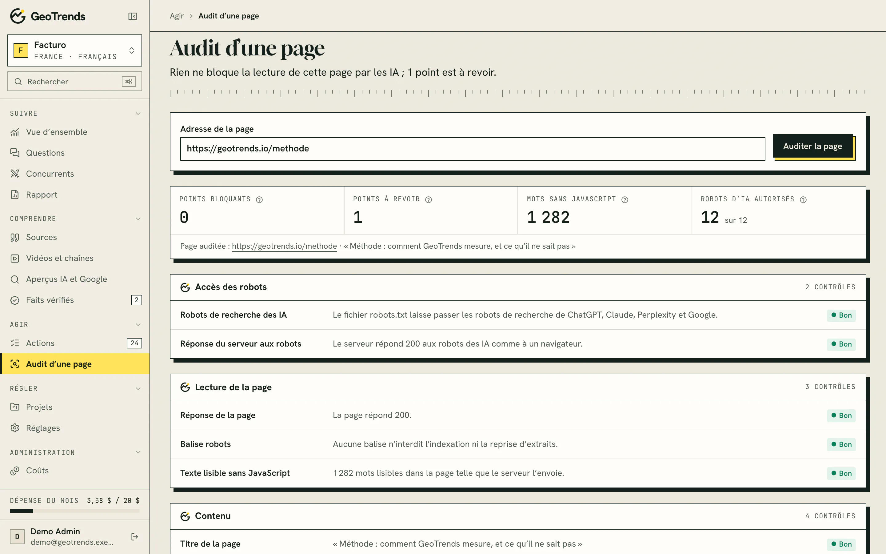

<!-- Page générée depuis la documentation du site (src/site/docs) par scripts/exporter-docs.ts : ne pas la modifier ici. -->

# Audit d’une page

> Une IA peut-elle lire votre page et y trouver une réponse ? Robots autorisés, réponse du serveur, texte sans JavaScript, titres, données, date, auteur.

[← Sommaire de la documentation](../README.md) · [Read this page in English](../../en/act/page-audit.md)

Avant de réécrire une page, il faut savoir si le blocage n’est pas technique : un robot interdit, un serveur qui refuse les robots, un texte qui n’apparaît qu’avec JavaScript. L’audit lit la page comme le font les robots des IA et dit, point par point, ce qui empêche une IA de la lire ou de la reprendre. La lecture est directe et gratuite : aucun appel payant.

Saisissez l’adresse complète d’une page publique dans **Adresse de la page**, puis **Auditer la page**. On arrive aussi ici par le bouton **Auditer** de l’onglet Nos pages de l’écran Sources, par **Auditer cette page** sur une ligne « Corriger nos pages » de la liste de travail, et par **Auditer une page** dans la barre du haut de l’écran Actions. Une adresse locale ou une adresse IP est refusée : « Cette adresse n’est pas lisible. »

*L’audit d’une page de facturo.exemple : le résumé en quatre chiffres, puis les contrôles rangés en quatre familles, chacun avec son état.*

## Le résumé

| Tuile | Ce qu’elle compte |
| --- | --- |
| **Points bloquants** | Ce qui empêche une IA de lire ou de reprendre la page : à corriger en premier. |
| **Points à revoir** | Ce qui n’empêche pas la lecture mais rend la page moins facile à citer. |
| **Mots sans JavaScript** | Nombre de mots dans la page telle que le serveur l’envoie. Les robots des IA n’exécutent pas le JavaScript. |
| **Robots d’IA autorisés** | Robots des IA que le fichier robots.txt du site laisse passer, sur les douze listés. |

## Les contrôles

Chaque contrôle porte un état : **Bon**, **À revoir**, **Bloquant** ou **Pour information**, avec une phrase qui explique ce qui a été trouvé.

| Contrôle | Règle |
| --- | --- |
| **Accès des robots** : Robots de recherche des IA | Bloquant si le robots.txt interdit la page à un robot de recherche (ChatGPT, Claude, Perplexity, Google ou Bing). Sans fichier robots.txt, rien n’est interdit. |
| **Accès des robots** : Réponse du serveur aux robots | Bloquant si le serveur répond 200 à un navigateur mais autre chose à un robot : un pare-feu ou l’hébergeur le bloque, même si le robots.txt l’autorise. |
| **Accès des robots** : Robots d’entraînement | Pour information si GPTBot, ClaudeBot, Google-Extended ou Applebot-Extended sont interdits. C’est un choix : cela n’empêche pas d’être cité. |
| **Lecture de la page** : Réponse de la page | Bloquant si la page ne répond pas 200, ou ne répond pas dans les 15 secondes. |
| **Lecture de la page** : Balise robots | Bloquant si la page porte « noindex » ou « nosnippet ». |
| **Lecture de la page** : Texte lisible sans JavaScript | Bloquant sous 150 mots, à revoir sous 400 mots, bon au-delà. L’en-tête, le menu et le pied de page ne comptent pas. |
| **Lecture de la page** : Adresse de référence | À revoir si la page désigne une autre adresse comme référence : c’est elle que les moteurs retiennent. |
| **Contenu** : Titre de la page | Bon si la page a une balise de titre, à revoir sinon. |
| **Contenu** : Titre principal | Bon avec un seul titre principal (h1) ; à revoir sans h1, ou avec plusieurs. |
| **Contenu** : Découpage en parties | À revoir sous trois sous-titres (h2) ; bon au-delà, avec le nombre de sous-titres en forme de question. |
| **Contenu** : Listes et tableaux | Bon à partir de deux listes ou tableaux ; pour information en dessous. |
| **Repères pour les IA** : Données structurées | Bon si la page déclare des données structurées (JSON-LD), avec leurs types ; à revoir sinon. |
| **Repères pour les IA** : Date de la page | À revoir sans date de publication ou de mise à jour lisible, ou si elle a plus de 18 mois ; bon sinon. |
| **Repères pour les IA** : Auteur | Bon si un auteur est déclaré ; pour information sinon. |
| **Repères pour les IA** : Fichier llms.txt | Toujours pour information : rien ne prouve que les IA s’en servent. |

## Robot par robot

Le dernier bloc donne, pour chacun des douze robots, la **Règle du site** (Autorisé ou Bloqué, lue dans le robots.txt) et la **Réponse du serveur**, testée pour cinq d’entre eux en se présentant sous leur nom ; les autres sont marqués « non testé ».

| Robot | À quoi il sert | Réponse testée |
| --- | --- | --- |
| OAI-SearchBot | ChatGPT : recherche et citations | oui |
| ChatGPT-User | ChatGPT : page ouverte à la demande d’un utilisateur | oui |
| GPTBot | OpenAI : entraînement des modèles | non |
| Claude-SearchBot | Claude : recherche et citations | oui |
| Claude-User | Claude : page ouverte à la demande d’un utilisateur | non |
| ClaudeBot | Anthropic : entraînement des modèles | non |
| PerplexityBot | Perplexity : recherche et citations | oui |
| Googlebot | Google : résultats, Aperçus IA et Mode IA | oui |
| Google-Extended | Google : entraînement de Gemini | non |
| Bingbot | Bing : résultats et Copilot | non |
| Applebot-Extended | Apple : entraînement des modèles | non |
| CCBot | Common Crawl : base réutilisée par de nombreux modèles | non |

## Auditer une page en cinq étapes

1. **Choisir la page.** De préférence une page à vous déjà trouvée par une IA ou par Google : une ligne « Corriger nos pages » de la liste de travail, ou une page « Lue sans être citée » de l’écran Sources.

2. **Lire d’abord les points bloquants.** Un robot interdit, une page qui ne répond pas 200 ou un texte invisible sans JavaScript passent avant tout le reste.

3. **Vérifier robot par robot.** Si l’accès est bloqué, le dernier bloc dit quel robot, et si c’est le robots.txt ou le serveur qui refuse.

4. **Revoir le contenu.** Un titre principal, des sous-titres nets (en forme de question quand c’est possible), une comparaison en tableau, une date et un auteur visibles.

5. **Relancer l’audit.** Après la correction, auditez de nouveau la même adresse : c’est gratuit. Puis passez la ligne de travail à « Fait ».

## Limites

> [!WARNING]
> L’audit ne dit pas si la page sera citée : il dit si quelque chose l’en empêche. Il lit la page telle que le serveur l’envoie, depuis le serveur de l’outil : un pare-feu qui reconnaît les vrais robots à leur adresse peut les traiter autrement. La réponse du serveur n’est testée que pour cinq robots. Il audite une page à la fois, et ne lit pas le sens du texte : une page techniquement propre peut encore manquer la réponse à la question.

**Voir aussi**

- [Sources citées](../comprendre/sources.md)
- [La liste de travail](./liste-de-travail.md)
- [Les robots des IA peuvent-ils lire ma page ?](../cas-usage/robots-des-ia.md)
- [Ma page est lue mais pas citée : que corriger ?](../cas-usage/page-lue-pas-citee.md)

---

Mise à jour : 2026-11-18 · [Lire cette page sur le site](https://geotrends.io/documentation/agir/audit)
