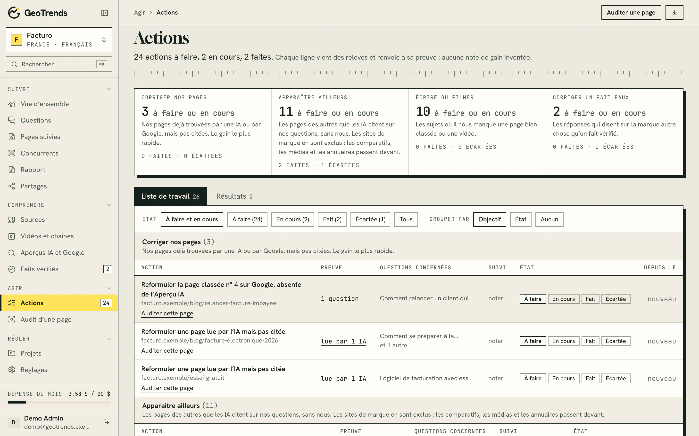

<!-- Page générée depuis la documentation du site (src/site/docs) par scripts/exporter-docs.ts : ne pas la modifier ici. -->

# La liste de travail

> Ce qu’il faut faire pour entrer dans les réponses, tiré des relevés : pages à corriger, pages où apparaître, sujets à couvrir, faits faux, avec la preuve.

[← Sommaire de la documentation](../README.md) · [Read this page in English](../../en/act/work-list.md)

L’écran Actions répond à la question du lundi matin : que faire en premier ? Chaque ligne vient des relevés et renvoie aux réponses qui la justifient. Aucune note de gain n’est inventée. La liste est gratuite : elle ne déclenche aucun appel payant.

Dans le menu, le nombre à côté d’**Actions** compte les lignes à faire. On arrive aussi ici par **À faire cette semaine** sur la vue d’ensemble, par **Voir l’action** sur les écrans Vidéos et chaînes et Faits vérifiés, et par **Les trois actions les plus utiles** du rapport. Dans la barre du haut, **Auditer une page** ouvre l’audit, et **Exporter** donne la liste en CSV.

*La liste de travail du projet Facturo : les quatre objectifs en tête, puis les lignes groupées par objectif, chacune avec sa preuve, son suivi et son état.*

## D’où viennent les lignes

La liste lit le dernier relevé de chaque IA d’interface pour chaque question suivie. Elle en tire cinq sortes de lignes, rangées sous quatre objectifs :

| Objectif | Ligne | Quand elle apparaît |
| --- | --- | --- |
| **Corriger nos pages** | « Reformuler la page classée n° 4 sur Google, absente de l’Aperçu IA » | Votre page est dans les dix premiers résultats de Google pour la question, mais l’Aperçu IA ne la cite pas. La page est trouvée : il lui manque une réponse nette, en tête de page. |
| **Corriger nos pages** | « Reformuler une page lue par l’IA mais pas citée » | Une IA a ouvert une page de la marque sans la retenir. Regardez les pages citées à sa place et donnez la même réponse, plus nettement. |
| **Apparaître ailleurs** | « Entrer dans le comparatif de comparatif-logiciels.exemple », « Obtenir une mention dans… » | Une page d’un autre site est citée sur vos questions, sans vous. Le titre et le conseil dépendent du type du site. |
| **Écrire ou filmer** | « Tourner une vidéo sur « … » » | Les IA citent des vidéos sur la question, aucune de vos chaînes. |
| **Écrire ou filmer** | « Travailler le référencement sur « … » » | Google affiche un Aperçu IA sans vous, et votre site n’est pas dans les dix premiers résultats. Seulement si un site est déclaré pour la marque. |
| **Corriger un fait faux** | « Corriger un fait faux : « … » » | Une réponse affirme sur la marque autre chose qu’un fait vérifié. Une ligne par réponse ; une erreur dite par Claude, interrogé par son API, est signalée aussi, et la ligne le précise. |

Pour une page où apparaître, le type du site donne le titre et le conseil : un comparatif (« Entrer dans le comparatif de… » : écrivez à son auteur, ou proposez-lui de tester votre offre), un annuaire (« Se faire référencer sur l’annuaire… »), un média (« Obtenir une mention dans… »), un blog (« Proposer un ajout à l’article de… »), un forum ou un réseau social (« Répondre dans la discussion citée sur… »), et pour le reste « Obtenir une place sur… ».

## Quelles pages entrent dans la liste

- Les **sites de marque** sont écartés : on ne demande pas une place chez un rival. Un site est reconnu comme tel s’il est déclaré pour un concurrent, classé « site de marque », ou s’il porte le nom d’une marque nommée dans les réponses.
- Les vidéos YouTube passent par les lignes « Tourner une vidéo », pas par les pages où apparaître.
- Si au moins cinq pages sont citées dans deux réponses ou plus, seules celles-là sont gardées ; sinon, les quinze premières. Jamais plus de quarante.
- Les comparatifs, les médias et les annuaires passent devant : c’est là qu’une place se demande. Les sites officiels, les boutiques et les autres passent derrière.
- Une page ajoutée depuis l’écran Sources (**Ajouter à la liste de travail**), ou qui porte déjà un état, une note ou une prise de contact, reste dans la liste tant qu’elle est citée, même une seule fois.

Les lignes sont triées par un poids de 1 à 5, calculé sur ce qui se compte : 5 pour une page à vous déjà trouvée, 4 pour un fait faux, 2 pour le référencement ; pour une page où apparaître, le nombre de réponses et d’IA qui la citent, plus un point pour un comparatif, un média ou un annuaire. À poids égal, la ligne qui a le plus de réponses passe devant. Ce poids n’est pas affiché à l’écran ; il figure dans l’export CSV, colonne « Poids (1 à 5) ».

## Ce que montre l’écran

En tête, **Actions par objectif** : une tuile par objectif, avec le nombre de lignes à faire ou en cours, une phrase d’explication, et le compte des lignes faites et écartées. Un clic sur une tuile filtre la liste sur cet objectif. Deux onglets suivent : **Liste de travail** et **Résultats** (voir [Mesurer après une action](./mesure-apres-action.md)).

Au-dessus du tableau, le choix **État** montre par défaut les lignes à faire et en cours ; **Tous** montre aussi les lignes faites et écartées. **Grouper par** range le tableau par **Objectif** (le réglage par défaut), par **État**, ou **Aucun**.

| Colonne | Ce qu’elle montre |
| --- | --- |
| **Action** | Le titre de la ligne, l’adresse de la page visée, le type du site pour une page où apparaître, et **Auditer cette page** pour une page à corriger. |
| **Preuve** | Le nombre de réponses et d’IA concernées (ou « lue par 2 IA »). Un clic ouvre la question, ou la fiche s’il y en a plusieurs. |
| **Questions concernées** | La première question, et le nombre des autres. |
| **Suivi** | Le nombre de prises de contact et la dernière réponse reçue, « 1 note », ou **noter**. |
| **État** | Quatre boutons : À faire, En cours, Fait, Écartée. Un clic suffit. |
| **Depuis le** | La date du « fait », ou du dernier changement d’état, ou « nouveau ». |

## La fiche d’une action

Un clic sur le titre d’une ligne ouvre sa fiche : l’objectif, le type du site, la mention « ajoutée à la main » le cas échéant, le titre et le conseil complet. Puis l’**État**, la **Page visée** avec **Auditer cette page**, les **Questions concernées**, et les **Réponses qui font preuve** : jusqu’à dix réponses, avec leur IA et leur date, chacune ouvrant le texte. En bas, la note libre et le journal des prises de contact (voir [Suivre une action](./prises-de-contact.md)). **Fermer** revient à la liste.

> [!NOTE]
> **Une ligne faite garde sa trace**
>
> Quand une ligne passe à **Fait**, l’outil garde la date et une copie de la ligne (titre, page, questions). Si les relevés ne la proposent plus ensuite, parce que la page n’est plus citée sans vous, elle sort de la liste mais reste dans l’onglet Résultats, avec sa note, son journal et son avant-après.

## Travailler la liste

1. **Commencer par « Corriger nos pages ».** Ce sont vos pages déjà trouvées par une IA ou par Google : le gain le plus rapide. **Auditer cette page** dit d’abord si quelque chose bloque leur lecture.

2. **Ouvrir la fiche et vérifier la preuve.** Lisez les réponses qui font preuve avant d’agir : la page citée, la question, l’IA.

3. **Passer la ligne à « En cours ».** Notez ce que vous faites et chaque prise de contact dans la fiche. Une première prise de contact fait passer une nouvelle ligne à « En cours ».

4. **Passer la ligne à « Fait ».** Le jour où la page est corrigée, publiée ou citée ailleurs. La date sert à comparer avant et après.

5. **Écarter ce qui ne vaut pas la peine.** **Écartée** retire une ligne des lignes ouvertes, sans la supprimer : **Tous** la montre encore.

## Limites

> [!WARNING]
> La liste suit les derniers relevés : une page qui n’est plus citée en sort, et une nouvelle y entre. Seuls les relevés d’interface comptent, sauf pour les faits faux. Le poids est un ordre de tri tiré des comptes, pas une promesse de gain : faire une action ne garantit aucune citation. Les conseils dépendent du type du site ; tant qu’un site n’est pas classé, la ligne le dit.

**Voir aussi**

- [Suivre une action et ses prises de contact](./prises-de-contact.md)
- [Mesurer après une action](./mesure-apres-action.md)
- [Audit d’une page](./audit.md)
- [Dans quelle page faut-il apparaître en premier ?](../cas-usage/pages-ou-apparaitre.md)

---

Mise à jour : 2026-11-18 · [Lire cette page sur le site](https://geotrends.io/documentation/agir/liste-de-travail)
