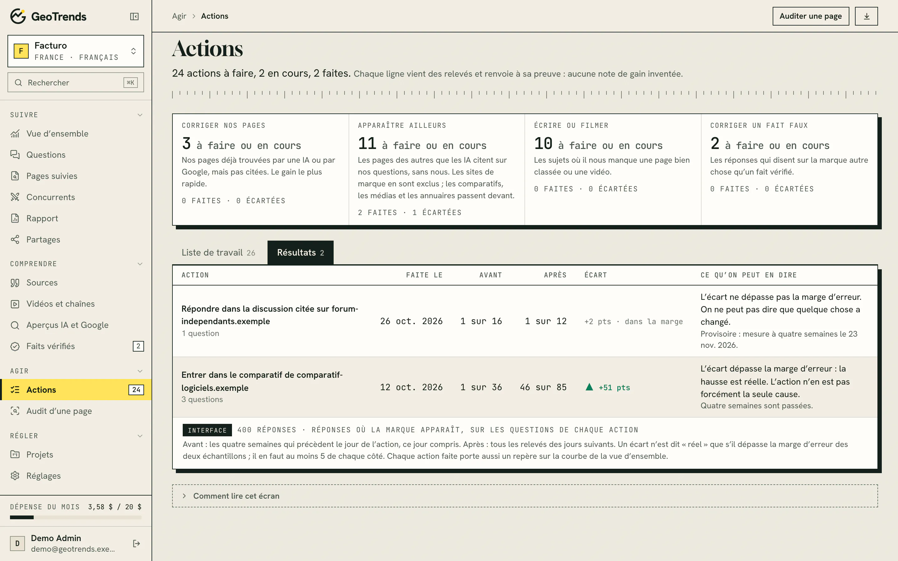

<!-- Page générée depuis la documentation du site (src/site/docs) par scripts/exporter-docs.ts : ne pas la modifier ici. -->

# Mesurer après une action

> Une action faite est suivie : la présence de la marque sur ses questions, quatre semaines avant et après, et une phrase qui dit si l’écart dépasse le bruit.

[← Sommaire de la documentation](../README.md) · [Read this page in English](../../en/act/measure-after-action.md)

Corriger une page ou entrer dans un comparatif prend du temps. Encore faut-il savoir si cela a changé quelque chose. Dès qu’une ligne de la liste de travail passe à « fait », l’outil compare la présence de la marque sur les questions de cette action, avant et après, et dit en clair si l’écart dépasse la marge d’erreur.

Le résultat se lit à deux endroits : l’onglet **Résultats** de l’écran Actions, qui réunit toutes les actions faites, et le bloc **Avant et après** de la fiche de chaque action. Sur le grand graphique de la vue d’ensemble, un repère « Action faite » marque aussi la date, et sa ligne, sous le graphique, ouvre ce résultat.

*L’onglet Résultats de l’écran Actions, projet Facturo : chaque action faite, sa date, la présence avant et après, l’écart et ce qu’on peut en dire.*

## Comment le résultat est calculé

- **Les questions** : celles de l’action, gardées au moment où elle est passée à « fait », même si elle sort ensuite de la liste.
- **Avant** : les réponses d’interface à ces questions sur les quatre semaines qui précèdent le jour de l’action, ce jour compris. Un relevé du jour même a précédé l’effet de l’action.
- **Après** : toutes les réponses d’interface des jours suivants.
- **La présence** : les réponses où la marque est nommée ou citée, sur les réponses reçues. Une question sans Aperçu IA ne compte pas comme une absence.
- **L’écart** n’est dit « réel » que s’il dépasse la marge d’erreur des deux échantillons, et il faut au moins 5 réponses de chaque côté.

Les relevés d’une mesure approfondie comptent ici : poser la question plusieurs fois après l’action est le moyen le plus rapide d’avoir assez de réponses.

## L’onglet Résultats

| Colonne | Ce qu’elle montre |
| --- | --- |
| **Action** | Le titre, le nombre de questions, et « sortie de la liste » si les relevés ne la proposent plus. |
| **Faite le** | La date retenue pour la comparaison, corrigeable dans la fiche. |
| **Avant** | Réponses avec la marque, sur les réponses reçues dans les quatre semaines d’avant (« 2 sur 12 », par exemple). |
| **Après** | La même chose depuis le lendemain de l’action. |
| **Écart** | L’écart en points, coloré seulement s’il dépasse la marge d’erreur. |
| **Ce qu’on peut en dire** | La conclusion en une phrase, puis « Provisoire : mesure à quatre semaines le … » ou « Quatre semaines sont passées. » |

| Situation | Ce que dit l’outil |
| --- | --- |
| Aucun relevé depuis l’action | Rien à comparer pour l’instant. |
| Aucun relevé dans les quatre semaines d’avant | Pas de point de comparaison. |
| Moins de 5 réponses d’un côté | Trop peu de relevés pour conclure : il en faut au moins 5 de chaque côté. |
| Écart dans la marge d’erreur | On ne peut pas dire que quelque chose a changé. |
| Hausse au-delà de la marge | La hausse est réelle. L’action n’en est pas forcément la seule cause. |
| Baisse au-delà de la marge | La baisse est réelle. L’action n’en est pas forcément la cause. |

Le résultat se lit à tout moment, mais il est marqué provisoire pendant les quatre semaines qui suivent l’action. Dans la fiche, le bloc **Avant et après** donne les mêmes chiffres, avec **Les quatre semaines d’avant**, **Depuis le …**, l’écart et la conclusion.

## Suivre l’effet d’une correction

1. **Passer la ligne à « Fait » le bon jour.** Le jour où la page corrigée est en ligne, ou où le comparatif vous ajoute. Si vous le faites plus tard, corrigez **Faite le** dans la fiche.

2. **Laisser les relevés tourner.** Les relevés automatiques de chaque semaine remplissent la colonne **Après**. Pour aller plus vite sur une question, lancez une mesure approfondie depuis sa page : le prix est écrit sur le bouton.

3. **Lire le résultat après quatre semaines.** Ouvrez l’onglet **Résultats**. Une hausse au-delà de la marge est réelle ; un écart dans la marge ne permet pas de conclure.

4. **Recouper avec les repères.** Sur la courbe de la vue d’ensemble, un repère de changement de modèle à la même date peut expliquer l’écart autant que votre action.

## Limites

> [!WARNING]
> L’outil dit si l’écart est réel, pas s’il vient de l’action : un nouveau modèle, un concurrent ou une autre action sur les mêmes questions peuvent jouer aussi. Avec quelques questions relevées une fois par semaine, quatre semaines donnent souvent moins de 5 réponses de chaque côté : la mesure approfondie aide alors. Une action sans effet mesurable n’est pas forcément inutile ; l’outil dit seulement qu’on ne peut pas le prouver.

**Voir aussi**

- [La liste de travail](./liste-de-travail.md)
- [Mesure approfondie](../mesurer/mesure-approfondie.md)
- [Méthode de mesure](../reference/methode.md)
- [Ma correction a-t-elle compté ?](../cas-usage/effet-d-une-correction.md)

---

Mise à jour : 2026-11-18 · [Lire cette page sur le site](https://geotrends.io/documentation/agir/mesure-apres-action)
