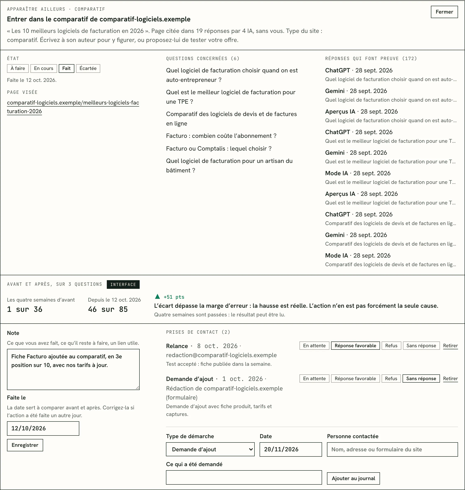

<!-- Page générée depuis la documentation du site (src/site/docs) par scripts/exporter-docs.ts : ne pas la modifier ici. -->

# Suivre une action et ses prises de contact

> La fiche d’une action garde son état, une note, la date où elle a été faite et le journal des prises de contact : à qui, quand, et ce qui en est revenu.

[← Sommaire de la documentation](../README.md) · [Read this page in English](../../en/act/outreach.md)

Entrer dans un comparatif ou faire corriger un article demande souvent plusieurs messages, sur plusieurs semaines. La fiche d’une action garde la trace de ce travail : vous ne relancerez pas deux fois le même site, et vous verrez ce qui a marché. Tout y est gratuit : rien ne part vers un fournisseur payant.

La fiche s’ouvre d’un clic sur le titre d’une ligne de la liste de travail, ou sur sa colonne **Suivi** (« noter », « 1 note », ou le nombre de prises de contact et la dernière réponse). Les liens **Voir l’action** des écrans Vidéos et chaînes et Faits vérifiés ouvrent directement la bonne fiche.

## L’état de la ligne

| État | Quand le choisir |
| --- | --- |
| **À faire** | L’état de départ de toute ligne. |
| **En cours** | Vous avez commencé : une page en réécriture, un message envoyé. Une première prise de contact fait passer une nouvelle ligne à « En cours ». |
| **Fait** | L’action est terminée. L’outil garde la date et une copie de la ligne : c’est ce qui permet de comparer avant et après. |
| **Écartée** | La ligne ne vaut pas la peine. Elle sort des lignes ouvertes sans être supprimée. |

Sous les boutons, la fiche rappelle « Faite le … » ou « Dernier changement le … ». La date du « fait » ne bouge plus si la ligne était déjà faite.

## La note

Le champ **Note** reçoit ce que vous avez fait, ce qu’il reste à faire, un lien utile : 2 000 signes au plus. Pour une ligne faite, un champ **Faite le** permet de corriger la date si l’action a été faite un autre jour (jamais une date à venir) : c’est elle qui sert à comparer avant et après. **Enregistrer** garde les deux. La note apparaît dans la colonne **Suivi** de la liste et dans l’export CSV.

## Le journal des prises de contact

Le bloc **Prises de contact** liste chaque démarche, la plus récente d’abord : son type, sa date, la personne ou le formulaire contacté, et ce qui a été demandé. Pour en ajouter une, remplissez **Type de démarche**, **Date** (aujourd’hui par défaut), **À qui** (nom, adresse ou formulaire du site) et **Ce qui a été demandé**, puis **Ajouter au journal**.

| Type de démarche | Pour quoi |
| --- | --- |
| **Demande d’ajout** | Demander une place dans un comparatif, un annuaire, un article. Proposé par défaut. |
| **Proposition de test** | Proposer à un auteur de tester votre offre. |
| **Réponse dans un fil** | Répondre dans une discussion de forum ou de réseau social. |
| **Demande de correction** | Faire corriger une information fausse. Proposé par défaut pour un fait faux. |
| **Relance** | Relancer une démarche restée sans réponse. |
| **Autre démarche** | Tout le reste. |

Une démarche ajoutée est « En attente ». Quand la réponse arrive, un clic la note : **Réponse favorable**, **Refus**, **Sans réponse**, ou de nouveau **En attente**. **Retirer** efface une démarche du journal.

*La fiche d’une action : son état, la page visée, les questions concernées, la note et le journal des prises de contact.*

## Tenir le journal d’une démarche

1. **Ouvrir la fiche.** Depuis la liste de travail, un clic sur le titre de la ligne, par exemple « Entrer dans le comparatif de comparatif-logiciels.exemple ».

2. **Noter le message envoyé.** Choisissez **Demande d’ajout**, indiquez à qui (« rédaction, formulaire de contact ») et ce que vous avez demandé, puis **Ajouter au journal**. La ligne passe à « En cours ».

3. **Noter la réponse.** Le jour où l’auteur répond, cliquez **Réponse favorable** ou **Refus**. Sans nouvelles, notez **Sans réponse**, puis ajoutez une **Relance**.

4. **Passer la ligne à « Fait ».** Quand la page vous cite, passez la ligne à **Fait**. Corrigez la date dans **Faite le** si la page a changé un autre jour.

## Limites

> [!WARNING]
> Le journal est un carnet : l’outil n’envoie aucun message et ne relance personne. Une ligne que les relevés ne proposent plus disparaît de la liste, sauf si elle est faite (elle reste alors dans l’onglet Résultats) ; sa note et son journal restent gardés et reviennent si la page est de nouveau citée. Une réponse favorable ne garantit pas une citation : seule la mesure suivante le dira.

**Voir aussi**

- [La liste de travail](./liste-de-travail.md)
- [Mesurer après une action](./mesure-apres-action.md)
- [Dans quelle page faut-il apparaître en premier ?](../cas-usage/pages-ou-apparaitre.md)
- [Une IA répète une information fausse sur ma marque : que faire ?](../cas-usage/information-fausse.md)

---

Mise à jour : 2026-11-18 · [Lire cette page sur le site](https://geotrends.io/documentation/agir/prises-de-contact)
