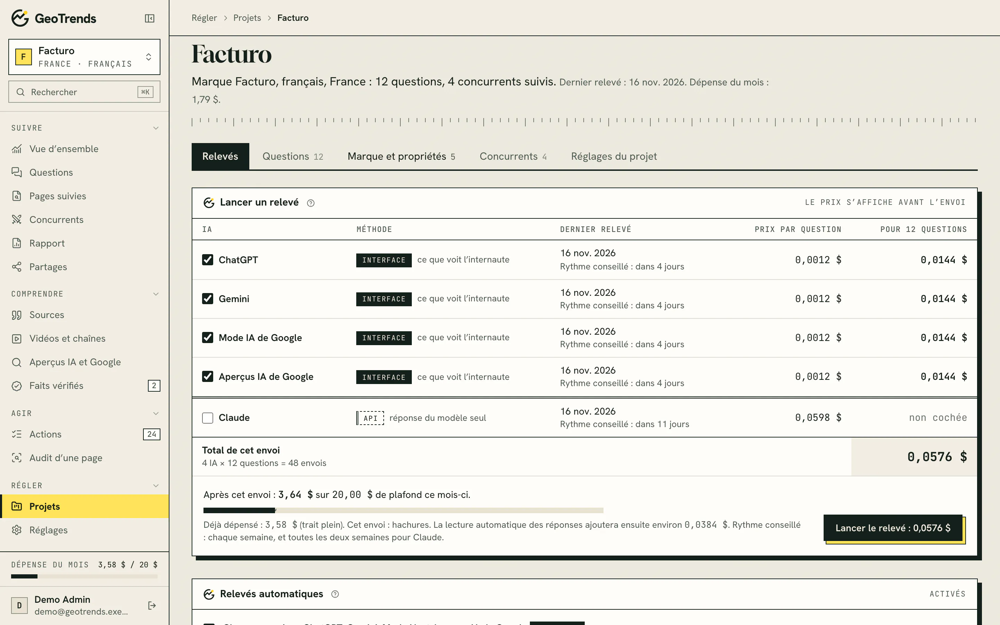
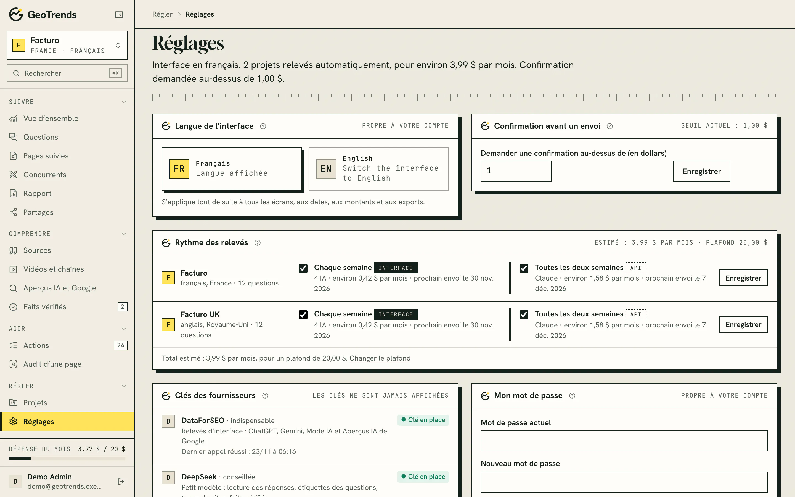
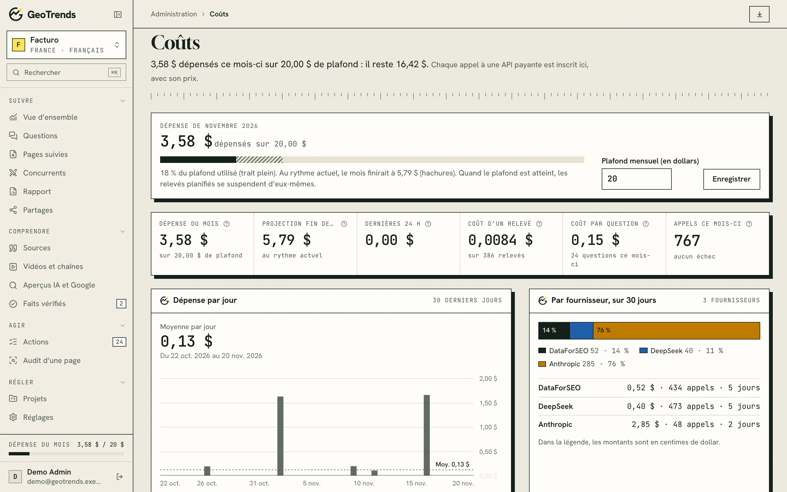

<!-- Page générée depuis la documentation du site (src/site/docs) par scripts/exporter-docs.ts : ne pas la modifier ici. -->

# Comment suivre une marque sans dépasser son budget ?

> Prix affiché avant chaque envoi, rythme des relevés automatiques, seuil de confirmation et plafond du mois : régler la dépense d’un projet avant qu’elle n’arrive.

[← Sommaire de la documentation](../README.md) · [Read this page in English](../../en/use-cases/tracking-on-a-budget.md)

Facturo vient s’ajouter aux projets déjà suivis, et le budget du mois ne bouge pas. Chaque question coûte un peu à chaque relevé, chaque IA a son prix, et Claude coûte bien plus que les autres. Tout se règle avant l’envoi : rien ne part sans un clic, ou sans un rythme que vous avez activé.

## Ce qu’il vous faut

- La liste des questions du projet : le prix d’un relevé est proportionnel à leur nombre.
- Un compte administrateur pour changer le plafond du mois, commun à tous les projets ; il vaut 20 $ tant que personne ne le change.

## Étapes

1. **Lire le prix avant l’envoi.** Ouvrez la fiche du projet, onglet **Relevés**. Le bloc **Lancer un relevé** donne, pour chaque IA, son **Prix par question** (0,0012 $ par l’interface, environ 0,06 $ pour Claude), la date du **Dernier relevé** et le rythme conseillé. Cochez les IA voulues : le **Total de cet envoi** et la dépense du mois après l’envoi s’affichent, puis le bouton **Lancer le relevé** porte le prix.

   

2. **Choisir le rythme automatique.** Dans le même onglet, **Relevés automatiques** propose deux cases : **Chaque semaine : ChatGPT, Gemini, Mode IA et Aperçus IA de Google**, et **Toutes les deux semaines : Claude**. Chacune affiche son coût estimé par mois pour les questions du projet. Laissez Claude décoché si le budget est serré : les quatre IA d’interface montrent ce que voient vos clients.

3. **Vérifier le total de tous les projets.** Ouvrez **Réglages**. **Rythme des relevés** liste les projets relevés automatiquement, avec leur coût estimé et le total rapporté au plafond. **Confirmation avant un envoi** fixe le montant au-dessus duquel un envoi demande une confirmation de plus ; il vaut 1 $ par défaut.

   

4. **Tenir le plafond.** Dans **Coûts** (comptes administrateurs), le haut de l’écran montre la dépense du mois face au plafond, avec une barre ; le champ **Plafond mensuel (en dollars)** le change. La tuile **Projection fin de mois** prolonge la dépense au rythme des jours écoulés ; **Par projet, ce mois-ci** et **Par IA relevée, ce mois-ci** disent où part l’argent. Quand le plafond est atteint, les relevés planifiés se suspendent d’eux-mêmes et aucun envoi n’est possible. La dépense du mois reste visible dans le menu, avec sa barre.

   

5. **Alléger la liste.** Sur **Questions**, archivez les questions qui ne servent plus : elles ne sont plus relevées. Avant une **Mesure approfondie**, le prix s’affiche aussi : 25 envois sur quatre IA, c’est cent relevés pour une seule question.

## Ce que ça permet de décider

Combien de questions suivre, sur quelles IA et à quel rythme, pour un montant connu d’avance. Et où couper si le mois dérape : Claude d’abord, puis les questions les moins utiles, plutôt que le rythme des IA d’interface, qui fait la tendance.

> [!WARNING]
> **Avant d’agir**
>
> Le prix de Claude est une moyenne des derniers appels : il varie avec la longueur des réponses et le nombre de recherches. La lecture automatique des réponses et les autres petits appels (étiquettes, classement des sites, faits) s’ajoutent, pour quelques centimes ; tout est inscrit au journal des coûts. Le plafond vaut pour tout l’outil : il n’existe pas de plafond par projet.

**Voir aussi**

- [Ce que coûte un relevé](../demarrer/couts.md)
- [Le tableau des coûts](../piloter/couts.md)
- [Lancer un relevé](../projet/lancer-un-releve.md)
- [Relevés automatiques](../projet/releves-automatiques.md)
- [Quelles IA regarder en premier, et pourquoi Claude est-il à part ?](./quelles-ia-regarder.md)

---

Mise à jour : 2026-11-18 · [Lire cette page sur le site](https://geotrends.io/cas-usage/budget-de-suivi)
