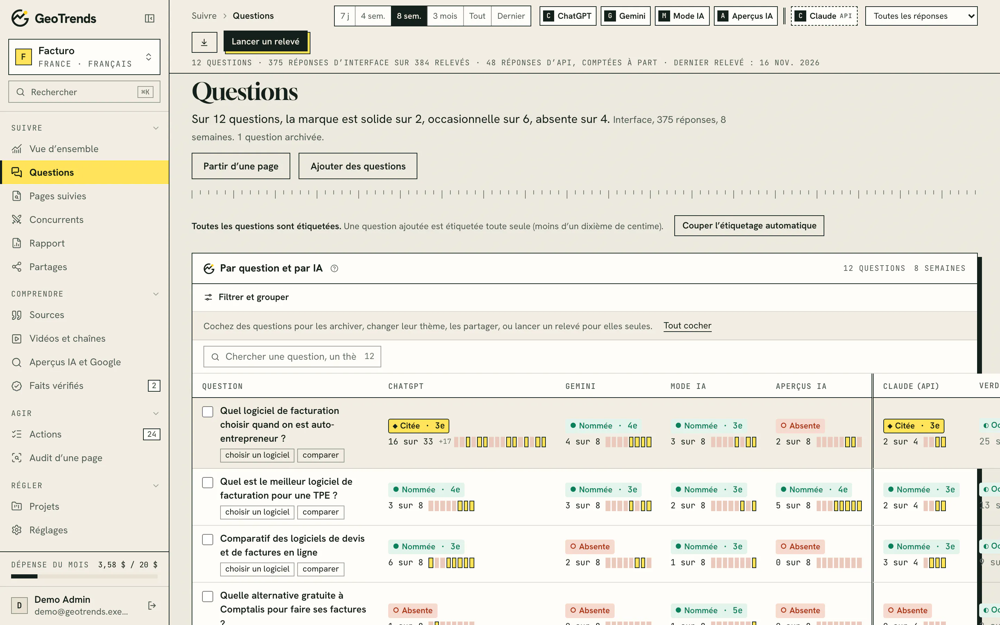
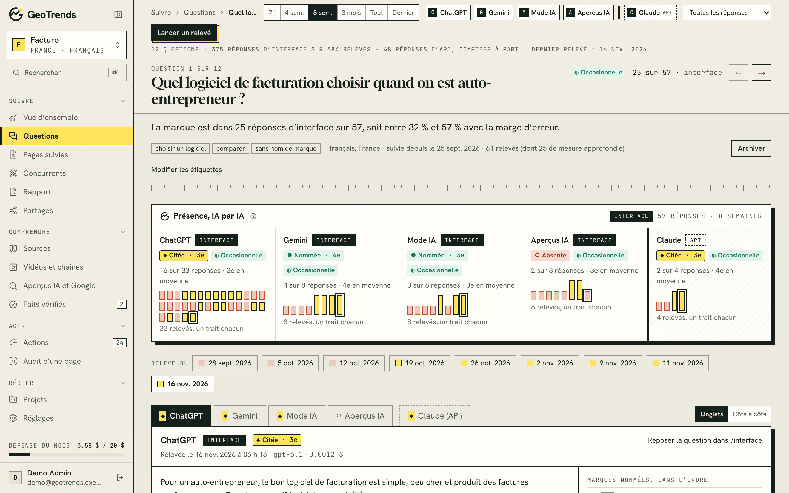
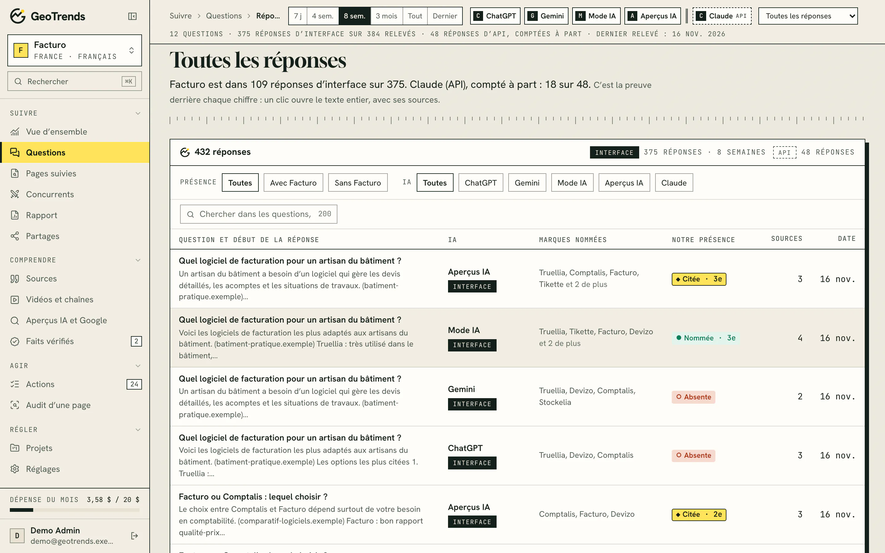

<!-- Page générée depuis la documentation du site (src/site/docs) par scripts/exporter-docs.ts : ne pas la modifier ici. -->

# ChatGPT cite-t-il ma marque, et sur quelles questions ?

> Le chiffre de ChatGPT, puis la liste des questions où il cite, nomme ou ignore la marque, jusqu’au texte de chaque réponse avec ses sources et ses recherches.

[← Sommaire de la documentation](../README.md) · [Read this page in English](../../en/use-cases/does-chatgpt-cite-my-brand.md)

Un client vous dit qu’il a trouvé Facturo « en demandant à ChatGPT ». Un autre que ChatGPT lui a conseillé Comptalis. Avant d’en tirer quoi que ce soit, il faut savoir ce que ChatGPT répond vraiment sur vos questions : sur lesquelles il cite Facturo, sur lesquelles il la nomme sans la citer, et sur lesquelles il l’ignore.

## Ce qu’il vous faut

- Des relevés de ChatGPT sur les questions du projet. Un pourcentage s’affiche à partir de 5 réponses, un verdict sur une question à partir de 3.
- Le site, les chaînes YouTube et les réseaux sociaux de la marque déclarés dans le projet : sans eux, une page de Facturo citée ne compte pas pour Facturo.

## Étapes

1. **Lire le chiffre de ChatGPT.** Sur **Vue d’ensemble**, le tableau **Présence, IA par IA** donne la ligne de ChatGPT : sa **Visibilité** sur la période, avec le nombre de réponses, puis comment Facturo y apparaît : **Site cité**, **Vidéo citée**, **Nom seul** et **Lu, non cité**. Un clic sur « ChatGPT » ouvre toutes ses réponses.

2. **Voir les questions une à une.** Ouvrez **Questions**. La colonne ChatGPT donne le dernier état de chaque question : citée, nommée, lue ou absente. Quand la question a plusieurs relevés, un compte du type « 3 sur 5 » et une coche par relevé s’affichent dessous. Un clic sur l’en-tête trie la colonne ; un clic sur un état ouvre la réponse.

   

3. **Ouvrir une réponse.** La page de la question montre en tête son verdict et la présence de Facturo, IA par IA. Plus bas, choisissez ChatGPT : le texte est celui que ChatGPT a affiché, jamais traduit : Facturo est surlignée, un concurrent suivi est souligné, chaque source porte son numéro. Dessous : **Sources citées**, **Pages lues sans être citées** et **Recherches lancées par l’IA**. Le lien **Reposer la question dans l’interface** permet de vérifier par vous-même.

   

4. **Réunir toutes ses réponses.** L’écran **Réponses**, ouvert depuis le nom de ChatGPT, se filtre par **Présence** (avec ou sans Facturo) et par **IA**. Choisissez « Sans Facturo » : c’est la liste des réponses de ChatGPT où vous manquez, chacune avec sa question et ses marques nommées.

   

5. **Lire tout l’outil du point de vue de ChatGPT.** Dans la barre du haut, masquez les autres IA avec le filtre **IA**. Les écrans **Concurrents**, **Sources** et la carte des thèmes ne comptent plus que ChatGPT : qui il nomme à votre place, quelles pages il cite.

## Ce que ça permet de décider

- Les questions où ChatGPT ignore Facturo : ce sont elles qu’il faut travailler en premier, en partant des pages qu’il cite.
- Les questions où il lit une page de Facturo sans la citer : la page est trouvée, elle est à reformuler.
- Les questions où il nomme Facturo sans la citer : il connaît la marque, mais ne s’appuie pas sur vos pages.

> [!WARNING]
> **Avant d’agir**
>
> Avec un relevé par semaine, une question compte peu de réponses : le verdict « absente » sur trois réponses est un signal, pas une certitude. ChatGPT est relevé sans forcer sa recherche web, depuis une session neutre : un client connecté peut lire autre chose. Quand OpenAI change de modèle, un repère l’indique sur la courbe de la vue d’ensemble ; un écart ce jour-là peut venir de là.

**Voir aussi**

- [La page d’une question](../mesurer/fiche-question.md)
- [Toutes les réponses](../mesurer/reponses.md)
- [Les IA suivies](../reference/ia-suivies.md)
- [Ma marque est-elle citée, nommée ou absente ?](./citee-nommee-ou-absente.md)
- [Ma page est lue mais pas citée : que corriger ?](./page-lue-pas-citee.md)

---

Mise à jour : 2026-11-18 · [Lire cette page sur le site](https://geotrends.io/cas-usage/chatgpt-cite-t-il-ma-marque)
