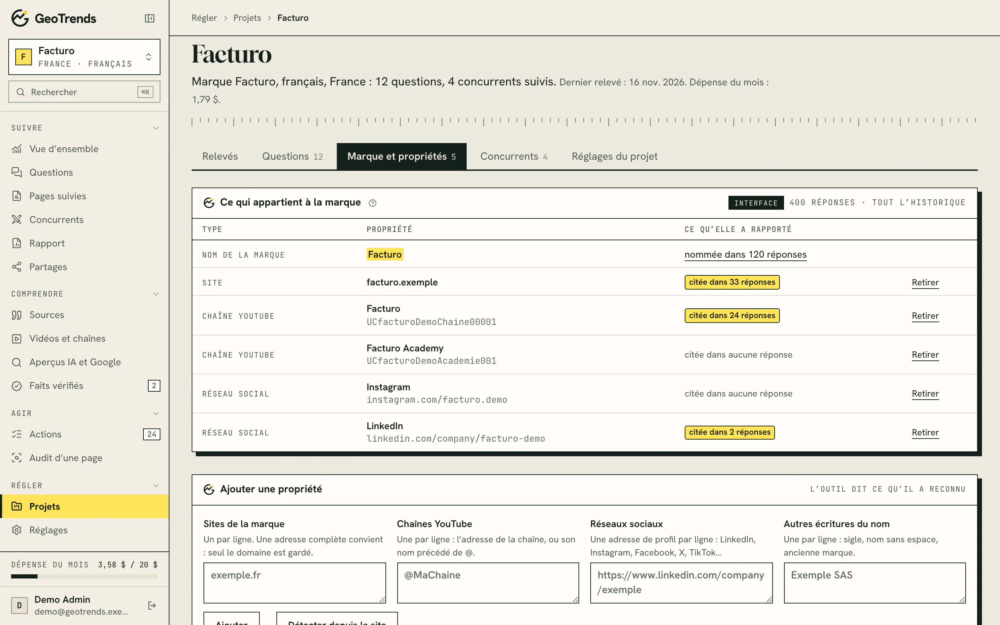

<!-- Page générée depuis la documentation du site (src/site/docs) par scripts/exporter-docs.ts : ne pas la modifier ici. -->

# Ma marque est-elle citée, nommée ou absente ?

> Site cité, vidéo citée, nom seul, page lue sans être citée : quatre façons d’être dans une réponse d’IA, qui ne se lisent pas et ne se corrigent pas pareil.

[← Sommaire de la documentation](../README.md) · [Read this page in English](../../en/use-cases/cited-mentioned-or-absent.md)

Être dans une réponse d’IA peut vouloir dire plusieurs choses. L’IA cite une page de facturo.exemple ou une vidéo de la chaîne Facturo comme source. Elle écrit « Facturo » dans son texte sans s’appuyer sur vos pages. Ou elle ouvre une de vos pages et ne la retient pas. Chaque cas appelle un travail différent : il faut d’abord savoir lequel est le vôtre.

## Ce qu’il vous faut

- Tout ce qui appartient à la marque, déclaré dans le projet : ses sites, ses chaînes YouTube, ses réseaux sociaux, les autres écritures de son nom.
- Des réponses reçues. Une question sans réponse, ou sans Aperçu IA chez Google, n’entre pas dans le compte.

## Étapes

1. **Déclarer ce qui appartient à la marque.** Ouvrez la fiche du projet, onglet **Marque et propriétés** : **Sites de la marque**, **Chaînes YouTube** (Facturo, Facturo Academy), **Réseaux sociaux**, **Autres écritures du nom**. Le bouton **Détecter depuis le site** lit la page d’accueil et propose les profils trouvés ; rien n’est ajouté sans votre relecture. Une page publiée sous un profil déclaré, sur LinkedIn par exemple, compte comme une page de la marque.

   

2. **Lire l’état de chaque réponse.** Sur **Questions**, chaque case porte un état, expliqué sous le tableau. **Citée** : une page ou une vidéo de la marque figure parmi les sources. **Nommée** : le nom est dans le texte, sans page de la marque citée. **Lue** : une page de la marque a été ouverte par l’IA, sans être citée. **Absente** : l’IA a répondu sans la marque. **Pas d’aperçu** : Google n’a rien affiché, ce n’est pas une absence.

   

3. **Voir d’où vient la visibilité.** Sur **Vue d’ensemble**, la **Visibilité** compte les réponses où Facturo est nommée ou citée. La tuile **Sources à nous** compte les citations de vos pages et de vos vidéos. Plus bas, le bloc **D’où vient la visibilité** répartit les réponses avec la marque en trois : **Par le site**, **Par la chaîne YouTube**, **Par le seul nom**.

   

4. **Retrouver vos pages une à une.** Ouvrez **Sources**, onglet **Nos pages**. Chaque page ou vidéo de la marque y figure avec le nombre de réponses où elle est **Citée**, le nombre de fois où elle a été **Lue sans être citée**, sa place **Chez Google** et les **Pages citées à sa place**.

5. **Vérifier sur une question.** Sur la page d’une question, le bloc **Sur cette question** liste **Nos pages** : celles qui ont été citées, et celles qui ont été lues sans être citées. Les réponses s’ouvrent juste en dessous, IA par IA, avec la marque surlignée dans le texte.

## Ce que ça permet de décider

| Ce que vous voyez | Ce que ça veut dire | Où travailler |
| --- | --- | --- |
| Citée | Une de vos pages sert de preuve à l’IA. | Garder la page à jour, et la surveiller. |
| Nommée seulement | L’IA connaît la marque, mais s’appuie sur d’autres pages. | Les pages qu’elle cite : y entrer, ou écrire mieux qu’elles. |
| Lue sans être citée | Votre page est trouvée, puis écartée. | La reformuler : une réponse nette, en tête de page. |
| Absente | Ni votre nom, ni vos pages. | Les pages citées à votre place, en commençant par les comparatifs. |

> [!WARNING]
> **Avant d’agir**
>
> Seuls ChatGPT et Claude disent quelles pages ils ont lues sans les citer : chez Gemini et Google, l’état « lue » n’existe pas. Le nom est cherché comme un mot entier, avec ses autres écritures : un homonyme compterait aussi, relisez quelques réponses avant de conclure. Une propriété oubliée dans le projet fait passer une citation de Facturo pour une absence.

**Voir aussi**

- [Sites, chaînes YouTube et réseaux sociaux](../projet/sites-chaines-reseaux.md)
- [Notions clés](../demarrer/notions-cles.md)
- [Sources citées](../comprendre/sources.md)
- [Ma page est lue mais pas citée : que corriger ?](./page-lue-pas-citee.md)
- [Dans quelle page faut-il apparaître en premier ?](./pages-ou-apparaitre.md)

---

Mise à jour : 2026-11-18 · [Lire cette page sur le site](https://geotrends.io/cas-usage/citee-nommee-ou-absente)
