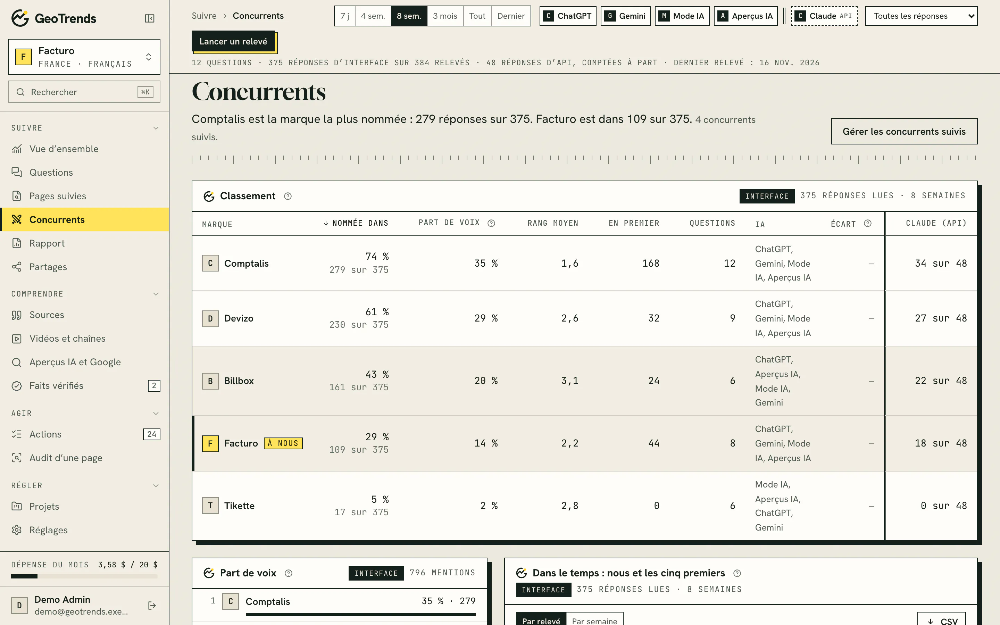

<!-- Page générée depuis la documentation du site (src/site/docs) par scripts/exporter-docs.ts : ne pas la modifier ici. -->

# Quel concurrent s’installe sur mes sujets ?

> Repérer la marque qui monte dans les réponses des IA, vérifier que la hausse dépasse la marge d’erreur, puis voir sur quelles questions et grâce à quelles pages.

[← Sommaire de la documentation](../README.md) · [Read this page in English](../../en/use-cases/competitor-moving-in.md)

Il y a deux mois, Tikette n’apparaissait presque jamais dans les réponses sur la facturation des indépendants. Depuis quelques relevés, son nom revient. Avant de réagir, il faut savoir si la hausse est réelle, sur quelles questions elle se joue, chez quelles IA, et quelles pages la portent.

## Ce qu’il vous faut

- Plusieurs semaines de relevés : une hausse se lit entre deux périodes, pas entre deux jours.
- Le concurrent suivi dans le projet, avec son site déclaré si vous le connaissez : ses pages citées lui sont alors attribuées.
- Des réponses dont les marques sont lues.

## Étapes

1. **Repérer qui monte.** Ouvrez **Concurrents** et choisissez une période assez longue dans la barre du haut, huit semaines ou trois mois. Dans le tableau **Classement**, la colonne **Écart** compare chaque marque à la période d’avant ; elle n’est colorée que si l’écart dépasse la marge d’erreur. Le graphique **Dans le temps : nous et les cinq premiers** trace la part des réponses lues qui nomment chaque marque, relevé après relevé.

   

2. **Repérer les nouveaux venus.** Ouvrez **Rapport**. La tuile **Nouvelles marques** et le bloc **Marques nommées pour la première fois** listent les marques nommées au dernier relevé et dans aucune réponse du précédent. Un nom inconnu qui revient d’un rapport à l’autre mérite d’être suivi : le bouton **Suivre** est sur la même ligne.

3. **Se placer face à lui.** Dans la barre du haut, le filtre **Face à** ne garde que les réponses qui nomment Tikette. Tous les écrans se recalculent : la visibilité de Facturo devient sa présence quand Tikette est cité, la liste des sources devient celle des réponses où Tikette apparaît. **Toutes les réponses** retire le filtre.

4. **Voir les questions où il passe devant.** Sur **Concurrents**, la grille **Question par question, IA par IA**, réglée sur **Face à un concurrent** puis sur Tikette, dit pour chaque question et chaque IA qui est devant. Le tableau **Face-à-face** compare les deux marques mesure par mesure.

5. **Trouver les pages qui le portent.** Ouvrez **Sources**. Dans la barre **À qui profitent les citations**, un clic sur la part « Concurrents suivis » filtre les tableaux sur les pages des concurrents. Sur l’onglet **Pages**, la fiche d’une page donne les marques nommées dans les réponses qui la citent : c’est souvent un comparatif tiers qui fait entrer une marque.

## Ce que ça permet de décider

S’il faut répondre, et où. Une hausse au-dessus de la marge, concentrée sur quelques questions et portée par quelques pages, se travaille : entrer dans les mêmes comparatifs, écrire une meilleure réponse sur ces questions. Une hausse dans la marge se surveille au relevé suivant.

> [!WARNING]
> **Avant d’agir**
>
> Une hausse au-dessus de la marge dit que le concurrent est plus souvent nommé, pas pourquoi. « Pour la première fois » se lit par rapport au relevé précédent seulement. Les marques des IA autres que ChatGPT viennent de la lecture automatique, qui peut confondre deux noms proches. Le filtre **Face à** s’applique à tous les écrans tant que vous ne le retirez pas.

**Voir aussi**

- [Concurrents et part de voix](../comprendre/concurrents.md)
- [Rapport et alertes](../piloter/rapport-et-alertes.md)
- [Sources citées](../comprendre/sources.md)
- [Qui est cité à ma place ?](./qui-est-cite-a-ma-place.md)
- [Un chiffre a bougé : vraie évolution ou bruit ?](./evolution-ou-bruit.md)

---

Mise à jour : 2026-11-18 · [Lire cette page sur le site](https://geotrends.io/cas-usage/concurrent-qui-s-installe)
